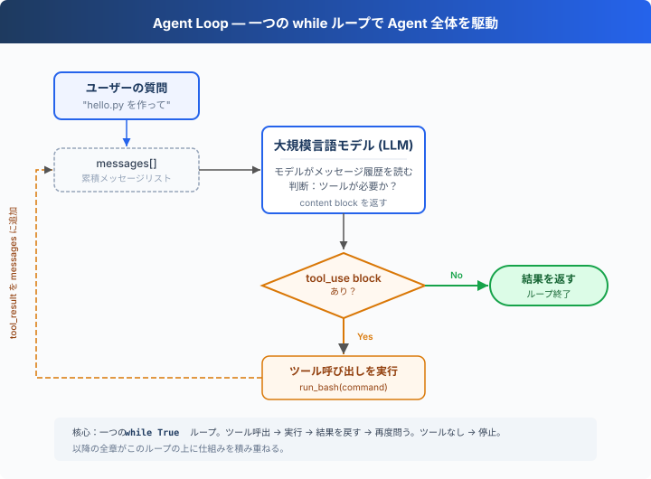

# s01: Agent Loop — ループ一つで十分

> **TypeScript 対照版**：実装範囲と章間の参照は Python 原版に従い、識別子を保持します。コード例は実装の抜粋です。

[English](README.md) · [中文](README.zh.md) · [日本語](README.ja.md)

`s01` → [s02](../s02_tool_use/) → s03 → s04 → ... → s16 → s17
> *"One loop & Bash is all you need"* — ツール一つ + ループ一つ = 一つの Agent。
>
> **Harness レイヤー**: ループ — モデルと現実世界をつなぐ最初の架け橋。

---

## 課題

モデルにこう頼んだとする：「ディレクトリ内のファイル一覧を取得して、XXX.ts を実行して」。

モデルは bash コマンドを出力できるが、出力が終わると止まってしまう — 自分で実行することも、結果を見て推論を続けることもない。

手動で実行し、出力をチャットに貼り付ければ、モデルは続きを生成できる。次のコマンドが出たら、また実行して貼り付ける。

毎回の往復で、あなたが中間層になっている。これを自動化するのが、この章の目的だ。

---

## ソリューション



一つの `while True` ループ — モデルがツールを呼べば続き、呼ばなければ停止。ループは response の content block を直接確認する：

| シグナル | 意味 | ループの動作 |
|----------|------|-------------|
| `tool_use` block を含む | モデルがツール呼び出しを要求 | 実行 → 結果を戻す → 続行 |
| `tool_use` block を含まない | モデルがツールを呼ばなかった | ループ終了 |

---

## 仕組み

このプロセスをコードに変換してみよう。ステップごとに：

**ステップ 1**：ユーザーの質問を最初のメッセージとして設定する。

```typescript
const messages: Anthropic.MessageParam[] = [{ role: 'user', content: query }];
```

**ステップ 2**：メッセージとツール定義を一緒に LLM に送信する。

```typescript
const response = await client.messages.create({ model: MODEL, system: SYSTEM, messages, tools: TOOLS, max_tokens: 8000 });
```

**ステップ 3**：モデルの応答を追加し、ツールを呼び出したか確認する。呼び出しなし → 終了。

```typescript
messages.push({ role: 'assistant', content: response.content });
    const tool_calls = response.content.filter((block) => block.type === 'tool_use');
    if (!tool_calls.length) return;
```

実際の `tool_use` block だけが実行段階に進むため、空の tool result メッセージは追加されない。

**ステップ 4**：モデルが要求したツールを実行し、結果を収集する。

```typescript
const results: Anthropic.ToolResultBlockParam[] = [];
    for (const block of tool_calls) {
      const input = block.input as ToolInput;
      if (!Object.hasOwn(input, 'command')) { const error = new Error("'command'"); error.name = 'KeyError'; throw error; }
      console.log(`\x1b[33m$ ${input.command}\x1b[0m`);
      const output = run_bash(input.command as string);
      console.log(Array.from(output).slice(0, 200).join(''));
      results.push({ type: 'tool_result', tool_use_id: block.id, content: output });
    }
```

**ステップ 5**：ツールの結果を新しいメッセージとして追加し、ステップ 2 に戻る。

```typescript
messages.push({ role: 'user', content: results });
```

完全な関数に組み立てる：

```typescript
export async function agent_loop(messages: Anthropic.MessageParam[], client: Pick<Anthropic, 'messages'>, MODEL: string): Promise<void> {
  while (true) {
    const response = await client.messages.create({ model: MODEL, system: SYSTEM, messages, tools: TOOLS, max_tokens: 8000 });
    messages.push({ role: 'assistant', content: response.content });
    const tool_calls = response.content.filter((block) => block.type === 'tool_use');
    if (!tool_calls.length) return;
    const results: Anthropic.ToolResultBlockParam[] = [];
    for (const block of tool_calls) {
      const input = block.input as ToolInput;
      if (!Object.hasOwn(input, 'command')) { const error = new Error("'command'"); error.name = 'KeyError'; throw error; }
      console.log(`\x1b[33m$ ${input.command}\x1b[0m`);
      const output = run_bash(input.command as string);
      console.log(Array.from(output).slice(0, 200).join(''));
      results.push({ type: 'tool_result', tool_use_id: block.id, content: output });
    }
    messages.push({ role: 'user', content: results });
  }
}
```

30 行あまり — これが最小実行可能な agent harness のカーネルだ。これは知能そのものではなく、モデルが継続的に行動できるための最小ランタイムフレームワーク。モデルが決定し（ツールを呼ぶか、どれを呼ぶか）、harness が実行を担う（ツールを呼び出し、結果を新しいメッセージとして追加する）。次の 16 章はすべてこのループの上に仕組みを積み重ねていく。ループ自体は永遠に変わらない。

---

## 試してみよう

> **安全上の注意**: このコードはモデルが生成したシェルコマンドを実行します。プロジェクトファイルへの影響を避けるため、一時テストディレクトリで実行してください。s03 で権限制御を追加します。

**準備**（初回のみ）：

```sh
npm ci
cp -n .env.example .env
# .env を編集し、ANTHROPIC_API_KEY と MODEL_ID を入力
```

**実行**：

```sh
npm run s01
```

以下のプロンプトを試してみよう：

1. `Create a file called hello.ts that prints "Hello, World!"`
2. `List all TypeScript files in this directory`
3. `What is the current git branch?`

観察のポイント：モデルがツールを呼び出すとき（ループ継続）、呼び出さないとき（ループ終了）の違い。

---

## 次へ

現在、モデルが持っているのは bash だけだ — ファイルを読むには `cat`、書くには `echo ... >`、探すには `find`。不便でエラーも起きやすい。

→ s02 Tool Use：5 つの本格的なツールを与えたらどうなる？ モデルは複数のツールを同時に呼び出すか？ 並列実行で競合は起きないか？


<!-- translation-sync: zh@v2, en@v2, ja@v2 -->

## TypeScript の検証

実行入口は [code.ts](code.ts)、参照実装は [Python 原版](../../s01_agent_loop/code.py) です。章のテストは `npm run test:s01`。差分テストには Python 3 と PyYAML が必要です。全体の検証状況は[対照記録](../docs/parity-audit.md)を参照してください。
