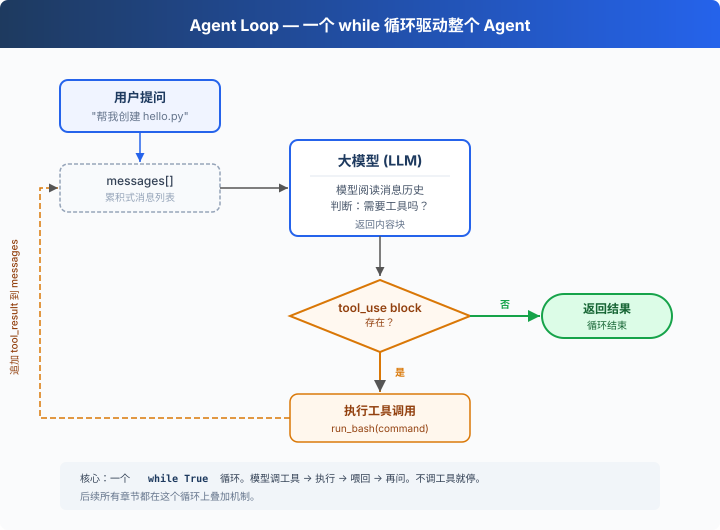

# s01: Agent Loop — 一个循环就够了

> **TS 对照版**：实现范围和跨章引用以 Python 原版为准；标识符沿用 Python。代码块摘自本章实现，可能省略 import、外层类或分支。

[English](README.md) · [中文](README.zh.md) · [日本語](README.ja.md)

`s01` → [s02](../s02_tool_use/) → s03 → s04 → ... → s16 → s17
> *"One loop & Bash is all you need"* — 一个工具 + 一个循环 = 一个 Agent。
>
> **Harness 层**: 循环 — 模型与真实世界的第一道连接。

---

## 问题

你提出了一个问题给大模型：“帮我读取下我的目录下有哪些文件，并且执行XXX.ts”。

模型能输出一条 bash 命令，但输出完了就停了，它不会自己跑，也不会看到结果后继续推理。

你可以手动跑一遍，把输出粘贴回对话框，让它接着干。下一个命令出来，你再跑一遍、再贴回去。

每一个来回，你都在做中间层。而把它自动化，就是这一章要做的事。

---

## 解决方案



一个 `while True` 循环，模型调用工具就继续，不调用就停。循环直接检查响应里的内容块：

| 信号 | 含义 | 循环动作 |
|------|------|---------|
| 包含 `tool_use` block | 模型要求调用工具 | 执行 → 结果喂回去 → 继续 |
| 不包含 `tool_use` block | 模型没有调用工具 | 退出循环 |

---

## 工作原理

将这个过程翻译成代码。分步来看：

**第 1 步**：把用户的问题作为第一条消息。

```typescript
const messages: Anthropic.MessageParam[] = [{ role: 'user', content: query }];
```

**第 2 步**：将消息和工具定义一起发给 LLM。

```typescript
const response = await client.messages.create({ model: MODEL, system: SYSTEM, messages, tools: TOOLS, max_tokens: 8000 });
```

**第 3 步**：追加模型回答，检查它是否调了工具。没调 → 结束。

```typescript
messages.push({ role: 'assistant', content: response.content });
    const tool_calls = response.content.filter((block) => block.type === 'tool_use');
    if (!tool_calls.length) return;
```

只有实际存在的 `tool_use` block 才会进入执行阶段，因此不会追加空的工具结果消息。

**第 4 步**：执行模型要求的工具，收集结果。

```typescript
const results: Anthropic.ToolResultBlockParam[] = [];
    for (const block of tool_calls) {
      const input = block.input as ToolInput;
      if (!Object.hasOwn(input, 'command')) { const error = new Error("'command'"); error.name = 'KeyError'; throw error; }
      console.log(`\x1b[33m$ ${input.command}\x1b[0m`);
      const output = run_bash(input.command as string);
      console.log(Array.from(output).slice(0, 200).join(''));
      results.push({ type: 'tool_result', tool_use_id: block.id, content: output });
    }
```

**第 5 步**：把工具结果作为新消息追加，回到第 2 步。

```typescript
messages.push({ role: 'user', content: results });
```

组装为一个完整函数：

```typescript
export async function agent_loop(messages: Anthropic.MessageParam[], client: Pick<Anthropic, 'messages'>, MODEL: string): Promise<void> {
  while (true) {
    const response = await client.messages.create({ model: MODEL, system: SYSTEM, messages, tools: TOOLS, max_tokens: 8000 });
    messages.push({ role: 'assistant', content: response.content });
    const tool_calls = response.content.filter((block) => block.type === 'tool_use');
    if (!tool_calls.length) return;
    const results: Anthropic.ToolResultBlockParam[] = [];
    for (const block of tool_calls) {
      const input = block.input as ToolInput;
      if (!Object.hasOwn(input, 'command')) { const error = new Error("'command'"); error.name = 'KeyError'; throw error; }
      console.log(`\x1b[33m$ ${input.command}\x1b[0m`);
      const output = run_bash(input.command as string);
      console.log(Array.from(output).slice(0, 200).join(''));
      results.push({ type: 'tool_result', tool_use_id: block.id, content: output });
    }
    messages.push({ role: 'user', content: results });
  }
}
```

三十多行，这就是最小可运行的 agent harness 内核。它为模型提供持续行动的最小运行框架：模型负责决策（要不要调工具、调哪个），harness 负责执行（调用工具，把结果作为新消息追加）。后面 16 个章节都在这个循环上叠加机制，循环本身始终不变。

---

## 试一下

> **安全提示**：代码会执行模型生成的 shell 命令。建议在一个临时测试目录中运行，避免影响你的项目文件。s03 会加入权限控制。

**准备**（首次运行）：

```sh
npm ci
cp -n .env.example .env
# 编辑 .env，填入 ANTHROPIC_API_KEY 和 MODEL_ID
```

**运行**：

```sh
npm run s01
```

试试这些 prompt：

1. `Create a file called hello.ts that prints "Hello, World!"`
2. `List all TypeScript files in this directory`
3. `What is the current git branch?`

观察重点：模型什么时候调用工具（循环继续），什么时候不调用（循环结束）？

---

## 接下来

现在模型手里只有 bash 一个工具，读文件要 `cat`，写文件要 `echo ... >`，找个文件要 `find`，又丑又容易出错。

s02 Tool Use → 给它 5 个真正的工具，会发生什么？模型会不会一次调用多个工具？几个工具同时跑会不会互相踩？


<!-- translation-sync: zh@v1, en@v0, ja@v0 -->

## TypeScript 对齐与验证

[code.ts](code.ts) 是独立运行入口；[Python 原版](../../s01_agent_loop/code.py) 是行为依据。Promise/子进程 I/O 对应 Python 的同步调用与线程；文件和锁的适配以原版各章节为准。原图保持原文件名和字节。

在 TS 工程目录执行 `npm run test:s01`。差分测试通过假模型运行未修改的 Python 原版，因此还需要 Python 3 与 PyYAML。它们验证离线行为；真实 API、全部入口和全项目最终检查的状态统一记录在[对齐记录](../docs/parity-audit.md)。
