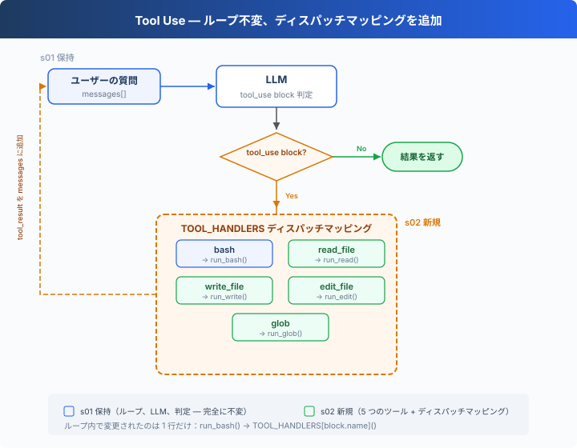

# s02: Tool Use — ツール一つ追加、一行追加だけ

> **TypeScript 対照版**：実装範囲と章間の参照は Python 原版に従い、識別子を保持します。コード例は実装の抜粋です。

[English](README.md) · [中文](README.zh.md) · [日本語](README.ja.md)

s01 → `s02` → [s03](../s03_permission/) → s04 → ... → s16 → s17
> *"ツールを一つ追加、ハンドラを一つ追加"* — ループはそのまま。新しいツールをディスパッチマップに登録するだけ。
>
> **Harness レイヤー**: ツールディスパッチ — モデルが触れる範囲を拡張。

---

## ツールは bash 一つだけ

s01 の Agent には bash 一つのツールしかない。ファイルを読むには `cat`、書くには `echo "..." > file.ts`、編集するには `sed`。

モデルは「このファイルを読みたい」と考えながら、`cat path/to/file` と組み立てなければならない。翻訳の層が一つ増え、トークンを無駄にし、エラーも起きやすい。

---

## 概要：ツールディスパッチ



s01 のループは完全に保持される（LLM 呼び出し、`tool_use` block 判定、メッセージ追加 — 一文字も変更なし）。唯一の変更点はツール実行の 1 行：`run_bash()` が `TOOL_HANDLERS[block.name]()` の検索ディスパッチに置き換わる。

Agent にツールを追加するには、たった二つ：

1. **ツールを定義**：`TOOLS` 配列に一条を追加
2. **ハンドラを登録**：`TOOL_HANDLERS` 辞書に一つのマッピングを追加

---

## 1 つのツールから 5 つのツールへ

s01 には bash だけだった：

```typescript
// s01 exposed only bash.
const tools = TOOLS.filter((tool) => tool.name === 'bash');
```

s02 では 5 つに増え、各ツールは独立して定義される：

```typescript
export const TOOLS: Anthropic.Tool[] = [
  {
    "name": "bash",
    "description": "Run a shell command.",
    "input_schema": {
      "type": "object",
      "properties": {
        "command": {
          "type": "string"
        }
      },
      "required": [
        "command"
      ]
    }
  },
  {
    "name": "read_file",
    "description": "Read file contents.",
    "input_schema": {
      "type": "object",
      "properties": {
        "path": {
          "type": "string"
        },
        "limit": {
          "type": "integer"
        }
      },
      "required": [
        "path"
      ]
    }
  },
  {
    "name": "write_file",
    "description": "Write content to a file.",
    "input_schema": {
      "type": "object",
      "properties": {
        "path": {
          "type": "string"
        },
        "content": {
          "type": "string"
        }
      },
      "required": [
        "path",
        "content"
      ]
    }
  },
  {
    "name": "edit_file",
    "description": "Replace exact text in a file once.",
    "input_schema": {
      "type": "object",
      "properties": {
        "path": {
          "type": "string"
        },
        "old_text": {
          "type": "string"
        },
        "new_text": {
          "type": "string"
        }
      },
      "required": [
        "path",
        "old_text",
        "new_text"
      ]
    }
  },
  {
    "name": "glob",
    "description": "Find files matching a glob pattern; ** matches recursively.",
    "input_schema": {
      "type": "object",
      "properties": {
        "pattern": {
          "type": "string"
        }
      },
      "required": [
        "pattern"
      ]
    }
  }
];
```

各ツールには専用の実装関数がある：

```typescript
export function run_read(path: string, limit?: number | null): string {
  try {
    const text = new TextDecoder('utf-8', { fatal: true, ignoreBOM: true }).decode(readFileSync(safe_path(path)));
    let lines = text.split(/\r\n|[\n\r\v\f\x1c-\x1e\x85\u2028\u2029]/);
    if (lines.at(-1) === '') lines.pop();
    if (limit) {
      if (typeof limit !== 'number' && typeof limit !== 'boolean') throw new TypeError("'<' not supported between instances of 'str' and 'int'");
      if (Number(limit) < lines.length) {
        if (!Number.isInteger(Number(limit))) throw new TypeError('slice indices must be integers or None or have an __index__ method');
        lines = [...lines.slice(0, Number(limit)), `... (${lines.length - Number(limit)} more lines)`];
      }
    }
    return lines.join('\n');
  } catch (error) {
    return `Error: ${error instanceof Error ? error.message : String(error)}`;
  }
}

export function run_write(path: string, content: string): string {
  try {
    const file_path = safe_path(path);
    mkdirSync(dirname(file_path), { recursive: true });
    writeFileSync(file_path, content, 'utf8');
    return `Wrote ${Array.from(content).length} bytes to ${path}`;
  } catch (error) {
    return `Error: ${error instanceof Error ? error.message : String(error)}`;
  }
}

export function run_edit(path: string, old_text: string, new_text: string): string {
  try {
    const file_path = safe_path(path);
    const text = new TextDecoder('utf-8', { fatal: true, ignoreBOM: true }).decode(readFileSync(file_path)).replace(/\r\n?/g, '\n');
    if (typeof old_text !== 'string') throw new TypeError('old_text must be a string'); if (!text.includes(old_text)) return `Error: text not found in ${path}`;
    if (typeof new_text !== 'string') throw new TypeError('new_text must be a string'); writeFileSync(file_path, text.replace(old_text, () => new_text), 'utf8');
    return `Edited ${path}`;
  } catch (error) {
    return `Error: ${error instanceof Error ? error.message : String(error)}`;
  }
}

export function run_glob(pattern: string): string {
  try {
    const matches = [...new Set(python_glob(pattern, WORKDIR))]
      .filter((match) => is_relative_to(resolve_path(match), WORKDIR))
      .sort();
    const shown = matches.slice(0, 200);
    if (matches.length > 200) shown.push('... (more matches omitted; narrow the pattern)');
    return shown.length ? shown.join('\n') : '(no matches)';
  } catch (error) {
    return `Error: ${error instanceof Error ? error.message : String(error)}`;
  }
}
```

---

## ツールディスパッチ

```typescript
export const TOOL_HANDLERS: Record<string, (input: ToolInput) => string | Promise<string>> = {
  bash: (input: Record<string, unknown>) => (bind_kwargs(input, ["command"], ["command"], "run_bash"), run_bash(input.command as string)),
  read_file: (input: Record<string, unknown>) => (bind_kwargs(input, ["path","limit"], ["path"], "run_read"), run_read(input.path as string, input.limit as number | undefined)),
  write_file: (input: Record<string, unknown>) => (bind_kwargs(input, ["path","content"], ["path","content"], "run_write"), run_write(input.path as string, input.content as string)),
  edit_file: (input: Record<string, unknown>) => (bind_kwargs(input, ["path","old_text","new_text"], ["path","old_text","new_text"], "run_edit"), run_edit(input.path as string, input.old_text as string, input.new_text as string)),
  glob: (input: Record<string, unknown>) => (bind_kwargs(input, ["pattern"], ["pattern"], "run_glob"), run_glob(input.pattern as string)),
};

export async function agent_loop(messages: Anthropic.MessageParam[], client: Pick<Anthropic, 'messages'>, MODEL: string): Promise<void> {
  while (true) {
    const response = await client.messages.create({ model: MODEL, system: SYSTEM, messages, tools: TOOLS, max_tokens: 8000 });
    messages.push({ role: 'assistant', content: response.content });
    const tool_calls = response.content.filter((block) => block.type === 'tool_use');
    if (!tool_calls.length) return;
    const results: Anthropic.ToolResultBlockParam[] = [];
    for (const block of tool_calls) {
      console.log(`\x1b[33m> ${block.name}\x1b[0m`);

      const handler = Object.hasOwn(TOOL_HANDLERS, block.name) ? TOOL_HANDLERS[block.name] : undefined;
      const output = handler ? await handler(block.input as ToolInput) : `Unknown: ${block.name}`;
      console.log(Array.from(output).slice(0, 200).join(''));
      results.push({ type: 'tool_result', tool_use_id: block.id, content: output });
    }
    messages.push({ role: 'user', content: results });
  }
}
```

ツールの追加 = `TOOLS` 配列に一条 + `TOOL_HANDLERS` 辞書に一行。ループは変わらない。

---

## 複数のツール呼び出し

モデルはよく一度に複数の tool_use を返す — 「a.ts と b.ts を読んで、全 .ts ファイルを列挙して」。

これらの呼び出しは、`response.content` に現れる元の順序で一つずつ実行する。

---

## 速查

| 概念 | 一言で |
|------|--------|
| TOOL_HANDLERS | ツール名 → ハンドラ関数の辞書。ツール追加 = マッピング一行追加 |
| ツール定義 | モデルに「何ができるか」を伝える JSON schema |
| 複数ツール呼び出し | モデルは一度に複数の tool_use を返す可能性があり、元の順序で一つずつ実行する |
| ループ不変 | s01 の `while True` ループ — 一行も変更なし |

---

## s01 からの変更

| コンポーネント | 変更前 (s01) | 変更後 (s02) |
|--------------|-------------|-------------|
| ツール数 | 1 (bash) | 5 (+read, write, edit, glob) |
| ツール実行 | ハードコード `run_bash()` | TOOL_HANDLERS 検索ディスパッチ |
| パス安全性 | なし | safe_path 検証（file tools のみ） |
| ループ | `while True` + `tool_use` block | s01 と完全に同一 |

---

## 試してみよう

```sh
cd learn-claude-code/learn-claude-code-ts
npm run s02
```

以下のプロンプトを試してみよう：

1. `Read the file README.md and tell me what this project is about`
2. `Create a file called test.ts that prints "hello", then read it back`
3. `Find all TypeScript files in this directory`
4. `Read both README.md and package.json, then create a summary file`

観察のポイント：モデルがツールを一つだけ呼び出すときと、複数同時に呼び出すときの違い。複数のツール呼び出しは正しい順序で実行されているか？

---

## 次へ

Agent は 5 つの専用ツールを持つようになった。file tools は `safe_path` で保護されるが、bash には短い拒否リストがあり、s03 で統一した権限確認を追加する。

→ s03 Permission：ツール実行前にゲートを追加 — この操作は安全か？ ユーザーの承認が必要か？


<!-- translation-sync: zh@v1, en@v1, ja@v1 -->

## TypeScript の検証

実行入口は [code.ts](code.ts)、参照実装は [Python 原版](../../s02_tool_use/code.py) です。章のテストは `npm run test:s02`。差分テストには Python 3 と PyYAML が必要です。全体の検証状況は[対照記録](../docs/parity-audit.md)を参照してください。
