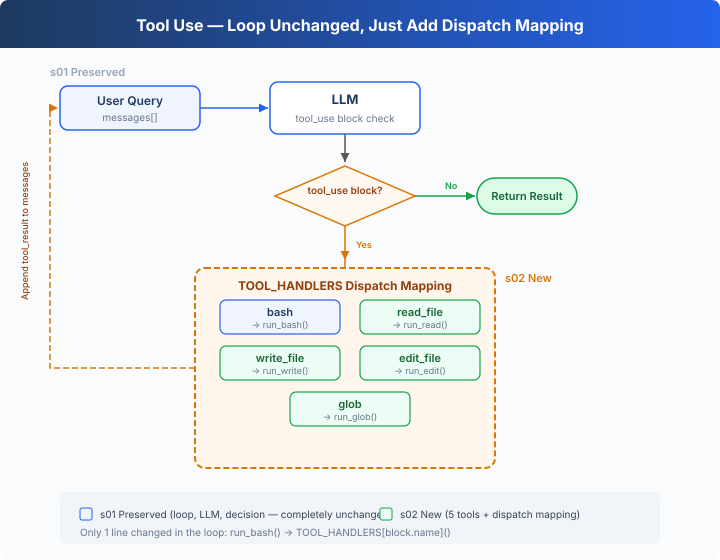

# s02: Tool Use — Add a Tool, Add Just One Line

> **TypeScript reference edition**: implementation boundaries and chapter imports follow Python. Identifiers are preserved. Code blocks are implementation excerpts and may omit enclosing declarations.

[English](README.md) · [中文](README.zh.md) · [日本語](README.ja.md)

s01 → `s02` → [s03](../s03_permission/) → s04 → ... → s16 → s17
> *"Add a tool, add just one handler"* — The loop stays the same. Register the new tool in the dispatch map and you're done.
>
> **Harness Layer**: Tool Dispatch — Expanding the model's reach.

---

## Only One Tool: Bash

The s01 Agent has only one tool: bash. To read a file, `cat`; to write, `echo "..." > file.ts`; to edit, `sed`.

The model thinks "read this file" but has to spell out `cat path/to/file`. An extra layer of translation that wastes tokens and invites errors.

---

## Overview: Tool Dispatch



The s01 loop is fully preserved (LLM call, `tool_use` block check, message append — not a single word changed). The only change is in that one line of tool execution: `run_bash()` is replaced with `TOOL_HANDLERS[block.name]()` dispatch lookup.

Adding a tool to the Agent requires just two things:

1. **Define the tool**: Add one entry to the `TOOLS` array
2. **Register the handler**: Add one mapping in the `TOOL_HANDLERS` dict

---

## From 1 Tool to 5 Tools

s01 had only bash:

```typescript
// s01 exposed only bash.
const tools = TOOLS.filter((tool) => tool.name === 'bash');
```

s02 expands to 5 tools, each independently defined:

```typescript
export const TOOLS: Anthropic.Tool[] = [
  {
    "name": "bash",
    "description": "Run a shell command.",
    "input_schema": {
      "type": "object",
      "properties": {
        "command": {
          "type": "string"
        }
      },
      "required": [
        "command"
      ]
    }
  },
  {
    "name": "read_file",
    "description": "Read file contents.",
    "input_schema": {
      "type": "object",
      "properties": {
        "path": {
          "type": "string"
        },
        "limit": {
          "type": "integer"
        }
      },
      "required": [
        "path"
      ]
    }
  },
  {
    "name": "write_file",
    "description": "Write content to a file.",
    "input_schema": {
      "type": "object",
      "properties": {
        "path": {
          "type": "string"
        },
        "content": {
          "type": "string"
        }
      },
      "required": [
        "path",
        "content"
      ]
    }
  },
  {
    "name": "edit_file",
    "description": "Replace exact text in a file once.",
    "input_schema": {
      "type": "object",
      "properties": {
        "path": {
          "type": "string"
        },
        "old_text": {
          "type": "string"
        },
        "new_text": {
          "type": "string"
        }
      },
      "required": [
        "path",
        "old_text",
        "new_text"
      ]
    }
  },
  {
    "name": "glob",
    "description": "Find files matching a glob pattern; ** matches recursively.",
    "input_schema": {
      "type": "object",
      "properties": {
        "pattern": {
          "type": "string"
        }
      },
      "required": [
        "pattern"
      ]
    }
  }
];
```

Each tool has its own implementation function:

```typescript
export function run_read(path: string, limit?: number | null): string {
  try {
    const text = new TextDecoder('utf-8', { fatal: true, ignoreBOM: true }).decode(readFileSync(safe_path(path)));
    let lines = text.split(/\r\n|[\n\r\v\f\x1c-\x1e\x85\u2028\u2029]/);
    if (lines.at(-1) === '') lines.pop();
    if (limit) {
      if (typeof limit !== 'number' && typeof limit !== 'boolean') throw new TypeError("'<' not supported between instances of 'str' and 'int'");
      if (Number(limit) < lines.length) {
        if (!Number.isInteger(Number(limit))) throw new TypeError('slice indices must be integers or None or have an __index__ method');
        lines = [...lines.slice(0, Number(limit)), `... (${lines.length - Number(limit)} more lines)`];
      }
    }
    return lines.join('\n');
  } catch (error) {
    return `Error: ${error instanceof Error ? error.message : String(error)}`;
  }
}

export function run_write(path: string, content: string): string {
  try {
    const file_path = safe_path(path);
    mkdirSync(dirname(file_path), { recursive: true });
    writeFileSync(file_path, content, 'utf8');
    return `Wrote ${Array.from(content).length} bytes to ${path}`;
  } catch (error) {
    return `Error: ${error instanceof Error ? error.message : String(error)}`;
  }
}

export function run_edit(path: string, old_text: string, new_text: string): string {
  try {
    const file_path = safe_path(path);
    const text = new TextDecoder('utf-8', { fatal: true, ignoreBOM: true }).decode(readFileSync(file_path)).replace(/\r\n?/g, '\n');
    if (typeof old_text !== 'string') throw new TypeError('old_text must be a string'); if (!text.includes(old_text)) return `Error: text not found in ${path}`;
    if (typeof new_text !== 'string') throw new TypeError('new_text must be a string'); writeFileSync(file_path, text.replace(old_text, () => new_text), 'utf8');
    return `Edited ${path}`;
  } catch (error) {
    return `Error: ${error instanceof Error ? error.message : String(error)}`;
  }
}

export function run_glob(pattern: string): string {
  try {
    const matches = [...new Set(python_glob(pattern, WORKDIR))]
      .filter((match) => is_relative_to(resolve_path(match), WORKDIR))
      .sort();
    const shown = matches.slice(0, 200);
    if (matches.length > 200) shown.push('... (more matches omitted; narrow the pattern)');
    return shown.length ? shown.join('\n') : '(no matches)';
  } catch (error) {
    return `Error: ${error instanceof Error ? error.message : String(error)}`;
  }
}
```

---

## Tool Dispatch

```typescript
export const TOOL_HANDLERS: Record<string, (input: ToolInput) => string | Promise<string>> = {
  bash: (input: Record<string, unknown>) => (bind_kwargs(input, ["command"], ["command"], "run_bash"), run_bash(input.command as string)),
  read_file: (input: Record<string, unknown>) => (bind_kwargs(input, ["path","limit"], ["path"], "run_read"), run_read(input.path as string, input.limit as number | undefined)),
  write_file: (input: Record<string, unknown>) => (bind_kwargs(input, ["path","content"], ["path","content"], "run_write"), run_write(input.path as string, input.content as string)),
  edit_file: (input: Record<string, unknown>) => (bind_kwargs(input, ["path","old_text","new_text"], ["path","old_text","new_text"], "run_edit"), run_edit(input.path as string, input.old_text as string, input.new_text as string)),
  glob: (input: Record<string, unknown>) => (bind_kwargs(input, ["pattern"], ["pattern"], "run_glob"), run_glob(input.pattern as string)),
};

export async function agent_loop(messages: Anthropic.MessageParam[], client: Pick<Anthropic, 'messages'>, MODEL: string): Promise<void> {
  while (true) {
    const response = await client.messages.create({ model: MODEL, system: SYSTEM, messages, tools: TOOLS, max_tokens: 8000 });
    messages.push({ role: 'assistant', content: response.content });
    const tool_calls = response.content.filter((block) => block.type === 'tool_use');
    if (!tool_calls.length) return;
    const results: Anthropic.ToolResultBlockParam[] = [];
    for (const block of tool_calls) {
      console.log(`\x1b[33m> ${block.name}\x1b[0m`);

      const handler = Object.hasOwn(TOOL_HANDLERS, block.name) ? TOOL_HANDLERS[block.name] : undefined;
      const output = handler ? await handler(block.input as ToolInput) : `Unknown: ${block.name}`;
      console.log(Array.from(output).slice(0, 200).join(''));
      results.push({ type: 'tool_result', tool_use_id: block.id, content: output });
    }
    messages.push({ role: 'user', content: results });
  }
}
```

Adding a tool = one entry in `TOOLS` array + one line in `TOOL_HANDLERS` dict. The loop stays the same.

---

## Multiple Tool Calls

The model often returns multiple tool_use calls at once — "read a.ts and b.ts, then list all .ts files".

Calls are executed one by one in their original `response.content` order.

---

## Quick Reference

| Concept | One-Liner |
|---------|-----------|
| TOOL_HANDLERS | Tool name → handler function dict. Add a tool = add one mapping line |
| Tool Definition | JSON schema telling the model "what I can do" |
| Multiple tool calls | Model may return multiple tool_use at once; calls execute in their original order |
| Loop Unchanged | s01's `while True` loop — not a single line changed |

---

## Changes from s01

| Component | Before (s01) | After (s02) |
|-----------|-------------|-------------|
| Tool count | 1 (bash) | 5 (+read, write, edit, glob) |
| Tool execution | Hardcoded `run_bash()` | TOOL_HANDLERS dispatch lookup |
| Path safety | None | safe_path validation (file tools only) |
| Loop | `while True` + `tool_use` block | Identical to s01 |

---

## Try It

```sh
cd learn-claude-code/learn-claude-code-ts
npm run s02
```

Try these prompts:

1. `Read the file README.md and tell me what this project is about`
2. `Create a file called test.ts that prints "hello", then read it back`
3. `Find all TypeScript files in this directory`
4. `Read both README.md and package.json, then create a summary file`

What to watch for: When does the model call just one tool, and when does it call multiple at once? Are multiple tool calls executed in the correct order?

---

## What's Next

The Agent now has 5 specialized tools. File tools are protected by `safe_path`, bash has a small deny list, while s03 adds a unified permission gate.

→ s03 Permission: Add a gate before tool execution — is this operation safe? Does it need user approval?


<!-- translation-sync: zh@v1, en@v1, ja@v1 -->

## TypeScript verification

Run [code.ts](code.ts) with `npm run s02` and tests with `npm run test:s02`. Differential tests execute the unmodified [Python reference](../../s02_tool_use/code.py) with fake model responses and require Python 3 and PyYAML. See the [alignment audit](../docs/parity-audit.md) for full-project and live-API verification status.
