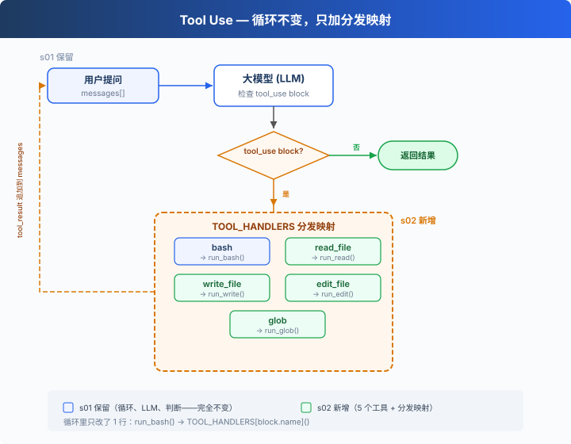

# s02: Tool Use — 多加一个工具，只加一行

> **TS 对照版**：实现范围和跨章引用以 Python 原版为准；标识符沿用 Python。代码块摘自本章实现，可能省略 import、外层类或分支。

[English](README.md) · [中文](README.zh.md) · [日本語](README.ja.md)

s01 → `s02` → [s03](../s03_permission/) → s04 → ... → s16 → s17
> *"加一个工具, 只加一个 handler"* — 循环不用动, 新工具注册进 dispatch map 就行。
>
> **Harness 层**: 工具分发 — 扩展模型能触达的边界。

---

## 只有 bash 一个工具

s01 的 Agent 只有一个 bash 工具。读文件要 `cat`，写文件要 `echo "..." > file.ts`，改文件要 `sed`。

模型想的是"读这个文件"，却要拼出 `cat path/to/file`。多了一层翻译，浪费 token，还容易拼错。

---

## 全局视角：工具分发



s01 的循环完全保留（LLM 调用、`tool_use` block 判断、消息追加）。唯一的变动在工具执行那 1 行：`run_bash()` 替换为 `TOOL_HANDLERS[block.name]()` 查表分发。

给 Agent 加一个工具只需要做两件事：

1. **定义工具**：在 `TOOLS` 数组里加一条描述
2. **注册处理函数**：在 `TOOL_HANDLERS` 字典里加一个映射

---

## 从 1 个工具到 5 个工具

s01 只有一个 bash：

```typescript
// s01 exposed only bash.
const tools = TOOLS.filter((tool) => tool.name === 'bash');
```

s02 加到 5 个，每个工具都是独立定义：

```typescript
export const TOOLS: Anthropic.Tool[] = [
  {
    "name": "bash",
    "description": "Run a shell command.",
    "input_schema": {
      "type": "object",
      "properties": {
        "command": {
          "type": "string"
        }
      },
      "required": [
        "command"
      ]
    }
  },
  {
    "name": "read_file",
    "description": "Read file contents.",
    "input_schema": {
      "type": "object",
      "properties": {
        "path": {
          "type": "string"
        },
        "limit": {
          "type": "integer"
        }
      },
      "required": [
        "path"
      ]
    }
  },
  {
    "name": "write_file",
    "description": "Write content to a file.",
    "input_schema": {
      "type": "object",
      "properties": {
        "path": {
          "type": "string"
        },
        "content": {
          "type": "string"
        }
      },
      "required": [
        "path",
        "content"
      ]
    }
  },
  {
    "name": "edit_file",
    "description": "Replace exact text in a file once.",
    "input_schema": {
      "type": "object",
      "properties": {
        "path": {
          "type": "string"
        },
        "old_text": {
          "type": "string"
        },
        "new_text": {
          "type": "string"
        }
      },
      "required": [
        "path",
        "old_text",
        "new_text"
      ]
    }
  },
  {
    "name": "glob",
    "description": "Find files matching a glob pattern; ** matches recursively.",
    "input_schema": {
      "type": "object",
      "properties": {
        "pattern": {
          "type": "string"
        }
      },
      "required": [
        "pattern"
      ]
    }
  }
];
```

每个工具有自己的实现函数：

```typescript
export function run_read(path: string, limit?: number | null): string {
  try {
    const text = new TextDecoder('utf-8', { fatal: true, ignoreBOM: true }).decode(readFileSync(safe_path(path)));
    let lines = text.split(/\r\n|[\n\r\v\f\x1c-\x1e\x85\u2028\u2029]/);
    if (lines.at(-1) === '') lines.pop();
    if (limit) {
      if (typeof limit !== 'number' && typeof limit !== 'boolean') throw new TypeError("'<' not supported between instances of 'str' and 'int'");
      if (Number(limit) < lines.length) {
        if (!Number.isInteger(Number(limit))) throw new TypeError('slice indices must be integers or None or have an __index__ method');
        lines = [...lines.slice(0, Number(limit)), `... (${lines.length - Number(limit)} more lines)`];
      }
    }
    return lines.join('\n');
  } catch (error) {
    return `Error: ${error instanceof Error ? error.message : String(error)}`;
  }
}

export function run_write(path: string, content: string): string {
  try {
    const file_path = safe_path(path);
    mkdirSync(dirname(file_path), { recursive: true });
    writeFileSync(file_path, content, 'utf8');
    return `Wrote ${Array.from(content).length} bytes to ${path}`;
  } catch (error) {
    return `Error: ${error instanceof Error ? error.message : String(error)}`;
  }
}

export function run_edit(path: string, old_text: string, new_text: string): string {
  try {
    const file_path = safe_path(path);
    const text = new TextDecoder('utf-8', { fatal: true, ignoreBOM: true }).decode(readFileSync(file_path)).replace(/\r\n?/g, '\n');
    if (typeof old_text !== 'string') throw new TypeError('old_text must be a string'); if (!text.includes(old_text)) return `Error: text not found in ${path}`;
    if (typeof new_text !== 'string') throw new TypeError('new_text must be a string'); writeFileSync(file_path, text.replace(old_text, () => new_text), 'utf8');
    return `Edited ${path}`;
  } catch (error) {
    return `Error: ${error instanceof Error ? error.message : String(error)}`;
  }
}

export function run_glob(pattern: string): string {
  try {
    const matches = [...new Set(python_glob(pattern, WORKDIR))]
      .filter((match) => is_relative_to(resolve_path(match), WORKDIR))
      .sort();
    const shown = matches.slice(0, 200);
    if (matches.length > 200) shown.push('... (more matches omitted; narrow the pattern)');
    return shown.length ? shown.join('\n') : '(no matches)';
  } catch (error) {
    return `Error: ${error instanceof Error ? error.message : String(error)}`;
  }
}
```

---

## 工具分发

```typescript
export const TOOL_HANDLERS: Record<string, (input: ToolInput) => string | Promise<string>> = {
  bash: (input: Record<string, unknown>) => (bind_kwargs(input, ["command"], ["command"], "run_bash"), run_bash(input.command as string)),
  read_file: (input: Record<string, unknown>) => (bind_kwargs(input, ["path","limit"], ["path"], "run_read"), run_read(input.path as string, input.limit as number | undefined)),
  write_file: (input: Record<string, unknown>) => (bind_kwargs(input, ["path","content"], ["path","content"], "run_write"), run_write(input.path as string, input.content as string)),
  edit_file: (input: Record<string, unknown>) => (bind_kwargs(input, ["path","old_text","new_text"], ["path","old_text","new_text"], "run_edit"), run_edit(input.path as string, input.old_text as string, input.new_text as string)),
  glob: (input: Record<string, unknown>) => (bind_kwargs(input, ["pattern"], ["pattern"], "run_glob"), run_glob(input.pattern as string)),
};

export async function agent_loop(messages: Anthropic.MessageParam[], client: Pick<Anthropic, 'messages'>, MODEL: string): Promise<void> {
  while (true) {
    const response = await client.messages.create({ model: MODEL, system: SYSTEM, messages, tools: TOOLS, max_tokens: 8000 });
    messages.push({ role: 'assistant', content: response.content });
    const tool_calls = response.content.filter((block) => block.type === 'tool_use');
    if (!tool_calls.length) return;
    const results: Anthropic.ToolResultBlockParam[] = [];
    for (const block of tool_calls) {
      console.log(`\x1b[33m> ${block.name}\x1b[0m`);

      const handler = Object.hasOwn(TOOL_HANDLERS, block.name) ? TOOL_HANDLERS[block.name] : undefined;
      const output = handler ? await handler(block.input as ToolInput) : `Unknown: ${block.name}`;
      console.log(Array.from(output).slice(0, 200).join(''));
      results.push({ type: 'tool_result', tool_use_id: block.id, content: output });
    }
    messages.push({ role: 'user', content: results });
  }
}
```

加一个工具 = 在 `TOOLS` 数组加一条 + 在 `TOOL_HANDLERS` 字典加一行。循环不变。

---

## 多个工具调用

模型经常一次返回多个 tool_use："读一下 a.ts 和 b.ts，然后列出所有 .ts 文件"。

这些调用按照 `response.content` 中的原始顺序逐个执行。

---

## 速查

| 概念 | 一句话 |
|------|--------|
| TOOL_HANDLERS | 工具名 → 处理函数的字典。加工具 = 加一行映射 |
| 工具定义 | 告诉模型"我能做什么"的 JSON schema |
| 多工具调用 | 模型可一次返回多个 tool_use，并按原始顺序逐个执行 |
| 循环不变 | s01 的 `while True` 循环一行都没改 |

---

## 相对 s01 的变更

| 组件 | 之前 (s01) | 之后 (s02) |
|------|-----------|-----------|
| 工具数量 | 1 (bash) | 5 (+read, write, edit, glob) |
| 工具执行 | 硬编码 `run_bash()` | TOOL_HANDLERS 查表分发 |
| 路径安全 | 无 | safe_path 校验（仅 file tools） |
| 循环 | `while True` + `tool_use` block | 与 s01 完全一致 |

---

## 试一下

```sh
cd learn-claude-code/learn-claude-code-ts
npm run s02
```

试试这些 prompt：

1. `Read the file README.md and tell me what this project is about`
2. `Create a file called test.ts that prints "hello", then read it back`
3. `Find all TypeScript files in this directory`
4. `Read both README.md and package.json, then create a summary file`

观察重点：模型什么时候只调一个工具，什么时候一次调多个？多个工具调用的顺序和结果是否正确？

---

## 接下来

现在 Agent 有 5 个专用工具。file tools 受 `safe_path` 保护，bash 有简短的拒绝列表；s03 将增加统一的权限入口。

s03 Permission → 在工具执行之前加一道门：这个操作安全吗？需要用户批准吗？


<!-- translation-sync: zh@v1, en@v0, ja@v0 -->

## TypeScript 对齐与验证

[code.ts](code.ts) 是独立运行入口；[Python 原版](../../s02_tool_use/code.py) 是行为依据。Promise/子进程 I/O 对应 Python 的同步调用与线程；文件和锁的适配以原版各章节为准。原图保持原文件名和字节。

在 TS 工程目录执行 `npm run test:s02`。差分测试通过假模型运行未修改的 Python 原版，因此还需要 Python 3 与 PyYAML。它们验证离线行为；真实 API、全部入口和全项目最终检查的状态统一记录在[对齐记录](../docs/parity-audit.md)。
