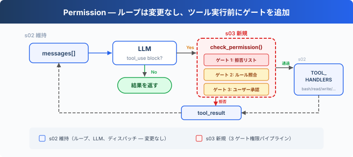
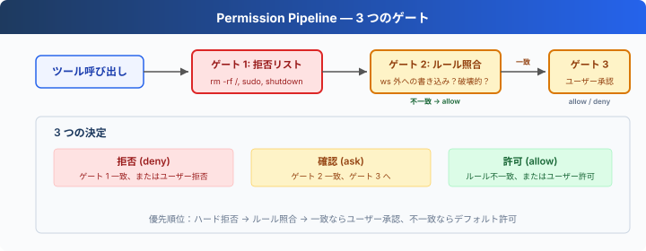

# s03: Permission — 実行前に権限を判断する

> **TypeScript 対照版**：実装範囲と章間の参照は Python 原版に従い、識別子を保持します。コード例は実装の抜粋です。

[English](README.md) · [中文](README.zh.md) · [日本語](README.ja.md)

s01 → s02 → `s03` → [s04](../s04_hooks/) → s05 → ... → s16 → s17
> *"ツール実行前に権限を判断"* — 権限パイプラインは、どの操作に承認が必要かを決める。
>
> **Harness レイヤー**: 権限 — ツール実行前に一つのゲートを追加。

---

## 課題

s02 の Agent は 5 つのツールを持つ。file tools は `safe_path` で保護されるが、bash には短い拒否リストだけがあり、破壊的な操作を統一して確認する仕組みがない。

安全性はモデルを信頼することではなく、コードに頼る — ツール実行前に判断を挟む。

---

## ソリューション



s02 のループは完全に維持される。唯一の変更は、ツール実行前に `check_permission()` を挿入すること — 各ツール呼び出しは 3 つのゲートを固定順序で通過する：ハード拒否が最優先、次にソフト確認、どちらも一致しなければ許可。

3 つのゲートは 3 つの決定に対応する：

| ゲート | 役割 | 一致時 |
|--------|------|--------|
| 1. 拒否リスト | 常に禁止される操作（`rm -rf /`、`sudo`） | 即座に拒否、実行しない |
| 2. ルールマッチング | コンテキスト依存の操作（作業ディレクトリ外への読み書き、`rm` ファイル） | ゲート 3 へ |
| 3. ユーザー承認 | ゲート 2 が一致した場合、ユーザー確認を待機 | ユーザーが許可または拒否を決定 |

3 つのゲートのどれにも一致しない → 直接実行。日常の操作の大部分はこの経路を通る。

---

## 仕組み



**ゲート 1**：ハード拒否リスト。最初に確認し、一致すればブロックメッセージを返す。このリストは権限ゲートの位置を示すための単純な文字列照合であり、完全なセキュリティ境界ではない。

```typescript
export const DENY_LIST = ['rm -rf /', 'sudo', 'shutdown', 'reboot', 'mkfs', 'dd if=', '> /dev/sda'];

export function check_deny_list(command: string): string | null {
  for (const pattern of DENY_LIST) if (command.includes(pattern)) return `Blocked: '${pattern}' is on the deny list`;
  return null;
}
```

**ゲート 2**：ルールマッチング — 「いつユーザーに聞くべきか」を記述する。各ルールはツールとチェック条件を指定する。

```typescript
export const DESTRUCTIVE_COMMAND_WORD = /(?:^|[;&|()\n])\s*(?:rm|del)(?=\s|$|[;&|()])/i;

export function contains_destructive_command(command: string): boolean { return DESTRUCTIVE_COMMAND_WORD.test(command); }

export const PERMISSION_RULES = [
  { tools: ['read_file', 'write_file', 'edit_file'],
    check: (args: ToolInput) => !is_relative_to(resolve_path((Object.hasOwn(args, 'path') ? args.path : '') as string), WORKDIR), message: 'Writing outside workspace' },
  { tools: ['bash'], check: (args: ToolInput) => {
    const command = (Object.hasOwn(args, 'command') ? args.command : '') as string;
    return contains_destructive_command(command) || ['rm ', '> /etc/', 'chmod 777'].some((kw) => command.includes(kw));
  }, message: 'Potentially destructive command' },
];

export function check_rules(tool_name: string, args: ToolInput): string | null {
  for (const rule of PERMISSION_RULES) if (rule.tools.includes(tool_name) && rule.check(args)) return rule.message;
  return null;
}
```

**ゲート 3**：ルールが一致した後、ユーザー入力を待機。

```typescript
export async function ask_user(tool_name: string, args: ToolInput, reason: string,
  question: (prompt: string) => Promise<string> = async (prompt) => await terminal?.question(prompt, { signal: input_closed }) ?? 'n'): Promise<string> {
  console.log(`\n\x1b[33m[permission] ${reason}\x1b[0m`); console.log(`   Tool: ${tool_name}(${python_str(args)})`);
  const choice = (await question('   Allow? [y/N] ')).trim().toLowerCase();
  return ['y', 'yes'].includes(choice) ? 'allow' : 'deny';
}
```

**3 つのゲートを直列に接続**、ツール実行前に挿入する：

```typescript
export async function check_permission(block: ToolCall, approve: Approval = ask_user): Promise<boolean> {
  if (block.name === 'bash') {
    const input = block.input as ToolInput;
    const reason = check_deny_list((Object.hasOwn(input, 'command') ? input.command : '') as string);
    if (reason) { console.log(`\n\x1b[31m[blocked] ${reason}\x1b[0m`); return false; }
  }
  const reason = check_rules(block.name, block.input as ToolInput);
  if (reason && await approve(block.name, block.input as ToolInput, reason) === 'deny') return false;
  return true;
}
```

---

## s02 からの変更点

| コンポーネント | 変更前 (s02) | 変更後 (s03) |
|---------------|-------------|-------------|
| セキュリティモデル | なし（モデルを信頼） | 3 ゲート権限パイプライン |
| 新規関数 | — | check_deny_list, check_rules, ask_user, check_permission |
| ループ | すべてのツールを直接実行 | 実行前に check_permission() を挿入 |

---

## 試してみよう

```sh
cd learn-claude-code/learn-claude-code-ts
npm run s03
```

以下のプロンプトを試してみよう：

1. `Create a file called test.txt in the current directory`（そのまま通過するはず）
2. `Delete the file test.txt`（bash + rm でゲート 2 が発動）
3. `What files are in the current directory?`（読み取り専用、すべて通過）
4. `Try to write a file to /etc/something`（作業ディレクトリ外への書き込みでゲート 2 が発動）
5. Windows では `del test.txt` と `DEL test.txt` がゲート 2 を発動し、`model`、`delimiter`、`echo del test.txt` は発動しない。

観察のポイント：どの操作がそのまま通過するか？ どれに確認が必要か？ どれが即座に拒否されるか？

---

## 次へ

権限チェックは実装された — しかし、毎回ループ内に `check_permission()` をハードコードしている。ツール実行の前後にログを追加したい場合は？ 特定の操作後に自動的に git commit をトリガーしたい場合は？ このような拡張ロジックがループ内に散らばると、ループはすぐに膨張する。

→ s04 Hooks：ループにフックを追加する。拡張ロジックはフックにぶら下げ、ループはクリーンに保つ。


<!-- translation-sync: zh@v1, en@v1, ja@v1 -->

## TypeScript の検証

実行入口は [code.ts](code.ts)、参照実装は [Python 原版](../../s03_permission/code.py) です。章のテストは `npm run test:s03`。差分テストには Python 3 と PyYAML が必要です。全体の検証状況は[対照記録](../docs/parity-audit.md)を参照してください。
