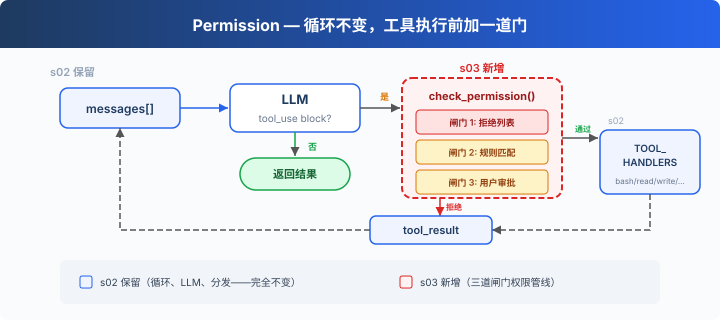
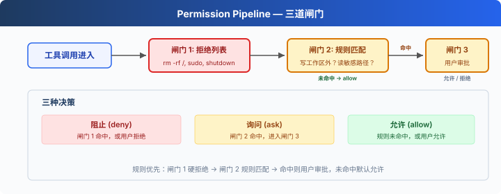

# s03: Permission — 执行前做权限判断

> **TS 对照版**：实现范围和跨章引用以 Python 原版为准；标识符沿用 Python。代码块摘自本章实现，可能省略 import、外层类或分支。

[English](README.md) · [中文](README.zh.md) · [日本語](README.ja.md)

s01 → s02 → `s03` → [s04](../s04_hooks/) → s05 → ... → s16 → s17
> *"工具执行前先做权限判断"* — 权限管线决定哪些操作需要审批。
>
> **Harness 层**: 权限 — 在工具执行前加一道门。

---

## 问题

s02 的 Agent 有 5 个工具。file tools 受 `safe_path` 保护，bash 只有简短的拒绝列表，尚无统一的破坏性操作审批入口。

安全边界由代码负责，判断发生在工具执行之前。

---

## 解决方案



s02 的循环完全保留。唯一的变动是在工具执行前插入 `check_permission()`。每个工具调用依次经过三道闸门：硬拒绝优先，软询问次之，都没命中就放行。

三道闸门对应三种决策：

| 闸门 | 作用 | 命中后 |
|------|------|--------|
| 1. 拒绝列表 | 永远禁止的操作（`rm -rf /`、`sudo`） | 直接拒绝，不执行 |
| 2. 规则匹配 | 取决于上下文的操作（读/写工作区外、`rm` 文件） | 交给闸门 3 |
| 3. 用户审批 | 闸门 2 命中后，暂停等用户确认 | 用户决定允许或拒绝 |

三道都没命中 → 直接执行。大部分日常操作走这条路。

---

## 工作原理



**闸门 1**：一张硬拒绝表，先查，命中就返回阻止信息。这张表使用简单字符串匹配来说明权限闸门的位置，不能视为完整的安全边界。

```typescript
export const DENY_LIST = ['rm -rf /', 'sudo', 'shutdown', 'reboot', 'mkfs', 'dd if=', '> /dev/sda'];

export function check_deny_list(command: string): string | null {
  for (const pattern of DENY_LIST) if (command.includes(pattern)) return `Blocked: '${pattern}' is on the deny list`;
  return null;
}
```

**闸门 2**负责规则匹配，用来描述"什么时候需要问用户"。每条规则指定工具和检查条件。

```typescript
export const DESTRUCTIVE_COMMAND_WORD = /(?:^|[;&|()\n])\s*(?:rm|del)(?=\s|$|[;&|()])/i;

export function contains_destructive_command(command: string): boolean { return DESTRUCTIVE_COMMAND_WORD.test(command); }

export const PERMISSION_RULES = [
  { tools: ['read_file', 'write_file', 'edit_file'],
    check: (args: ToolInput) => !is_relative_to(resolve_path((Object.hasOwn(args, 'path') ? args.path : '') as string), WORKDIR), message: 'Writing outside workspace' },
  { tools: ['bash'], check: (args: ToolInput) => {
    const command = (Object.hasOwn(args, 'command') ? args.command : '') as string;
    return contains_destructive_command(command) || ['rm ', '> /etc/', 'chmod 777'].some((kw) => command.includes(kw));
  }, message: 'Potentially destructive command' },
];

export function check_rules(tool_name: string, args: ToolInput): string | null {
  for (const rule of PERMISSION_RULES) if (rule.tools.includes(tool_name) && rule.check(args)) return rule.message;
  return null;
}
```

**闸门 3**：规则命中后，暂停等用户输入。

```typescript
export async function ask_user(tool_name: string, args: ToolInput, reason: string,
  question: (prompt: string) => Promise<string> = async (prompt) => await terminal?.question(prompt, { signal: input_closed }) ?? 'n'): Promise<string> {
  console.log(`\n\x1b[33m[permission] ${reason}\x1b[0m`); console.log(`   Tool: ${tool_name}(${python_str(args)})`);
  const choice = (await question('   Allow? [y/N] ')).trim().toLowerCase();
  return ['y', 'yes'].includes(choice) ? 'allow' : 'deny';
}
```

**三道闸门串在一起**，插在工具执行之前：

```typescript
export async function check_permission(block: ToolCall, approve: Approval = ask_user): Promise<boolean> {
  if (block.name === 'bash') {
    const input = block.input as ToolInput;
    const reason = check_deny_list((Object.hasOwn(input, 'command') ? input.command : '') as string);
    if (reason) { console.log(`\n\x1b[31m[blocked] ${reason}\x1b[0m`); return false; }
  }
  const reason = check_rules(block.name, block.input as ToolInput);
  if (reason && await approve(block.name, block.input as ToolInput, reason) === 'deny') return false;
  return true;
}
```

---

## 相对 s02 的变更

| 组件 | 之前 (s02) | 之后 (s03) |
|------|-----------|-----------|
| 安全模型 | 无（信任模型） | 三道闸门权限管线 |
| 新函数 | — | check_deny_list, check_rules, ask_user, check_permission |
| 循环 | 直接执行所有工具 | 执行前插入 check_permission() |

---

## 试一下

```sh
cd learn-claude-code/learn-claude-code-ts
npm run s03
```

试试这些 prompt：

1. `Create a file called test.txt in the current directory`（应该直接通过）
2. `Delete the file test.txt`（bash + rm 会触发闸门 2）
3. `What files are in the current directory?`（只读，全部通过）
4. `Try to write a file to /etc/something`（写工作区外，触发闸门 2）
5. 在 Windows 上，`del test.txt` 和 `DEL test.txt` 会触发闸门 2，而 `model`、`delimiter` 和 `echo del test.txt` 不会。

观察重点：哪些操作直接通过？哪些需要你确认？哪些被直接拒绝？

---

## 接下来

当前权限检查每次都在循环里硬编码 `check_permission()`。如果我想在每次工具执行前后加日志？如果想在某些操作后自动触发 git commit？这些扩展逻辑散落在 loop 里，循环很快就会膨胀。

s04 Hooks → 给循环加钩子，扩展逻辑挂在钩子上，循环保持干净。


<!-- translation-sync: zh@v1, en@v1, ja@v1 -->

## TypeScript 对齐与验证

[code.ts](code.ts) 是独立运行入口；[Python 原版](../../s03_permission/code.py) 是行为依据。Promise/子进程 I/O 对应 Python 的同步调用与线程；文件和锁的适配以原版各章节为准。原图保持原文件名和字节。

在 TS 工程目录执行 `npm run test:s03`。差分测试通过假模型运行未修改的 Python 原版，因此还需要 Python 3 与 PyYAML。它们验证离线行为；真实 API、全部入口和全项目最终检查的状态统一记录在[对齐记录](../docs/parity-audit.md)。
