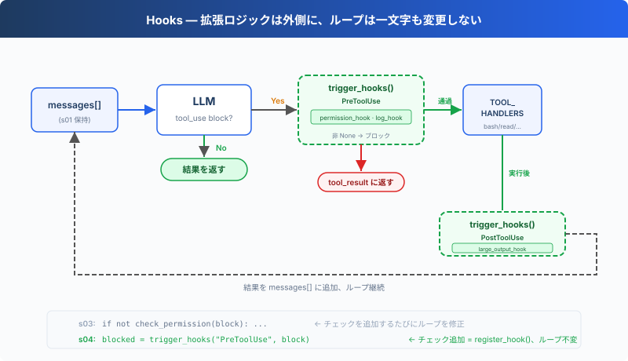

# s04: Hooks — ループに掛ける、ループには書き込まない

> **TypeScript 対照版**：実装範囲と章間の参照は Python 原版に従い、識別子を保持します。コード例は実装の抜粋です。

[English](README.md) · [中文](README.zh.md) · [日本語](README.ja.md)

s01 → s02 → s03 → `s04` → [s05](../s05_todo_write/) → s06 → ... → s16 → s17

> *"ループに掛ける、ループには書き込まない"* — フックがツール実行の前後に拡張ロジックを注入する。
>
> **Harness レイヤー**: フック — ループを侵襲しない拡張ポイント。

---

## 課題

s03 の Agent には権限チェックがある。しかし新しいチェックを追加するたび、「bash 呼び出しを毎回ログに記録」「操作後に自動 git add」、`agent_loop` 関数を修正する必要がある。

ループはすぐにこうなる：

```typescript
export async function agent_loop(messages: Anthropic.MessageParam[], client: Pick<Anthropic, 'messages'>, MODEL: string): Promise<void> {
  while (true) {
    const response = await client.messages.create({ model: MODEL, system: SYSTEM, messages, tools: TOOLS, max_tokens: 8000 });
    messages.push({ role: 'assistant', content: response.content });
    const tool_calls = response.content.filter((block) => block.type === 'tool_use');
    if (!tool_calls.length) {
      const force = await trigger_hooks('Stop', messages);
      if (force) { messages.push({ role: 'user', content: force as string }); continue; }
      return;
    }
    const results: Anthropic.ToolResultBlockParam[] = [];
    for (const block of tool_calls) {
      const blocked = await trigger_hooks('PreToolUse', block);
      if (blocked) {
        results.push({ type: 'tool_result', tool_use_id: block.id, content: python_str(blocked) });
        continue;
      }
      const handler = Object.hasOwn(TOOL_HANDLERS, block.name) ? TOOL_HANDLERS[block.name] : undefined;
      const output = handler ? await handler(block.input as ToolInput) : `Unknown: ${block.name}`;
      await trigger_hooks('PostToolUse', block, output);
      results.push({ type: 'tool_result', tool_use_id: block.id, content: output });
    }
    messages.push({ role: 'user', content: results });
  }
}
```

拡張したいのは Agent の振る舞いなのに、変更しているのはループそのもの。ループは安定した核心であるべき。拡張は外側に掛ける。

---

## ソリューション



s03 のループと権限ロジックは完全に保持される。唯一の変更点は `check_permission()` をループ本体内からフックに移動したこと。ループはもうチェック関数を直接呼び出さず、代わりに `trigger_hooks("PreToolUse", block)` を呼び、登録済みのフックが何を実行するかを決める。

4 つのイベントで、完全な agent cycle をカバー：

| イベント | 発火タイミング | 典型的な用途 |
|----------|--------------|-------------|
| UserPromptSubmit | ユーザー入力後、LLM に入る前 | 入力バリデーション、コンテキスト注入 |
| PreToolUse | ツール実行前 | 権限チェック、ログ記録 |
| PostToolUse | ツール実行後 | 副作用（自動 git add など）、出力チェック |
| Stop | ループが終了する直前 | 後処理、ループを続行するかの判断 |

拡張は `register_hook()` で追加する。ループは `trigger_hooks()` を呼ぶだけ。

---

## 仕組み

**フック登録簿**：イベント名をコールバックリストにマッピングする辞書。

```typescript
export const HOOKS: Record<'UserPromptSubmit' | 'PreToolUse' | 'PostToolUse' | 'Stop', Hook[]> = {
  UserPromptSubmit: [], PreToolUse: [], PostToolUse: [], Stop: [],
};

export function register_hook(event: keyof typeof HOOKS, callback: Hook): void {
  HOOKS[event].push(callback);
}

export async function trigger_hooks(event: keyof typeof HOOKS, ...args: unknown[]): Promise<unknown> {
  for (const callback of HOOKS[event]) {
    const result = await callback(...args);
    if (result !== null && result !== undefined) return result;
  }
  return null;
}
```

`PreToolUse` が `None` 以外を返すと、現在のツール実行は中止される。`Stop` が `None` 以外を返すと、ループは続行する。`UserPromptSubmit` と `PostToolUse` の戻り値は制御フローに影響しない。

**UserPromptSubmit** はユーザー入力後、LLM に入る前に発火する。以下の hook は現在の作業ディレクトリを記録する：

```typescript
export function context_inject_hook(_query: string): null {
  console.log(`\x1b[90m[HOOK] UserPromptSubmit: working in ${WORKDIR}\x1b[0m`);
  return null;
}
```

メインループでは、ユーザー入力直後に発火：

```typescript
await trigger_hooks('UserPromptSubmit', query);
      history.push({ role: 'user', content: query });
      await agent_loop(history, client, MODEL);
```

**PreToolUse / PostToolUse**、ツール実行の前後のフック。s03 の権限チェックロジックは PreToolUse フックに包まれ、さらにログフックと大出力リマインダーが追加される：

```typescript
export async function permission_hook(block: ToolCall): Promise<string | null> {
  const input = block.input as ToolInput;
  if (block.name === 'bash') {
    const command = ((Object.hasOwn(input, 'command') ? input.command : '')) as string;
    for (const pattern of DENY_LIST) {
      if (command.includes(pattern)) {
        console.log(`\n\x1b[31m[blocked] '${pattern}'\x1b[0m`);
        return 'Permission denied by deny list';
      }
    }
    if (contains_destructive_command(command) || DESTRUCTIVE.some((keyword) => command.includes(keyword))) {
      console.log('\n\x1b[33m[permission] Potentially destructive command\x1b[0m');
      console.log(`   Tool: ${block.name}(${python_str(input)})`);
      const choice = (await terminal?.question('   Allow? [y/N] ', { signal: input_closed }))?.trim().toLowerCase();
      if (!choice || !['y', 'yes'].includes(choice)) return 'Permission denied by user';
    }
  }
  if (['read_file', 'write_file', 'edit_file'].includes(block.name)) {
    const path = ((Object.hasOwn(input, 'path') ? input.path : '')) as string;
    if (!is_relative_to(resolve_path(path), WORKDIR)) {
      console.log('\n\x1b[33m[permission] Access outside workspace\x1b[0m');
      console.log(`   Tool: ${block.name}(${python_str(input)})`);
      const choice = (await terminal?.question('   Allow? [y/N] ', { signal: input_closed }))?.trim().toLowerCase();
      if (!choice || !['y', 'yes'].includes(choice)) return 'Permission denied by user';
    }
  }
  return null;
}

export function log_hook(block: ToolCall): null {
  const args_preview = python_str(Object.values(block.input as ToolInput).slice(0, 2)).slice(0, 60);
  console.log(`\x1b[90m[HOOK] ${block.name}(${args_preview})\x1b[0m`);
  return null;
}

export function large_output_hook(block: ToolCall, output: unknown): null {
  const length = Array.from(python_str(output)).length;
  if (length > 100000) console.log(`\x1b[33m[HOOK] Large output from ${block.name}: ${length} chars\x1b[0m`);
  return null;
}
```

**Stop** はループが終了する直前に発火する。以下の hook は終了時の統計を出力する：

```typescript
export function summary_hook(messages: Anthropic.MessageParam[]): null {
  const tool_count = messages.reduce((total, message) => total + (Array.isArray(message.content)
    ? message.content.filter((block) => block.type === 'tool_result').length : 0), 0);
  console.log(`\x1b[90m[HOOK] Stop: session used ${tool_count} tool calls\x1b[0m`);
  return null;
}
```

agent_loop 内では、終了前に発火：

```typescript
const blocked = await trigger_hooks('PreToolUse', block);
      if (blocked) {
        results.push({ type: 'tool_result', tool_use_id: block.id, content: python_str(blocked) });
        continue;
      }
      const handler = Object.hasOwn(TOOL_HANDLERS, block.name) ? TOOL_HANDLERS[block.name] : undefined;
      const output = handler ? await handler(block.input as ToolInput) : `Unknown: ${block.name}`;
      await trigger_hooks('PostToolUse', block, output);
      results.push({ type: 'tool_result', tool_use_id: block.id, content: output });
    }
```

**ループ内で変更されたのは一箇所だけ**：s03 は直接 `check_permission(block)` を呼び出していたが、s04 は `trigger_hooks("PreToolUse", block)` に置き換えた：

```typescript
const tool_calls = response.content.filter((block) => block.type === 'tool_use');
    if (!tool_calls.length) {
      const force = await trigger_hooks('Stop', messages);
      if (force) { messages.push({ role: 'user', content: force as string }); continue; }
      return;
    }
```

4 つのフックが agent cycle の重要ノードをカバー：入力→実行前→実行後→終了。ループは trigger_hooks() を呼ぶだけで、具体的なロジックは全てフックコールバックにある。

---

## s03 からの変更

| コンポーネント | 変更前 (s03) | 変更後 (s04) |
|--------------|-------------|-------------|
| 拡張方式 | check_permission() をループ内にハードコード | HOOKS 登録簿 + trigger_hooks() |
| 新規関数 | — | register_hook, trigger_hooks |
| フックコールバック | — | context_inject_hook, permission_hook, log_hook, large_output_hook, summary_hook |
| ループ | check_permission() を直接呼び出し | trigger_hooks("PreToolUse", ...) を呼び出し |
| 終了制御 | なし | trigger_hooks("Stop", ...) が終了を阻止可能 |
| 入力横取り | なし | trigger_hooks("UserPromptSubmit", ...) がコンテキスト注入可能 |

---

## 試してみよう

```sh
cd learn-claude-code/learn-claude-code-ts
npm run s04
```

以下のプロンプトを試してみよう：

1. `Read the file README.md`（そのまま通過するはず、フックログを観察）
2. `Create a file called test.txt`（作成後、PostToolUse が発火するか観察）
3. `Delete all temporary files in /tmp`（bash + rm で権限フックが発動）

観察のポイント：各ツール実行前に `[HOOK]` ログが表示されるか？ 権限が拒否されたとき、フックが拦截したのか、ループ内のハードコードが拦截したのか？

---

## 次へ

Agent は安全に操作を実行できるようになった。しかし「まず何をして、次に何をすべきか」を立ち止まって考えたことはあるか？ 複雑なタスクを与えたとき、すぐに取り掛かるのか、まず計画を立てるのか？

→ s05 TodoWrite：Agent に計画ツールを与える。まずリストを作り、それから実行。


<!-- translation-sync: zh@v1, en@v1, ja@v1 -->

## TypeScript の検証

実行入口は [code.ts](code.ts)、参照実装は [Python 原版](../../s04_hooks/code.py) です。章のテストは `npm run test:s04`。差分テストには Python 3 と PyYAML が必要です。全体の検証状況は[対照記録](../docs/parity-audit.md)を参照してください。
