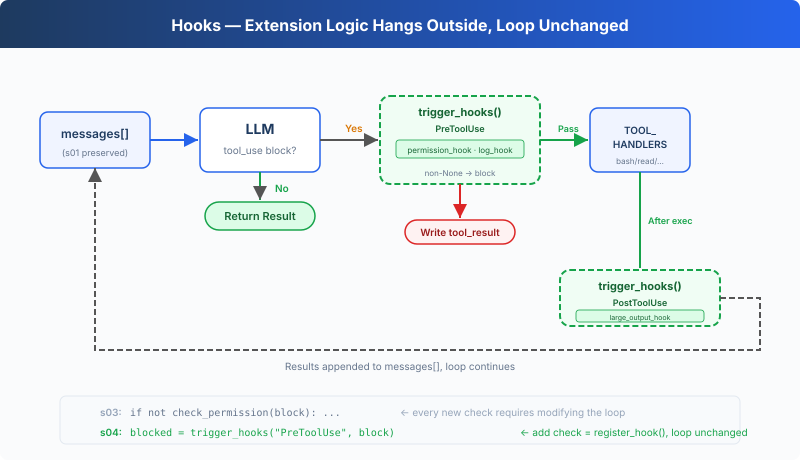

# s04: Hooks — Hang on the Loop, Don't Write into It

> **TypeScript reference edition**: implementation boundaries and chapter imports follow Python. Identifiers are preserved. Code blocks are implementation excerpts and may omit enclosing declarations.

[English](README.md) · [中文](README.zh.md) · [日本語](README.ja.md)

s01 → s02 → s03 → `s04` → [s05](../s05_todo_write/) → s06 → ... → s16 → s17

> *"Hang on the loop, don't write into it"* — Hooks inject extension logic before and after tool execution.
>
> **Harness Layer**: Hooks — Extension points that don't invade the loop.

---

## The Problem

The s03 Agent has permission checks. But every new check, "log every bash call", "auto git add after writes", requires modifying the `agent_loop` function.

The loop quickly becomes this:

```typescript
export async function agent_loop(messages: Anthropic.MessageParam[], client: Pick<Anthropic, 'messages'>, MODEL: string): Promise<void> {
  while (true) {
    const response = await client.messages.create({ model: MODEL, system: SYSTEM, messages, tools: TOOLS, max_tokens: 8000 });
    messages.push({ role: 'assistant', content: response.content });
    const tool_calls = response.content.filter((block) => block.type === 'tool_use');
    if (!tool_calls.length) {
      const force = await trigger_hooks('Stop', messages);
      if (force) { messages.push({ role: 'user', content: force as string }); continue; }
      return;
    }
    const results: Anthropic.ToolResultBlockParam[] = [];
    for (const block of tool_calls) {
      const blocked = await trigger_hooks('PreToolUse', block);
      if (blocked) {
        results.push({ type: 'tool_result', tool_use_id: block.id, content: python_str(blocked) });
        continue;
      }
      const handler = Object.hasOwn(TOOL_HANDLERS, block.name) ? TOOL_HANDLERS[block.name] : undefined;
      const output = handler ? await handler(block.input as ToolInput) : `Unknown: ${block.name}`;
      await trigger_hooks('PostToolUse', block, output);
      results.push({ type: 'tool_result', tool_use_id: block.id, content: output });
    }
    messages.push({ role: 'user', content: results });
  }
}
```

What you want to extend is the Agent's behavior, but what you're modifying is the loop itself. The loop should be a stable core; extensions should hang on the outside.

---

## The Solution



The s03 loop and permission logic are fully preserved. The only change is moving `check_permission()` from inside the loop body onto a hook. The loop no longer directly calls any check function. Instead it calls `trigger_hooks("PreToolUse", block)`, and the registry decides what to run.

Four events, covering a complete agent cycle:

| Event | Trigger Timing | Typical Use |
|-------|---------------|-------------|
| UserPromptSubmit | After user input, before entering LLM | Input validation, context injection |
| PreToolUse | Before tool execution | Permission checks, logging |
| PostToolUse | After tool execution | Side effects (auto git add etc.), output checking |
| Stop | When the loop is about to exit | Cleanup, decide whether the loop continues |

Extensions are added via `register_hook()`. The loop only calls `trigger_hooks()`.

---

## How It Works

**Hook registry**: a dict mapping event names to callback lists.

```typescript
export const HOOKS: Record<'UserPromptSubmit' | 'PreToolUse' | 'PostToolUse' | 'Stop', Hook[]> = {
  UserPromptSubmit: [], PreToolUse: [], PostToolUse: [], Stop: [],
};

export function register_hook(event: keyof typeof HOOKS, callback: Hook): void {
  HOOKS[event].push(callback);
}

export async function trigger_hooks(event: keyof typeof HOOKS, ...args: unknown[]): Promise<unknown> {
  for (const callback of HOOKS[event]) {
    const result = await callback(...args);
    if (result !== null && result !== undefined) return result;
  }
  return null;
}
```

When `PreToolUse` returns non-None, the current tool execution is blocked. When `Stop` returns non-None, the loop continues. Return values from `UserPromptSubmit` and `PostToolUse` do not affect control flow.

**UserPromptSubmit** triggers after user input and before entering the LLM. The following hook records the current working directory:

```typescript
export function context_inject_hook(_query: string): null {
  console.log(`\x1b[90m[HOOK] UserPromptSubmit: working in ${WORKDIR}\x1b[0m`);
  return null;
}
```

In the main loop, triggered right after user input:

```typescript
await trigger_hooks('UserPromptSubmit', query);
      history.push({ role: 'user', content: query });
      await agent_loop(history, client, MODEL);
```

**PreToolUse / PostToolUse**, hooks before and after tool execution. s03's permission check logic is now wrapped as a PreToolUse hook, plus a logging hook and a large-output reminder:

```typescript
export async function permission_hook(block: ToolCall): Promise<string | null> {
  const input = block.input as ToolInput;
  if (block.name === 'bash') {
    const command = ((Object.hasOwn(input, 'command') ? input.command : '')) as string;
    for (const pattern of DENY_LIST) {
      if (command.includes(pattern)) {
        console.log(`\n\x1b[31m[blocked] '${pattern}'\x1b[0m`);
        return 'Permission denied by deny list';
      }
    }
    if (contains_destructive_command(command) || DESTRUCTIVE.some((keyword) => command.includes(keyword))) {
      console.log('\n\x1b[33m[permission] Potentially destructive command\x1b[0m');
      console.log(`   Tool: ${block.name}(${python_str(input)})`);
      const choice = (await terminal?.question('   Allow? [y/N] ', { signal: input_closed }))?.trim().toLowerCase();
      if (!choice || !['y', 'yes'].includes(choice)) return 'Permission denied by user';
    }
  }
  if (['read_file', 'write_file', 'edit_file'].includes(block.name)) {
    const path = ((Object.hasOwn(input, 'path') ? input.path : '')) as string;
    if (!is_relative_to(resolve_path(path), WORKDIR)) {
      console.log('\n\x1b[33m[permission] Access outside workspace\x1b[0m');
      console.log(`   Tool: ${block.name}(${python_str(input)})`);
      const choice = (await terminal?.question('   Allow? [y/N] ', { signal: input_closed }))?.trim().toLowerCase();
      if (!choice || !['y', 'yes'].includes(choice)) return 'Permission denied by user';
    }
  }
  return null;
}

export function log_hook(block: ToolCall): null {
  const args_preview = python_str(Object.values(block.input as ToolInput).slice(0, 2)).slice(0, 60);
  console.log(`\x1b[90m[HOOK] ${block.name}(${args_preview})\x1b[0m`);
  return null;
}

export function large_output_hook(block: ToolCall, output: unknown): null {
  const length = Array.from(python_str(output)).length;
  if (length > 100000) console.log(`\x1b[33m[HOOK] Large output from ${block.name}: ${length} chars\x1b[0m`);
  return null;
}
```

**Stop** triggers when the loop is about to exit. The following hook prints a cleanup summary:

```typescript
export function summary_hook(messages: Anthropic.MessageParam[]): null {
  const tool_count = messages.reduce((total, message) => total + (Array.isArray(message.content)
    ? message.content.filter((block) => block.type === 'tool_result').length : 0), 0);
  console.log(`\x1b[90m[HOOK] Stop: session used ${tool_count} tool calls\x1b[0m`);
  return null;
}
```

In agent_loop, triggered before exit:

```typescript
const blocked = await trigger_hooks('PreToolUse', block);
      if (blocked) {
        results.push({ type: 'tool_result', tool_use_id: block.id, content: python_str(blocked) });
        continue;
      }
      const handler = Object.hasOwn(TOOL_HANDLERS, block.name) ? TOOL_HANDLERS[block.name] : undefined;
      const output = handler ? await handler(block.input as ToolInput) : `Unknown: ${block.name}`;
      await trigger_hooks('PostToolUse', block, output);
      results.push({ type: 'tool_result', tool_use_id: block.id, content: output });
    }
```

**Only one change in the loop**: s03 directly called `check_permission(block)`, s04 replaces it with `trigger_hooks("PreToolUse", block)`:

```typescript
const tool_calls = response.content.filter((block) => block.type === 'tool_use');
    if (!tool_calls.length) {
      const force = await trigger_hooks('Stop', messages);
      if (force) { messages.push({ role: 'user', content: force as string }); continue; }
      return;
    }
```

Four hooks cover the critical nodes of the agent cycle: input → before execution → after execution → exit. The loop only calls trigger_hooks(); all logic lives in hook callbacks.

---

## Changes from s03

| Component | Before (s03) | After (s04) |
|-----------|-------------|-------------|
| Extension method | check_permission() hardcoded in the loop | HOOKS registry + trigger_hooks() |
| New functions | — | register_hook, trigger_hooks |
| Hook callbacks | — | context_inject_hook, permission_hook, log_hook, large_output_hook, summary_hook |
| Loop | Directly calls check_permission() | Calls trigger_hooks("PreToolUse", ...) |
| Exit control | None | trigger_hooks("Stop", ...) can prevent exit |
| Input interception | None | trigger_hooks("UserPromptSubmit", ...) can inject context |

---

## Try It

```sh
cd learn-claude-code/learn-claude-code-ts
npm run s04
```

Try these prompts:

1. `Read the file README.md` (should pass directly, observe hook logs)
2. `Create a file called test.txt` (after creation, observe if PostToolUse fires)
3. `Delete all temporary files in /tmp` (bash + rm triggers permission hook)

What to watch for: Before each tool execution, does the `[HOOK]` log appear? When permission is denied, was it intercepted by a hook or hardcoded in the loop?

---

## What's Next

The Agent can now safely execute operations. But does it ever stop to think "what should I do first, and what next?" Given a complex task, does it jump straight in, or plan first?

→ s05 TodoWrite: Give the Agent a planning tool. Make a list first, then execute.


<!-- translation-sync: zh@v1, en@v1, ja@v1 -->

## TypeScript verification

Run [code.ts](code.ts) with `npm run s04` and tests with `npm run test:s04`. Differential tests execute the unmodified [Python reference](../../s04_hooks/code.py) with fake model responses and require Python 3 and PyYAML. See the [alignment audit](../docs/parity-audit.md) for full-project and live-API verification status.
