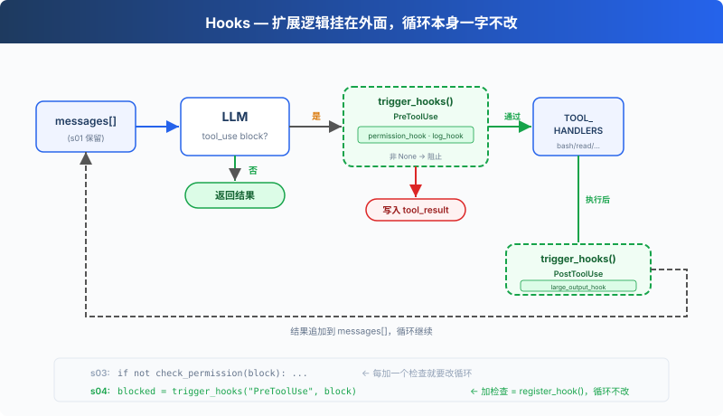

# s04: Hooks — 挂在循环上，不写进循环里

> **TS 对照版**：实现范围和跨章引用以 Python 原版为准；标识符沿用 Python。代码块摘自本章实现，可能省略 import、外层类或分支。

[English](README.md) · [中文](README.zh.md) · [日本語](README.ja.md)

s01 → s02 → s03 → `s04` → [s05](../s05_todo_write/) → s06 → ... → s16 → s17

> *"挂在循环上, 不写进循环里"* — hook 在工具执行前后注入扩展逻辑。
>
> **Harness 层**: hook — 扩展点不侵入循环。

---

## 问题

s03 的 Agent 有权限检查了。但每次加一个新检查，比如"记录每次 bash 调用"、"操作后自动 git add"，都要修改 `agent_loop` 函数。

循环很快就变成了这样：

```typescript
export async function agent_loop(messages: Anthropic.MessageParam[], client: Pick<Anthropic, 'messages'>, MODEL: string): Promise<void> {
  while (true) {
    const response = await client.messages.create({ model: MODEL, system: SYSTEM, messages, tools: TOOLS, max_tokens: 8000 });
    messages.push({ role: 'assistant', content: response.content });
    const tool_calls = response.content.filter((block) => block.type === 'tool_use');
    if (!tool_calls.length) {
      const force = await trigger_hooks('Stop', messages);
      if (force) { messages.push({ role: 'user', content: force as string }); continue; }
      return;
    }
    const results: Anthropic.ToolResultBlockParam[] = [];
    for (const block of tool_calls) {
      const blocked = await trigger_hooks('PreToolUse', block);
      if (blocked) {
        results.push({ type: 'tool_result', tool_use_id: block.id, content: python_str(blocked) });
        continue;
      }
      const handler = Object.hasOwn(TOOL_HANDLERS, block.name) ? TOOL_HANDLERS[block.name] : undefined;
      const output = handler ? await handler(block.input as ToolInput) : `Unknown: ${block.name}`;
      await trigger_hooks('PostToolUse', block, output);
      results.push({ type: 'tool_result', tool_use_id: block.id, content: output });
    }
    messages.push({ role: 'user', content: results });
  }
}
```

你想扩展的是 Agent 的行为，但你改的却是循环本身。循环应该是一个稳定的核心，扩展应该挂在外面。

---

## 解决方案



s03 的循环和权限逻辑完全保留。唯一的变动是把 `check_permission()` 从循环体内移到了 hook 上，循环不再直接调用任何检查函数，改为 `trigger_hooks("PreToolUse", block)`，由注册表决定跑什么。

四个事件，覆盖一个完整的 agent cycle：

| 事件 | 触发时机 | 典型用途 |
|------|---------|---------|
| UserPromptSubmit | 用户输入提交后、进入 LLM 前 | 输入验证、注入上下文 |
| PreToolUse | 工具执行前 | 权限检查、日志记录 |
| PostToolUse | 工具执行后 | 副作用（自动 git add 等）、输出检查 |
| Stop | 循环即将退出时 | 收尾清理、决定是否继续循环 |

扩展通过 `register_hook()` 添加，循环只调用 `trigger_hooks()`。

---

## 工作原理

**hook 注册表**：一个字典，事件名映射到回调列表。

```typescript
export const HOOKS: Record<'UserPromptSubmit' | 'PreToolUse' | 'PostToolUse' | 'Stop', Hook[]> = {
  UserPromptSubmit: [], PreToolUse: [], PostToolUse: [], Stop: [],
};

export function register_hook(event: keyof typeof HOOKS, callback: Hook): void {
  HOOKS[event].push(callback);
}

export async function trigger_hooks(event: keyof typeof HOOKS, ...args: unknown[]): Promise<unknown> {
  for (const callback of HOOKS[event]) {
    const result = await callback(...args);
    if (result !== null && result !== undefined) return result;
  }
  return null;
}
```

`PreToolUse` 返回非 `None` 时，本次工具执行被阻止；`Stop` 返回非 `None` 时，循环继续。`UserPromptSubmit` 和 `PostToolUse` 的返回值不参与控制流。

**UserPromptSubmit** 在用户输入提交后、进入 LLM 前触发。以下 hook 记录当前工作目录：

```typescript
export function context_inject_hook(_query: string): null {
  console.log(`\x1b[90m[HOOK] UserPromptSubmit: working in ${WORKDIR}\x1b[0m`);
  return null;
}
```

在主循环中，用户输入后立即触发：

```typescript
await trigger_hooks('UserPromptSubmit', query);
      history.push({ role: 'user', content: query });
      await agent_loop(history, client, MODEL);
```

**PreToolUse / PostToolUse**，工具执行前后的 hook。s03 的权限检查逻辑现在包装成 PreToolUse hook，再加一个日志 hook 和一个大输出提醒：

```typescript
export async function permission_hook(block: ToolCall): Promise<string | null> {
  const input = block.input as ToolInput;
  if (block.name === 'bash') {
    const command = ((Object.hasOwn(input, 'command') ? input.command : '')) as string;
    for (const pattern of DENY_LIST) {
      if (command.includes(pattern)) {
        console.log(`\n\x1b[31m[blocked] '${pattern}'\x1b[0m`);
        return 'Permission denied by deny list';
      }
    }
    if (contains_destructive_command(command) || DESTRUCTIVE.some((keyword) => command.includes(keyword))) {
      console.log('\n\x1b[33m[permission] Potentially destructive command\x1b[0m');
      console.log(`   Tool: ${block.name}(${python_str(input)})`);
      const choice = (await terminal?.question('   Allow? [y/N] ', { signal: input_closed }))?.trim().toLowerCase();
      if (!choice || !['y', 'yes'].includes(choice)) return 'Permission denied by user';
    }
  }
  if (['read_file', 'write_file', 'edit_file'].includes(block.name)) {
    const path = ((Object.hasOwn(input, 'path') ? input.path : '')) as string;
    if (!is_relative_to(resolve_path(path), WORKDIR)) {
      console.log('\n\x1b[33m[permission] Access outside workspace\x1b[0m');
      console.log(`   Tool: ${block.name}(${python_str(input)})`);
      const choice = (await terminal?.question('   Allow? [y/N] ', { signal: input_closed }))?.trim().toLowerCase();
      if (!choice || !['y', 'yes'].includes(choice)) return 'Permission denied by user';
    }
  }
  return null;
}

export function log_hook(block: ToolCall): null {
  const args_preview = python_str(Object.values(block.input as ToolInput).slice(0, 2)).slice(0, 60);
  console.log(`\x1b[90m[HOOK] ${block.name}(${args_preview})\x1b[0m`);
  return null;
}

export function large_output_hook(block: ToolCall, output: unknown): null {
  const length = Array.from(python_str(output)).length;
  if (length > 100000) console.log(`\x1b[33m[HOOK] Large output from ${block.name}: ${length} chars\x1b[0m`);
  return null;
}
```

**Stop** 在循环即将退出时触发。以下 hook 打印收尾统计：

```typescript
export function summary_hook(messages: Anthropic.MessageParam[]): null {
  const tool_count = messages.reduce((total, message) => total + (Array.isArray(message.content)
    ? message.content.filter((block) => block.type === 'tool_result').length : 0), 0);
  console.log(`\x1b[90m[HOOK] Stop: session used ${tool_count} tool calls\x1b[0m`);
  return null;
}
```

在 agent_loop 中，退出前触发：

```typescript
const blocked = await trigger_hooks('PreToolUse', block);
      if (blocked) {
        results.push({ type: 'tool_result', tool_use_id: block.id, content: python_str(blocked) });
        continue;
      }
      const handler = Object.hasOwn(TOOL_HANDLERS, block.name) ? TOOL_HANDLERS[block.name] : undefined;
      const output = handler ? await handler(block.input as ToolInput) : `Unknown: ${block.name}`;
      await trigger_hooks('PostToolUse', block, output);
      results.push({ type: 'tool_result', tool_use_id: block.id, content: output });
    }
```

**循环里只改了一处**：s03 直接调用 `check_permission(block)`，s04 改为 `trigger_hooks("PreToolUse", block)`：

```typescript
const tool_calls = response.content.filter((block) => block.type === 'tool_use');
    if (!tool_calls.length) {
      const force = await trigger_hooks('Stop', messages);
      if (force) { messages.push({ role: 'user', content: force as string }); continue; }
      return;
    }
```

四个 hook 覆盖了 agent cycle 的关键节点：输入→执行前→执行后→退出。循环只负责调用 trigger_hooks()，具体逻辑全在 hook 回调里。

---

## 相对 s03 的变更

| 组件 | 之前 (s03) | 之后 (s04) |
|------|-----------|-----------|
| 扩展方式 | check_permission() 硬编码在循环里 | HOOKS 注册表 + trigger_hooks() |
| 新函数 | — | register_hook, trigger_hooks |
| hook 回调 | — | context_inject_hook, permission_hook, log_hook, large_output_hook, summary_hook |
| 循环 | 直接调用 check_permission() | 调用 trigger_hooks("PreToolUse", ...) |
| 退出控制 | 无 | trigger_hooks("Stop", ...) 可阻止退出 |
| 输入拦截 | 无 | trigger_hooks("UserPromptSubmit", ...) 可注入上下文 |

---

## 试一下

```sh
cd learn-claude-code/learn-claude-code-ts
npm run s04
```

试试这些 prompt：

1. `Read the file README.md`（应该直接通过，观察 hook 日志）
2. `Create a file called test.txt`（通过后观察 PostToolUse 是否触发）
3. `Delete all temporary files in /tmp`（bash + rm 触发权限 hook）

观察重点：每次工具执行前，是否出现了 `[HOOK]` 日志？权限被拒时，是 hook 拦截的还是循环里硬编码的？

---

## 接下来

Agent 现在能安全执行操作了。但它有没有停下来想过"我应该先做什么，再做什么"？给它一个复杂任务，它是一上来就动手，还是先列个计划？

s05 TodoWrite → 给 Agent 一个计划工具。先列清单，再做。


<!-- translation-sync: zh@v1, en@v0, ja@v0 -->

## TypeScript 对齐与验证

[code.ts](code.ts) 是独立运行入口；[Python 原版](../../s04_hooks/code.py) 是行为依据。Promise/子进程 I/O 对应 Python 的同步调用与线程；文件和锁的适配以原版各章节为准。原图保持原文件名和字节。

在 TS 工程目录执行 `npm run test:s04`。差分测试通过假模型运行未修改的 Python 原版，因此还需要 Python 3 与 PyYAML。它们验证离线行为；真实 API、全部入口和全项目最终检查的状态统一记录在[对齐记录](../docs/parity-audit.md)。
