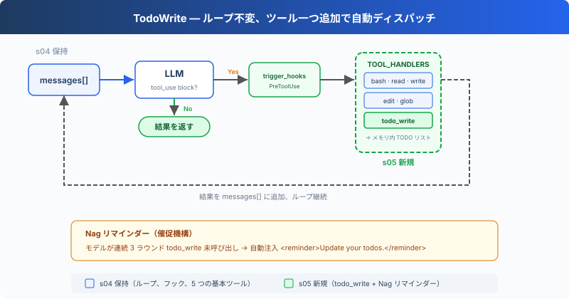

# s05: TodoWrite — 計画なき Agent は途中で道を外れる

> **TypeScript 対照版**：実装範囲と章間の参照は Python 原版に従い、識別子を保持します。コード例は実装の抜粋です。

[English](README.md) · [中文](README.zh.md) · [日本語](README.ja.md)

s01 → s02 → s03 → s04 → `s05` → [s06](../s06_subagent/) → s07 → ... → s16 → s17

> *"計画なき agent は風の向くままに"* — まず手順を列挙してから実行。長いタスクで見落としが減る。
>
> **Harness レイヤー**: 計画 — Agent が行動する前に考えさせる。

---

## 課題

Agent に複雑なタスクを与える：「全 TypeScript ファイルを snake_case にリネームし、テストを実行し、失敗を修正して。」

Agent は作業を開始する。3 つのファイルをリネーム、テストを実行、2 つの失敗を発見、修正を開始。修正しているうちに、本来の目的が「snake_case にリネーム」だったことを忘れる。テストの失敗に注意を全て持っていかれる。

会話が長くなるほど悪化する：ツールの結果がコンテキストを埋め続け、システムプロンプトの影響力が希釈される。10 ステップのリファクタリング：ステップ 1-3 を終えた時点で Agent は即興で動き始める。ステップ 4-10 は既に注意の外に追い出されているから。

---

## ソリューション



S05 は S04 のツールディスパッチ、権限チェック、Hooks を保持し、`todo_write` とリマインダーカウンターを追加する。`todo_write` は計画状態だけを更新し、実際の作業は既存のツールが行う。

新しいツールも `TOOL_HANDLERS[block.name]` を経由する。3 回連続のツール使用ラウンドで `todo_write` が呼ばれなければ、Harness は 3 回目のツール結果にリマインダーを追加する。

---

## 仕組み

**TodoManager** はメモリ上のタスクリストを保持し、更新を検証して、描画結果をモデルへ返す。`run_todo_write` は同じ状態を端末にも表示する：

```typescript
export class TodoManager {
  items: Todo[] = [];

  update(todos: unknown): string {
    if (typeof todos === 'string') {
      const serialized = todos;
      try { todos = JSON.parse(serialized); }
      catch {
        try { todos = literal_eval(serialized); } catch { throw new Error('todos must be a list or JSON array string'); }
      }
    }
    if (!Array.isArray(todos)) throw new Error('todos must be a list');
    if (todos.length > 20) throw new Error('Max 20 todos allowed');
    const validated: Todo[] = [];
    let in_progress_count = 0;
    for (const [index, todo] of todos.entries()) {
      if (!is_python_dict(todo)) throw new Error(`todos[${index}] must be an object`);
      const input = todo as Record<string, unknown>;
      const content = python_str(Object.hasOwn(input, 'content') ? input.content : '').trim();
      const status = python_str(Object.hasOwn(input, 'status') ? input.status : 'pending').toLowerCase();
      if (!content) throw new Error(`todos[${index}] requires content`);
      if (!['pending', 'in_progress', 'completed'].includes(status)) throw new Error(`todos[${index}] has invalid status '${status}'`);
      if (status === 'in_progress') in_progress_count += 1;
      validated.push({ content, status: status as Todo['status'] });
    }
    if (in_progress_count > 1) throw new Error('Only one todo can be in_progress at a time');
    this.items = validated;
    return this.render();
  }

  render(): string {
    if (!this.items.length) return 'No todos.';
    const lines: string[] = [];
    for (const todo of this.items) {
      const marker = { pending: '[ ]', in_progress: '[>]', completed: '[x]' }[todo.status];
      lines.push(`${marker} ${todo.content}`);
    }
    const done = this.items.filter((todo) => todo.status === 'completed').length;
    lines.push(`\n(${done}/${this.items.length} completed)`);
    return lines.join('\n');
  }
}
```

1 回の更新は最大 20 項目で、各項目には空でない `content` が必要となり、`in_progress` にできる項目は同時に 1 つだけ。文字列入力は JSON または Python のリスト表現として、`eval` を使わずに解析する。

ツール定義は他の 5 つと一緒にディスパッチマップに追加される：

```typescript
export const TOOLS: Anthropic.Tool[] = [
  { name: 'bash', description: 'Run a shell command.',
    input_schema: { type: 'object', properties: { command: { type: 'string' } }, required: ['command'] } },
  { name: 'read_file', description: 'Read file contents.',
    input_schema: { type: 'object', properties: { path: { type: 'string' }, limit: { type: 'integer' } }, required: ['path'] } },
  { name: 'write_file', description: 'Write content to a file.',
    input_schema: { type: 'object', properties: { path: { type: 'string' }, content: { type: 'string' } }, required: ['path', 'content'] } },
  { name: 'edit_file', description: 'Replace exact text in a file once.',
    input_schema: { type: 'object', properties: { path: { type: 'string' }, old_text: { type: 'string' }, new_text: { type: 'string' } }, required: ['path', 'old_text', 'new_text'] } },
  { name: 'glob', description: 'Find files matching a glob pattern; ** matches recursively.',
    input_schema: { type: 'object', properties: { pattern: { type: 'string' } }, required: ['pattern'] } },
  { name: 'todo_write', description: 'Create and manage a task list for your current coding session.',
    input_schema: { type: 'object', properties: { todos: { type: 'array', maxItems: 20, items: { type: 'object',
      properties: { content: { type: 'string', minLength: 1 }, status: { type: 'string', enum: ['pending', 'in_progress', 'completed'] } },
      required: ['content', 'status'] } } }, required: ['todos'] } },
];

export const TOOL_HANDLERS: Record<string, (input: ToolInput) => string> = {
  bash: (input: Record<string, unknown>) => (bind_kwargs(input, ["command"], ["command"], "run_bash"), run_bash(input.command as string)),
  read_file: (input: Record<string, unknown>) => (bind_kwargs(input, ["path","limit"], ["path"], "run_read"), run_read(input.path as string, input.limit as number | undefined)),
  write_file: (input: Record<string, unknown>) => (bind_kwargs(input, ["path","content"], ["path","content"], "run_write"), run_write(input.path as string, input.content as string)),
  edit_file: (input: Record<string, unknown>) => (bind_kwargs(input, ["path","old_text","new_text"], ["path","old_text","new_text"], "run_edit"), run_edit(input.path as string, input.old_text as string, input.new_text as string)),
  glob: (input: Record<string, unknown>) => (bind_kwargs(input, ["pattern"], ["pattern"], "run_glob"), run_glob(input.pattern as string)),
  todo_write: (input: Record<string, unknown>) => (bind_kwargs(input, ["todos"], ["todos"], "run_todo_write"), run_todo_write(input.todos)),
};
```

**リマインダー**：3 回連続のツール使用ラウンドで `todo_write` が呼ばれなければ、リマインダーを 3 回目の結果に追加し、カウンターをリセットする：

```typescript
rounds_since_todo = used_todo ? 0 : rounds_since_todo + 1;
    if (rounds_since_todo >= 3) {
      results.push({ type: 'text', text: '<reminder>Update your todos.</reminder>' });
      rounds_since_todo = 0;
    }
```

Agent がタスクを受け取った後の典型的な流れ：まず `todo_write` を呼び出して全手順を列挙（全て `pending`）→ 一つの手順に取り掛かり、`in_progress` に変更 → 完了したら `completed` に変更 → 次の `pending` を見る → 続行。

**重要な洞察**：todo_write は Agent に**実行能力**を何も追加しない。追加するのは**計画能力**だ。

---

## s04 からの変更

| コンポーネント | 変更前 (s04) | 変更後 (s05) |
|--------------|-------------|-------------|
| ツール数 | 5 (bash, read, write, edit, glob) | 6 (+todo_write) |
| 計画能力 | なし | ステータス付き TODO リスト + リマインダー |
| SYSTEM プロンプト | 汎用プロンプト | 「先に計画してから実行」のガイダンスを追加 |
| ループ | ツールディスパッチと Hooks | 同じ分配経路に rounds_since_todo とリマインダー注入を追加 |

---

## 試してみよう

```sh
cd learn-claude-code/learn-claude-code-ts
npm run s05
```

以下のプロンプトを試してみよう：

1. `Refactor s05_todo_write/example/hello.ts: add explicit types, JSDoc, and a main guard`（まず 3 手順を列挙してから実行するはず）
2. `Create a TypeScript module under s05_todo_write/example/demo_pkg with index.ts, utils.ts, and tests/utils.test.ts`
3. `Review TypeScript files under s05_todo_write/example and fix any style issues`

観察のポイント：最初のツール呼び出しは `todo_write` か？ TODO は何手順列挙されたか？ 実行中にステータスが `pending` から `in_progress` / `completed` に変わったか？

---

## 次へ

Agent は計画できるようになった。しかしタスクが大きすぎる場合、例えば「認証モジュール全体をリファクタリング」、TODO リストだけでは不十分。そのタスク自体が数十のサブタスクの集合体で、同じ会話のコンテキストに押し込めると溢れてしまう。

→ s06 Subagent：大きなタスクをサブタスクに分割し、それぞれを独立した Agent に任せる。それぞれが独自のクリーンなコンテキストを持ち、相互汚染がない。


<!-- translation-sync: zh@v1, en@v1, ja@v1 -->

## TypeScript の検証

実行入口は [code.ts](code.ts)、参照実装は [Python 原版](../../s05_todo_write/code.py) です。章のテストは `npm run test:s05`。差分テストには Python 3 と PyYAML が必要です。全体の検証状況は[対照記録](../docs/parity-audit.md)を参照してください。
