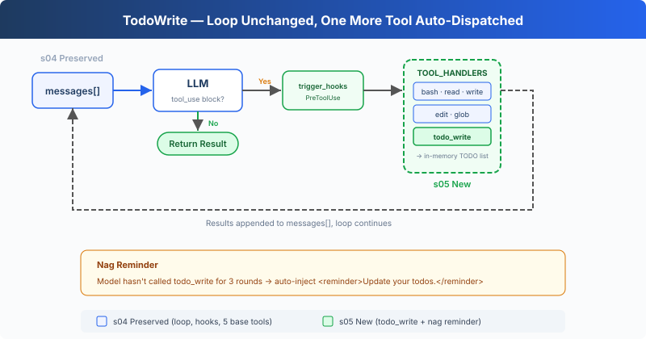

# s05: TodoWrite — An Agent Without a Plan Drifts Off Course

> **TypeScript reference edition**: implementation boundaries and chapter imports follow Python. Identifiers are preserved. Code blocks are implementation excerpts and may omit enclosing declarations.

[English](README.md) · [中文](README.zh.md) · [日本語](README.ja.md)

s01 → s02 → s03 → s04 → `s05` → [s06](../s06_subagent/) → s07 → ... → s16 → s17

> *"An agent without a plan goes wherever the wind blows"* — List the steps first, then execute. Complex tasks are less likely to miss steps.
>
> **Harness Layer**: Planning — Let the Agent think before it acts.

---

## The Problem

Give the Agent a complex task: "Rename all TypeScript files to snake_case, run tests, and fix failures."

The Agent starts working, renames 3 files, runs a test, finds 2 failures, starts fixing. While fixing, it forgets the original goal was "rename to snake_case", the test failures have consumed all its attention.

The longer the conversation, the worse it gets: tool results keep filling the context, diluting the system prompt's influence. A 10-step refactoring: after steps 1-3, the Agent starts improvising because steps 4-10 have been pushed out of its attention.

---

## The Solution



S05 keeps the tool dispatch, permissions, and hooks from S04, then adds `todo_write` and a reminder counter. `todo_write` only updates planning state; the existing tools still perform the work.

The new tool uses the same `TOOL_HANDLERS[block.name]` dispatch path. After three consecutive tool-use rounds without `todo_write`, the harness adds a reminder to that round's tool results.

---

## How It Works

**TodoManager** owns the in-memory list, validates updates, and renders the state returned to the model. `run_todo_write` also prints that state in the terminal:

```typescript
export class TodoManager {
  items: Todo[] = [];

  update(todos: unknown): string {
    if (typeof todos === 'string') {
      const serialized = todos;
      try { todos = JSON.parse(serialized); }
      catch {
        try { todos = literal_eval(serialized); } catch { throw new Error('todos must be a list or JSON array string'); }
      }
    }
    if (!Array.isArray(todos)) throw new Error('todos must be a list');
    if (todos.length > 20) throw new Error('Max 20 todos allowed');
    const validated: Todo[] = [];
    let in_progress_count = 0;
    for (const [index, todo] of todos.entries()) {
      if (!is_python_dict(todo)) throw new Error(`todos[${index}] must be an object`);
      const input = todo as Record<string, unknown>;
      const content = python_str(Object.hasOwn(input, 'content') ? input.content : '').trim();
      const status = python_str(Object.hasOwn(input, 'status') ? input.status : 'pending').toLowerCase();
      if (!content) throw new Error(`todos[${index}] requires content`);
      if (!['pending', 'in_progress', 'completed'].includes(status)) throw new Error(`todos[${index}] has invalid status '${status}'`);
      if (status === 'in_progress') in_progress_count += 1;
      validated.push({ content, status: status as Todo['status'] });
    }
    if (in_progress_count > 1) throw new Error('Only one todo can be in_progress at a time');
    this.items = validated;
    return this.render();
  }

  render(): string {
    if (!this.items.length) return 'No todos.';
    const lines: string[] = [];
    for (const todo of this.items) {
      const marker = { pending: '[ ]', in_progress: '[>]', completed: '[x]' }[todo.status];
      lines.push(`${marker} ${todo.content}`);
    }
    const done = this.items.filter((todo) => todo.status === 'completed').length;
    lines.push(`\n(${done}/${this.items.length} completed)`);
    return lines.join('\n');
  }
}
```

An update may contain at most 20 items, each item needs non-empty `content`, and only one item may be `in_progress`. The string input path accepts JSON or a Python list representation without using `eval`.

The tool definition joins the other 5 in the dispatch map:

```typescript
export const TOOLS: Anthropic.Tool[] = [
  { name: 'bash', description: 'Run a shell command.',
    input_schema: { type: 'object', properties: { command: { type: 'string' } }, required: ['command'] } },
  { name: 'read_file', description: 'Read file contents.',
    input_schema: { type: 'object', properties: { path: { type: 'string' }, limit: { type: 'integer' } }, required: ['path'] } },
  { name: 'write_file', description: 'Write content to a file.',
    input_schema: { type: 'object', properties: { path: { type: 'string' }, content: { type: 'string' } }, required: ['path', 'content'] } },
  { name: 'edit_file', description: 'Replace exact text in a file once.',
    input_schema: { type: 'object', properties: { path: { type: 'string' }, old_text: { type: 'string' }, new_text: { type: 'string' } }, required: ['path', 'old_text', 'new_text'] } },
  { name: 'glob', description: 'Find files matching a glob pattern; ** matches recursively.',
    input_schema: { type: 'object', properties: { pattern: { type: 'string' } }, required: ['pattern'] } },
  { name: 'todo_write', description: 'Create and manage a task list for your current coding session.',
    input_schema: { type: 'object', properties: { todos: { type: 'array', maxItems: 20, items: { type: 'object',
      properties: { content: { type: 'string', minLength: 1 }, status: { type: 'string', enum: ['pending', 'in_progress', 'completed'] } },
      required: ['content', 'status'] } } }, required: ['todos'] } },
];

export const TOOL_HANDLERS: Record<string, (input: ToolInput) => string> = {
  bash: (input: Record<string, unknown>) => (bind_kwargs(input, ["command"], ["command"], "run_bash"), run_bash(input.command as string)),
  read_file: (input: Record<string, unknown>) => (bind_kwargs(input, ["path","limit"], ["path"], "run_read"), run_read(input.path as string, input.limit as number | undefined)),
  write_file: (input: Record<string, unknown>) => (bind_kwargs(input, ["path","content"], ["path","content"], "run_write"), run_write(input.path as string, input.content as string)),
  edit_file: (input: Record<string, unknown>) => (bind_kwargs(input, ["path","old_text","new_text"], ["path","old_text","new_text"], "run_edit"), run_edit(input.path as string, input.old_text as string, input.new_text as string)),
  glob: (input: Record<string, unknown>) => (bind_kwargs(input, ["pattern"], ["pattern"], "run_glob"), run_glob(input.pattern as string)),
  todo_write: (input: Record<string, unknown>) => (bind_kwargs(input, ["todos"], ["todos"], "run_todo_write"), run_todo_write(input.todos)),
};
```

**Reminder**: after three tool-use rounds without `todo_write`, the reminder is appended to the third round's results and the counter resets:

```typescript
rounds_since_todo = used_todo ? 0 : rounds_since_todo + 1;
    if (rounds_since_todo >= 3) {
      results.push({ type: 'text', text: '<reminder>Update your todos.</reminder>' });
      rounds_since_todo = 0;
    }
```

Typical flow when the Agent receives a task: first call `todo_write` to list all steps (all `pending`) → pick one step, set it to `in_progress` → complete it, set to `completed` → look at the next `pending` → continue.

**Key insight**: todo_write doesn't give the Agent any additional **execution capability**. What it adds is **planning capability**.

---

## Changes from s04

| Component | Before (s04) | After (s05) |
|-----------|-------------|-------------|
| Tool count | 5 (bash, read, write, edit, glob) | 6 (+todo_write) |
| Planning | None | Stateful TODO list + reminder |
| SYSTEM prompt | Generic prompt | Added "plan before executing" guidance |
| Loop | Tool dispatch and hooks | Same dispatch path, plus rounds_since_todo and reminder injection |

---

## Try It

```sh
cd learn-claude-code/learn-claude-code-ts
npm run s05
```

Try these prompts:

1. `Refactor s05_todo_write/example/hello.ts: add explicit types, JSDoc, and a main guard` (should list 3 steps first, then execute)
2. `Create a TypeScript module under s05_todo_write/example/demo_pkg with index.ts, utils.ts, and tests/utils.test.ts`
3. `Review TypeScript files under s05_todo_write/example and fix any style issues`

What to watch for: Was the first tool call `todo_write`? How many TODO steps were listed? Did statuses move from `pending` to `in_progress` / `completed` during execution?

---

## What's Next

The Agent can plan now. But if a task is too large, say "refactor the entire auth module", a TODO list alone isn't enough. That task is itself a collection of dozens of subtasks that would drown in a single conversation's context.

→ s06 Subagent: Break large tasks into subtasks, each handled by an independent Agent with its own clean context, no cross-contamination.


<!-- translation-sync: zh@v1, en@v1, ja@v1 -->

## TypeScript verification

Run [code.ts](code.ts) with `npm run s05` and tests with `npm run test:s05`. Differential tests execute the unmodified [Python reference](../../s05_todo_write/code.py) with fake model responses and require Python 3 and PyYAML. See the [alignment audit](../docs/parity-audit.md) for full-project and live-API verification status.
