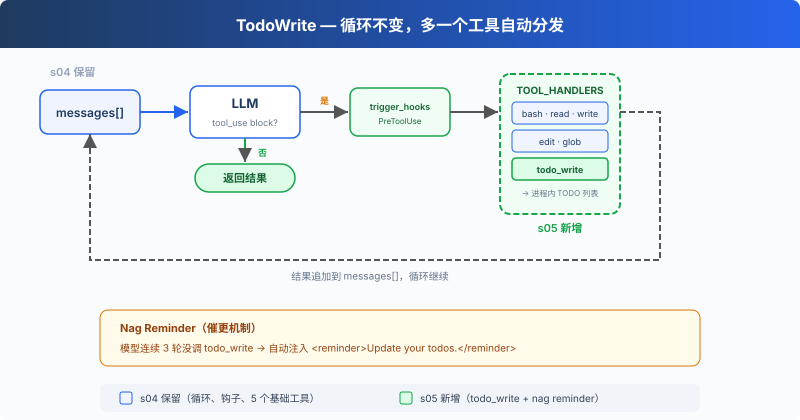

# s05: TodoWrite — 没有计划的 Agent，做着做着就偏了

> **TS 对照版**：实现范围和跨章引用以 Python 原版为准；标识符沿用 Python。代码块摘自本章实现，可能省略 import、外层类或分支。

[English](README.md) · [中文](README.zh.md) · [日本語](README.ja.md)

s01 → s02 → s03 → s04 → `s05` → [s06](../s06_subagent/) → s07 → ... → s16 → s17

> *"没有计划的 agent 走哪算哪"* — 先列步骤再动手，长任务更不容易漏项。
>
> **Harness 层**: 规划 — 让 Agent 在动手之前先想清楚。

---

## 问题

给 Agent 一个复杂任务："把所有 TypeScript 文件改成 snake_case 命名，然后跑测试，修好失败。"

Agent 开始干活，改了 3 个文件，跑了个测试，发现 2 个失败，开始修。修着修着，它忘了最初是"改成 snake_case"，测试失败把注意力全吸走了。

对话越长越严重：工具结果不断填满上下文，系统提示的影响力被稀释。一个 10 步重构，做完 1-3 步就开始即兴发挥，因为 4-10 步已经被挤出注意力了。

---

## 解决方案



S05 保留 S04 的工具分发、权限检查和 Hooks，再加入 `todo_write` 与 reminder 计数器。`todo_write` 只更新计划状态，实际工作仍由原有工具完成。

新工具仍通过 `TOOL_HANDLERS[block.name]` 分发。连续三个工具调用轮次没有使用 `todo_write` 时，Harness 会把 reminder 追加到第三轮的工具结果中。

---

## 工作原理

**TodoManager** 持有内存中的任务列表，负责校验更新，并把渲染结果返回给模型。`run_todo_write` 同时把这份状态打印到终端：

```typescript
export class TodoManager {
  items: Todo[] = [];

  update(todos: unknown): string {
    if (typeof todos === 'string') {
      const serialized = todos;
      try { todos = JSON.parse(serialized); }
      catch {
        try { todos = literal_eval(serialized); } catch { throw new Error('todos must be a list or JSON array string'); }
      }
    }
    if (!Array.isArray(todos)) throw new Error('todos must be a list');
    if (todos.length > 20) throw new Error('Max 20 todos allowed');
    const validated: Todo[] = [];
    let in_progress_count = 0;
    for (const [index, todo] of todos.entries()) {
      if (!is_python_dict(todo)) throw new Error(`todos[${index}] must be an object`);
      const input = todo as Record<string, unknown>;
      const content = python_str(Object.hasOwn(input, 'content') ? input.content : '').trim();
      const status = python_str(Object.hasOwn(input, 'status') ? input.status : 'pending').toLowerCase();
      if (!content) throw new Error(`todos[${index}] requires content`);
      if (!['pending', 'in_progress', 'completed'].includes(status)) throw new Error(`todos[${index}] has invalid status '${status}'`);
      if (status === 'in_progress') in_progress_count += 1;
      validated.push({ content, status: status as Todo['status'] });
    }
    if (in_progress_count > 1) throw new Error('Only one todo can be in_progress at a time');
    this.items = validated;
    return this.render();
  }

  render(): string {
    if (!this.items.length) return 'No todos.';
    const lines: string[] = [];
    for (const todo of this.items) {
      const marker = { pending: '[ ]', in_progress: '[>]', completed: '[x]' }[todo.status];
      lines.push(`${marker} ${todo.content}`);
    }
    const done = this.items.filter((todo) => todo.status === 'completed').length;
    lines.push(`\n(${done}/${this.items.length} completed)`);
    return lines.join('\n');
  }
}
```

一次更新最多包含 20 项；每项都必须有非空的 `content`；同一时间只能有一个 `in_progress`。字符串输入可以是 JSON，也可以是 Python 列表表示，解析过程不使用 `eval`。

工具定义和其他 5 个工具一起加入 dispatch map：

```typescript
export const TOOLS: Anthropic.Tool[] = [
  { name: 'bash', description: 'Run a shell command.',
    input_schema: { type: 'object', properties: { command: { type: 'string' } }, required: ['command'] } },
  { name: 'read_file', description: 'Read file contents.',
    input_schema: { type: 'object', properties: { path: { type: 'string' }, limit: { type: 'integer' } }, required: ['path'] } },
  { name: 'write_file', description: 'Write content to a file.',
    input_schema: { type: 'object', properties: { path: { type: 'string' }, content: { type: 'string' } }, required: ['path', 'content'] } },
  { name: 'edit_file', description: 'Replace exact text in a file once.',
    input_schema: { type: 'object', properties: { path: { type: 'string' }, old_text: { type: 'string' }, new_text: { type: 'string' } }, required: ['path', 'old_text', 'new_text'] } },
  { name: 'glob', description: 'Find files matching a glob pattern; ** matches recursively.',
    input_schema: { type: 'object', properties: { pattern: { type: 'string' } }, required: ['pattern'] } },
  { name: 'todo_write', description: 'Create and manage a task list for your current coding session.',
    input_schema: { type: 'object', properties: { todos: { type: 'array', maxItems: 20, items: { type: 'object',
      properties: { content: { type: 'string', minLength: 1 }, status: { type: 'string', enum: ['pending', 'in_progress', 'completed'] } },
      required: ['content', 'status'] } } }, required: ['todos'] } },
];

export const TOOL_HANDLERS: Record<string, (input: ToolInput) => string> = {
  bash: (input: Record<string, unknown>) => (bind_kwargs(input, ["command"], ["command"], "run_bash"), run_bash(input.command as string)),
  read_file: (input: Record<string, unknown>) => (bind_kwargs(input, ["path","limit"], ["path"], "run_read"), run_read(input.path as string, input.limit as number | undefined)),
  write_file: (input: Record<string, unknown>) => (bind_kwargs(input, ["path","content"], ["path","content"], "run_write"), run_write(input.path as string, input.content as string)),
  edit_file: (input: Record<string, unknown>) => (bind_kwargs(input, ["path","old_text","new_text"], ["path","old_text","new_text"], "run_edit"), run_edit(input.path as string, input.old_text as string, input.new_text as string)),
  glob: (input: Record<string, unknown>) => (bind_kwargs(input, ["pattern"], ["pattern"], "run_glob"), run_glob(input.pattern as string)),
  todo_write: (input: Record<string, unknown>) => (bind_kwargs(input, ["todos"], ["todos"], "run_todo_write"), run_todo_write(input.todos)),
};
```

**Reminder**：连续三个工具调用轮次没有使用 `todo_write` 时，reminder 会追加到第三轮的结果中，随后计数器清零：

```typescript
rounds_since_todo = used_todo ? 0 : rounds_since_todo + 1;
    if (rounds_since_todo >= 3) {
      results.push({ type: 'text', text: '<reminder>Update your todos.</reminder>' });
      rounds_since_todo = 0;
    }
```

Agent 收到任务后的典型流程：先调 `todo_write` 列出所有步骤（全 `pending`）→ 做一个步骤，改成 `in_progress` → 做完改成 `completed` → 看下一个 `pending` → 继续。

**关键洞察**：todo_write 不给 Agent 增加任何**执行能力**。它增加的是**规划能力**。

---

## 相对 s04 的变更

| 组件 | 之前 (s04) | 之后 (s05) |
|------|-----------|-----------|
| 工具数量 | 5 (bash, read, write, edit, glob) | 6 (+todo_write) |
| 规划能力 | 无 | 带状态的 TODO 列表 + reminder |
| SYSTEM 提示 | 通用提示 | 加入 "先计划再执行" 引导 |
| 循环 | 工具分发与 Hooks | 保留分发路径，加入 rounds_since_todo 和 reminder 注入 |

---

## 试一下

```sh
cd learn-claude-code/learn-claude-code-ts
npm run s05
```

试试这些 prompt：

1. `Refactor s05_todo_write/example/hello.ts: add explicit types, JSDoc, and a main guard`（先列 3 步再执行）
2. `Create a TypeScript module under s05_todo_write/example/demo_pkg with index.ts, utils.ts, and tests/utils.test.ts`
3. `Review TypeScript files under s05_todo_write/example and fix any style issues`

观察重点：第一次工具调用是不是 `todo_write`？TODO 列了几步？执行过程中状态有没有从 `pending` 变成 `in_progress` / `completed`？

---

## 接下来

Agent 能计划了。但如果一个任务太大，比如"重构整个认证模块"，光靠 TODO 列表不够。这个任务本身就是几十个小任务的集合，放在同一个对话里会被上下文淹没。

s06 Subagent → 把大任务拆成子任务，每个子任务派一个独立的 Agent。它们有自己的干净上下文，不会互相污染。


<!-- translation-sync: zh@v1, en@v1, ja@v1 -->

## TypeScript 对齐与验证

[code.ts](code.ts) 是独立运行入口；[Python 原版](../../s05_todo_write/code.py) 是行为依据。Promise/子进程 I/O 对应 Python 的同步调用与线程；文件和锁的适配以原版各章节为准。原图保持原文件名和字节。

在 TS 工程目录执行 `npm run test:s05`。差分测试通过假模型运行未修改的 Python 原版，因此还需要 Python 3 与 PyYAML。它们验证离线行为；真实 API、全部入口和全项目最终检查的状态统一记录在[对齐记录](../docs/parity-audit.md)。
