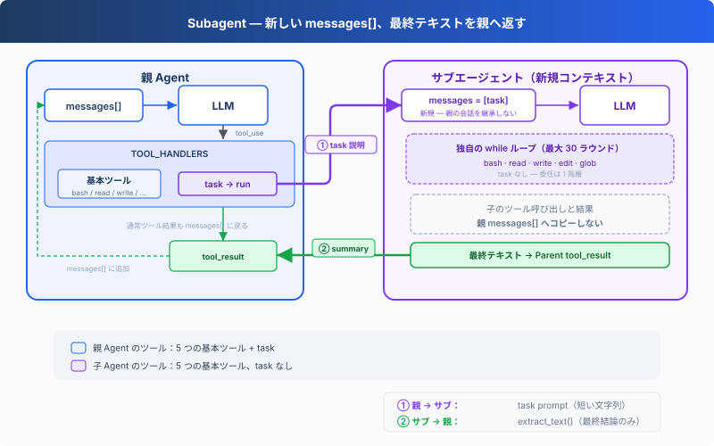

# s06: Subagent — サブタスクに独立したコンテキストを与える

> **TypeScript 対照版**：実装範囲と章間の参照は Python 原版に従い、識別子を保持します。コード例は実装の抜粋です。

[English](README.md) · [中文](README.zh.md) · [日本語](README.ja.md)

s01 → s02 → s03 → s04 → s05 → `s06` → [s07](../s07_skill_loading/) → s08 → ... → s16 → s17

> Subagent は新しい `messages[]` から始まる。最終テキストだけが親ループへ戻り、中間会話は親コンテキストへ入らない。
>
> **Harness レイヤー**: 委任 — 明確なサブタスクを別の会話コンテキストで処理する。

---

## 課題

Agent がバグを修正している。呼び出しチェーンを追うために多くのファイルを読み、すべてのツール呼び出しと結果が親の `messages[]` に残る。チェーンを把握した後は不要になる中間情報も、コンテキストを使い続ける。

---

## ソリューション



`task` を呼ぶと、新しい `messages[]` を使う入れ子の Agent Loop が同期実行される。ループが終了すると、最終テキストが親会話の tool result になる。

ここで分離するのはメッセージであり、プロセスやファイルシステムではない。親 Agent とサブエージェントは `WORKDIR` を共有するため、書き込みやコマンドは同じワークスペースへ作用する。サブエージェントは 5 つの基本ツールを持つが `task` はなく、親と同じ権限 Hooks とライフサイクル Hooks を使う。

---

## 仕組み

**run_subagent** は新しいメッセージリストを作り、入れ子のループを実行して、最終テキストを返す：

```typescript
export const SUB_TOOLS = [...BASE_TOOLS];

export const SUB_HANDLERS = { ...BASE_HANDLERS };

export async function run_subagent(prompt: string, client: Pick<Anthropic, 'messages'>, MODEL: string): Promise<string> {
  console.log('\n\x1b[35m[Subagent started]\x1b[0m');
  const messages: Anthropic.MessageParam[] = [{ role: 'user', content: prompt }];
  for (let turn = 0; turn < 30; turn += 1) {
    const response = await client.messages.create({ model: MODEL, system: SUB_SYSTEM, messages, tools: SUB_TOOLS, max_tokens: 8000 });
    messages.push({ role: 'assistant', content: response.content });
    const tool_calls = response.content.filter((block) => block.type === 'tool_use');
    if (!tool_calls.length) {
      const force = await trigger_hooks('Stop', messages);
      if (force) { messages.push({ role: 'user', content: force as string }); continue; }
      console.log('\x1b[35m[Subagent done]\x1b[0m');
      return extract_text(response.content) || '(no summary)';
    }
    const results: Anthropic.ToolResultBlockParam[] = [];
    for (const block of tool_calls) {
      const output = await execute_tool(block, SUB_HANDLERS);
      console.log(`  \x1b[90m[sub] ${block.name}: ${Array.from(output).slice(0, 100).join('')}\x1b[0m`);
      results.push({ type: 'tool_result', tool_use_id: block.id, content: output });
    }
    messages.push({ role: 'user', content: results });
  }
  console.log('\x1b[35m[Subagent stopped]\x1b[0m');
  return 'Subagent stopped after 30 turns without a final answer.';
}
```

メイン Agent の呼び出しは、他のツールと同じ：

```typescript
export const TASK_TOOL: Anthropic.Tool = {
  "name": "task",
  "description": "Run a subagent with fresh conversation context and return its final text.",
  "input_schema": {
    "type": "object",
    "properties": {
      "prompt": {
        "type": "string",
        "minLength": 1
      }
    },
    "required": [
      "prompt"
    ]
  }
};

export const TOOLS = [...BASE_TOOLS, TASK_TOOL];

export const TOOL_HANDLERS = { ...BASE_HANDLERS, task: (input: Record<string, unknown>) => (bind_kwargs(input, ["prompt"], ["prompt"], "run_subagent"), run_subagent(input.prompt as string, live_client!, live_model)) };
```

実際の境界は次のとおり：

| 決定 | 選択 | 理由 |
|------|------|------|
| 会話 | 新しい `messages[]` | 親の会話をサブエージェントへコピーしない |
| 実行 | 同じプロセスと `WORKDIR` | どちらのループからもファイル変更が見える |
| 戻り値 | 最終テキストのみ | 子のツール呼び出しと結果を親 messages へコピーしない |
| 委任の深さ | `SUB_TOOLS` に `task` なし | 本章では 1 階層の委任だけを許可 |
| ツールポリシー | Hooks を共有 | 親子で同じ権限チェックを使う |

親 Agent は他のツールと同じ handler map から `task` を実行する。サブエージェントは `SUB_SYSTEM`、`SUB_TOOLS`、ローカルな `messages` リストを使う。

---

## 試してみよう

```sh
cd learn-claude-code/learn-claude-code-ts
npm run s06
```

以下のプロンプトを試してみよう：

1. `Use a subtask to find what testing framework this project uses`（サブエージェントがファイルを読み、メイン Agent は結論のみ受け取る）
2. `Delegate: read s01_agent_loop/code.ts and s02_tool_use/code.ts and summarize what each one does`
3. `Use a task to create s06_subagent/example/string_tools.ts with a slugify(text: string) function, then verify it from the parent agent`

観察のポイント：`[Subagent started]` / `[Subagent done]` が表示されるか？ サブエージェントのツール呼び出しが `[sub] ...` と表示されるか？ 親 Agent は `task` が返した最終テキストだけを受け取るか？

---

## 次へ

Agent はタスクを分割できるようになった。しかし各タスクに必要な知識は異なる。フロントエンドコンポーネントの変更には React 規約が必要で、SQL を書くにはテーブル構造を知る必要がある。これらの知識をすべて system prompt に詰め込むと、コンテキストが溢れてしまう。

→ s07 Skill Loading：スキルをオンデマンドで注入する。system prompt にドキュメントを積み上げるのではなく、必要なときだけ読み込む。ファイルを読むのと同じくらい自然に。


<!-- translation-sync: zh@v2, en@v2, ja@v2 -->

## TypeScript の検証

実行入口は [code.ts](code.ts)、参照実装は [Python 原版](../../s06_subagent/code.py) です。章のテストは `npm run test:s06`。差分テストには Python 3 と PyYAML が必要です。全体の検証状況は[対照記録](../docs/parity-audit.md)を参照してください。
