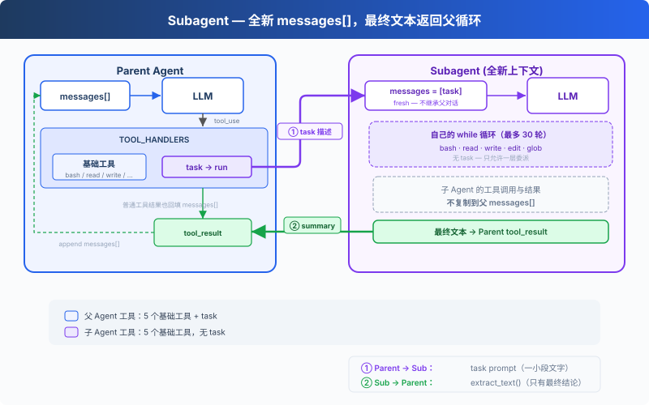

# s06: Subagent — 给子任务一段独立上下文

> **TS 对照版**：实现范围和跨章引用以 Python 原版为准；标识符沿用 Python。代码块摘自本章实现，可能省略 import、外层类或分支。

[English](README.md) · [中文](README.zh.md) · [日本語](README.ja.md)

s01 → s02 → s03 → s04 → s05 → `s06` → [s07](../s07_skill_loading/) → s08 → ... → s16 → s17

> Subagent 从全新的 `messages[]` 开始。最终文本返回父循环，中间对话不会进入父上下文。
>
> **Harness 层**: 委派 — 在另一段对话上下文中处理一个明确的子任务。

---

## 问题

Agent 在修一个 bug。为了追踪调用链，它读取了许多文件；每次工具调用和结果都会留在父循环的 `messages[]` 中。调用链已经弄清以后，多数中间细节不再需要，却仍然占用上下文。

---

## 解决方案



调用 `task` 时，会同步运行一个使用全新 `messages[]` 的嵌套 Agent Loop。循环结束后，它的最终文本会成为父对话中的工具结果。

这里隔离的是消息，不是进程或文件系统。父 Agent 与子 Agent 共享 `WORKDIR`，写文件和命令仍会影响同一个工作区。子 Agent 拥有五个基础工具，但没有 `task`；它的工具调用与父 Agent 使用同一组权限和生命周期 Hooks。

---

## 工作原理

**run_subagent** 创建新的消息列表，运行嵌套循环，并返回最终文本：

```typescript
export const SUB_TOOLS = [...BASE_TOOLS];

export const SUB_HANDLERS = { ...BASE_HANDLERS };

export async function run_subagent(prompt: string, client: Pick<Anthropic, 'messages'>, MODEL: string): Promise<string> {
  console.log('\n\x1b[35m[Subagent started]\x1b[0m');
  const messages: Anthropic.MessageParam[] = [{ role: 'user', content: prompt }];
  for (let turn = 0; turn < 30; turn += 1) {
    const response = await client.messages.create({ model: MODEL, system: SUB_SYSTEM, messages, tools: SUB_TOOLS, max_tokens: 8000 });
    messages.push({ role: 'assistant', content: response.content });
    const tool_calls = response.content.filter((block) => block.type === 'tool_use');
    if (!tool_calls.length) {
      const force = await trigger_hooks('Stop', messages);
      if (force) { messages.push({ role: 'user', content: force as string }); continue; }
      console.log('\x1b[35m[Subagent done]\x1b[0m');
      return extract_text(response.content) || '(no summary)';
    }
    const results: Anthropic.ToolResultBlockParam[] = [];
    for (const block of tool_calls) {
      const output = await execute_tool(block, SUB_HANDLERS);
      console.log(`  \x1b[90m[sub] ${block.name}: ${Array.from(output).slice(0, 100).join('')}\x1b[0m`);
      results.push({ type: 'tool_result', tool_use_id: block.id, content: output });
    }
    messages.push({ role: 'user', content: results });
  }
  console.log('\x1b[35m[Subagent stopped]\x1b[0m');
  return 'Subagent stopped after 30 turns without a final answer.';
}
```

主 Agent 调用时，跟调其他工具一样：

```typescript
export const TASK_TOOL: Anthropic.Tool = {
  "name": "task",
  "description": "Run a subagent with fresh conversation context and return its final text.",
  "input_schema": {
    "type": "object",
    "properties": {
      "prompt": {
        "type": "string",
        "minLength": 1
      }
    },
    "required": [
      "prompt"
    ]
  }
};

export const TOOLS = [...BASE_TOOLS, TASK_TOOL];

export const TOOL_HANDLERS = { ...BASE_HANDLERS, task: (input: Record<string, unknown>) => (bind_kwargs(input, ["prompt"], ["prompt"], "run_subagent"), run_subagent(input.prompt as string, live_client!, live_model)) };
```

实际边界如下：

| 决策 | 选择 | 原因 |
|------|------|------|
| 对话 | 全新的 `messages[]` | 不把父对话复制给子 Agent |
| 执行 | 同一进程和 `WORKDIR` | 两个循环都能看到文件系统修改 |
| 返回值 | 只返回最终文本 | 子 Agent 的工具调用和结果不进入父消息列表 |
| 委派深度 | `SUB_TOOLS` 中没有 `task` | 本章只允许一层委派 |
| 工具策略 | 共享 Hooks | 父子循环使用相同的权限检查 |

父 Agent 与其他工具一样，通过 handler map 分发 `task`。子 Agent 使用 `SUB_SYSTEM`、`SUB_TOOLS` 和自己的局部 `messages` 列表。

---

## 试一下

```sh
cd learn-claude-code/learn-claude-code-ts
npm run s06
```

试试这些 prompt：

1. `Use a subtask to find what testing framework this project uses`（子 Agent 去读文件，主 Agent 只收结论）
2. `Delegate: read s01_agent_loop/code.ts and s02_tool_use/code.ts and summarize what each one does`
3. `Use a task to create s06_subagent/example/string_tools.ts with a slugify(text: string) function, then verify it from the parent agent`

观察重点：是否出现 `[Subagent started]` / `[Subagent done]`？子 Agent 的工具调用是否以 `[sub] ...` 输出？父 Agent 是否只接收到 `task` 返回的最终文本？

---

## 接下来

Agent 现在能拆任务了。但每个任务需要的知识不一样：改前端组件需要知道 React 规范，写 SQL 需要知道表结构。这些知识全塞进 system prompt，上下文直接爆了。

s07 Skill Loading → 技能按需注入，不在 system prompt 里堆文档。用到的时候才加载，和读文件一样自然。


<!-- translation-sync: zh@v2, en@v2, ja@v2 -->

## TypeScript 对齐与验证

[code.ts](code.ts) 是独立运行入口；[Python 原版](../../s06_subagent/code.py) 是行为依据。Promise/子进程 I/O 对应 Python 的同步调用与线程；文件和锁的适配以原版各章节为准。原图保持原文件名和字节。

在 TS 工程目录执行 `npm run test:s06`。差分测试通过假模型运行未修改的 Python 原版，因此还需要 Python 3 与 PyYAML。它们验证离线行为；真实 API、全部入口和全项目最终检查的状态统一记录在[对齐记录](../docs/parity-audit.md)。
