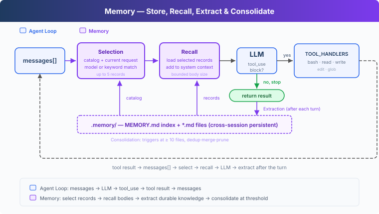
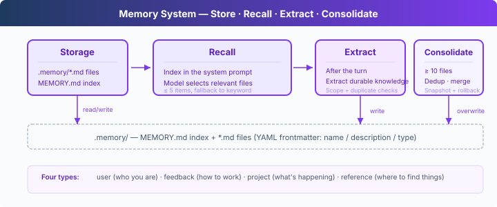

# s09: Memory — Keep Useful Knowledge Across Sessions

> **TypeScript reference edition**: implementation boundaries and chapter imports follow Python. Identifiers are preserved. Code blocks are implementation excerpts and may omit enclosing declarations.

[English](README.md) · [中文](README.zh.md) · [日本語](README.ja.md)

s01 → ... → s07 → s08 → `s09` → [s10](../s10_task_system/) → s11 → ... → s16 → s17
> *"Keep information that later tasks will need."* File storage + an index + relevance selection + on-demand recall.
>
> **Harness layer**: Memory stores reusable knowledge outside the conversation and recalls it for related tasks.

---

## The Problem

An Agent starts a new session without the previous conversation in `messages`. A coding preference, project fact, or debugging clue from an earlier session may still matter. Without persistent storage, the user has to provide it again.

A complete transcript works as an archive, but sending it with every request does not scale. The conversation keeps growing, useful information becomes hard to locate, and old facts may no longer be true. Memory must decide what is worth keeping across sessions and which records belong in the current task.



---

## Why Not Put Everything in the System Prompt?

The direct approach is to write preferences and project facts into one file, then put the entire file in the system prompt. It remembers the information, but every LLM call must resend all of it. As the store grows, more unrelated material consumes input tokens and context space.

s07 showed a better reading pattern: keep a short index available and load full content only when needed. Skills are human-authored and read-only. Memory lets the Agent extract information from conversation and reuse it in later work.

This chapter therefore needs four parts: storage, recall, extraction, and consolidation.



---

## Storage: One File per Record

Each memory is a Markdown file under `.memory/`. YAML frontmatter stores its `name`, `description`, and `type`:

```markdown
---
name: user-preference-tabs
description: User prefers tabs for indentation
type: user
---

User prefers using tabs, not spaces, for indentation.
```

There are four memory types:

| Type | What it stores | Example |
|------|----------------|---------|
| user | A durable user preference | "Use tabs for indentation" |
| feedback | Guidance that remains useful | "Do not mock the database" |
| project | A stable project fact | "The authentication rewrite is compliance-driven" |
| reference | An external pointer or lookup clue | "The pipeline issue is tracked in Linear INGEST" |

`MEMORY.md` is the index, with one line per memory file. After a write, `rebuild_memory_index()` regenerates it from the files:

```typescript
export function write_memory_file(name: string, mem_type: string, description: string, body: string): string {
  if (!name.trim()) throw new Error('Memory name cannot be empty');
  if (!(MEMORY_TYPES as readonly string[]).includes(mem_type)) throw new Error(`Unknown memory type: ${mem_type}`);
  if (!description.trim() || !body.trim()) throw new Error('Memory description and body cannot be empty');
  mkdirSync(MEMORY_DIR, { recursive: true });
  const path = memory_path(`${memory_slug(name)}.md`);
  writeFileSync(path, memory_document(name, mem_type, description, body), 'utf8');
  rebuild_memory_index();
  return path;
}
```

The index supports selection while full content stays in the individual files.

---

## Recall: Select First, Then Load Full Records

At the start of a user request, `select_relevant_memories()` sends the recent user text and memory catalog to a lightweight model call. It selects at most five relevant records:

```typescript
const prompt = 'Select memory records that are relevant to the current user request. '
    + 'Return only a JSON array of catalog indices, such as [0, 2]. Return [] when none are relevant.\n\n'
    + `Current request:\n${query}\n\nMemory catalog:\n${char_slice(catalog, 0, 12000)}`;
```

If the model call or JSON parsing fails, the code falls back to keyword matching. Only after selection does `load_memories()` read the corresponding files, with a limit on the total recalled text.

```typescript
const relevant_memories = await load_memories(messages, client, MODEL);
  const system = build_system(relevant_memories);
```

`build_system()` states that recalled content is background knowledge, not a new user command. The current request wins when it conflicts with memory. This lets the Agent use old information without letting old records issue instructions on the user's behalf.

---

## Extraction: Save Reusable Information After the Turn

Users do not always say "remember this." After the Agent finishes the current response, `extract_memories()` inspects the conversation and keeps only information likely to help later:

```typescript
const tool_calls = response.content.filter((block) => block.type === 'tool_use');
    if (!tool_calls.length) {
      const force = await trigger_hooks('Stop', messages);
      if (force) { messages.push({ role: 'user', content: force as string }); continue; }
      if (await extract_memories(messages, client, MODEL)) await consolidate_memories(client, MODEL);
      return;
    }
```

The model returns candidates, not records that are automatically allowed onto disk. Each candidate carries a `scope`: only `persistent` means that the information should survive into later sessions. `current_task` covers one-off commands, temporary paths, and temporary restrictions.

`should_store_memory()` performs the final admission check. It rejects incomplete candidates, phrases that refer to the current session or task, and duplicates of existing records. For example, "do not create files in this session" constrains the current work; it must not remain active in the next session.

---

## Consolidation: Merge Duplicate and Stale Records

As memory files accumulate, some become duplicate, contradictory, or stale. The teaching implementation calls `consolidate_memories()` after the store reaches ten records and asks the model for a cleaned list.

The code parses and validates the new list before replacing old files. It snapshots the current records first; if deletion or writing fails, it restores the originals and rebuilds the index:

```typescript
const snapshot = new Map(records.map((record) => [record.filename!, read_utf8(memory_path(record.filename!))]));
    try {
      for (const filename of python_glob('*.md', MEMORY_DIR, true)) {
        if (filename !== basename(MEMORY_INDEX)) { let path: string; try { path = memory_path(filename); } catch { continue; } unlinkSync(path); }
      }
      for (const record of consolidated) writeFileSync(memory_path(`${memory_slug(record.name)}.md`), memory_document(record.name, record.type, record.description, record.body), 'utf8');
      rebuild_memory_index();
    } catch (error) {
      for (const filename of python_glob('*.md', MEMORY_DIR, true)) {
        if (filename !== basename(MEMORY_INDEX)) { let path: string; try { path = memory_path(filename); } catch { continue; } unlinkSync(path); }
      }
      for (const [filename, content] of snapshot) writeFileSync(memory_path(filename), content, 'utf8');
      rebuild_memory_index();
      throw error;
    }
```

The course uses a simple count threshold. A real application must also choose a schedule that fits its data volume and prevent concurrent processes from rewriting the same store.

---

## This Lesson's Code

| Part | Implementation |
|------|----------------|
| Agent Loop | Keeps messages, tool calls, tool results, and hook trigger points |
| Base tools | `bash`, `read_file`, `write_file`, `edit_file`, `glob` |
| Storage | `.memory/MEMORY.md` index + `.memory/*.md` records |
| Recall | Catalog selection + keyword fallback + a body-size limit |
| Writing | End-of-turn extraction + persistence checks + duplicate filtering |
| Consolidation | Merge at the threshold; restore old files after replacement failure |

> **Boundary with s08:** s08 manages the active session's context budget. s09 manages reusable knowledge outside the conversation. Memory is selective storage, not a lossless transcript backup, and it does not replace context compaction.

---

## Try It

```sh
cd learn-claude-code/learn-claude-code-ts
npm run s09
```

1. Enter `I prefer using tabs for indentation. Remember that.` After the turn, check that `.memory/` contains a new record and `MEMORY.md` contains its index entry.
2. Enter `q`, restart the program, and ask `What indentation style do I prefer?` Confirm that a new session can recall the preference.
3. Store another preference unrelated to code formatting, then ask about indentation. Observe that the current request loads only relevant records.
4. Enter `Do not create files in this session.` Confirm that this temporary requirement does not become a persistent rule for the next session.

Exact wording and extraction counts can vary by model. Check what was written to `.memory/` and whether a later session recalls only relevant information.

---

## What's Next

Memory preserves information across sessions, but a complex task also needs durable status and dependency tracking. A TODO kept only in the conversation cannot carry progress across process restarts.

s10 Task System → Persist tasks, statuses, and dependencies to disk.

<!-- translation-sync: zh@v3, en@v3, ja@v3 -->

## TypeScript verification

Run [code.ts](code.ts) with `npm run s09` and tests with `npm run test:s09`. Differential tests execute the unmodified [Python reference](../../s09_memory/code.py) with fake model responses and require Python 3 and PyYAML. See the [alignment audit](../docs/parity-audit.md) for full-project and live-API verification status.
