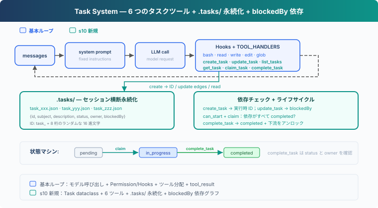
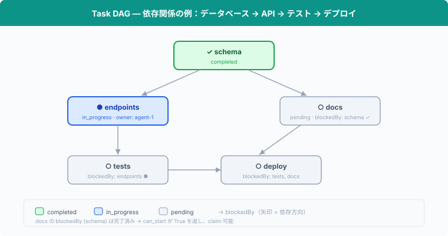

# s10: Task System — 実行チェックリストから協調できるタスク状態へ

> **TypeScript 対照版**：実装範囲と章間の参照は Python 原版に従い、識別子を保持します。コード例は実装の抜粋です。

[English](README.md) · [中文](README.zh.md) · [日本語](README.ja.md)

s01 → ... → s08 → s09 → `s10` → [s11](../s11_background_tasks/) → s12 → ... → s16 → s17

> *"大きな目標を小さなタスクに分け、順序付け、永続化"* — ファイル永続化タスクグラフ、マルチ Agent 協調の基盤。
>
> **Harness 層**: タスク — 永続化された目標、復旧可能な進捗。

---

## 課題

s05 の TodoWrite は、Agent が現在のタスクの実行手順を記録するためのものだ。各項目には内容と状態があり、次に何をするべきかを確認できる。

プロジェクトをデータベーステーブルの作成、API の実装、テストの追加という 3 つのタスクに分ける場合、Harness はそれらの関係も把握する必要がある。API はデータベーステーブルの完成を待ち、テストは API の仕様が確定するまで待たなければならない。各タスクの担当者も記録する必要がある。

TodoWrite は、こうした依存関係や担当を記録しない。「API を実装する」が未完了であることは示せても、そのタスクを開始できるかどうかを Harness が判断することはできない。

この章では Task System を追加する。各タスクは個別の ID と状態を持ち、`blockedBy` が前提タスクを、`owner` が担当する Agent を記録する。

---

## ソリューション



コードは S04 の 5 つの基本ツール、Permission、Hooks、共通の `execute_tool` を保ち、そこへ 6 つのタスクツール、`.tasks/` ディレクトリへの永続化、`blockedBy` の依存チェックを追加する。

TodoWrite vs Task System：

| | TodoWrite (s05) | Task System (s10) |
|---|---|---|
| 位置づけ | 現在のタスクの実行チェックリスト | 復旧可能なタスクシステム |
| ストレージ | プロセス内 / セッション状態 | `.tasks/{id}.json` |
| 依存関係 | なし | `blockedBy` 依存グラフ |
| ライフサイクル | 現在のセッション / 現在のタスク | セッション横断 |
| 分担 | タスクの引き受けなし | `owner` / claim |
| ステータス | pending / in_progress / completed | pending / in_progress / completed |
| 粒度 | Agent 自身の手順 | 引き受け・追跡・アンロックできるタスク |
| 更新契約 | リスト全体を置換 | 個別レコードを作成・取得・更新・一覧 |

---

## 仕組み



### Task: データ構造

各タスクは JSON ファイル、`.tasks/` ディレクトリに保存：

```typescript
export class Task {
  constructor(public id: string, public subject: string, public description: string, public status: string,
    public owner: string | null, public blockedBy: string[]) {}
}
```

ID は `task_` と 8 桁のランダムな 16 進文字で生成する。ファイルは排他的に作成し、同じ ID が存在する場合は生成し直す。

`TaskStore` はタスク ID を検証し、JSON ファイルを読み書きする。`TASKS = TaskStore(TASKS_DIR)` がこの章で使うタスクストアである。

### create_task: タスク作成

```typescript
export function create_task(subject: string, description = ''): Task { return TASKS.create(subject, description); }
```

`TaskStore.create` は subject を確認し、ランダム ID を割り当てて `.tasks/{id}.json` に書き込む。新しいタスクの `blockedBy` は常に空で、ツール結果が実行時に生成された ID をモデルへ返す。

### update_task: 返された ID で依存を追加

```typescript
export function update_task(task_id: string, addBlockedBy: string[]): Task { return TASKS.update_dependencies(task_id, addBlockedBy); }
```

タスクグラフは 2 段階で構築する。まず全ノードを作成し、その後 `create_task` が返した ID を使って `update_task` で辺を追加する。モデルが 1 回の応答で複数のツール呼び出しを出す場合、同じ階層の呼び出しはツール結果が返る前にすべて確定するため、ある `create_task` は別の呼び出しで生成されたばかりの ID を利用できない。

`update_task` は変更全体を検証してから保存する。対象と依存タスクは存在し、対象は pending かつ未所有でなければならず、自己依存や循環も禁止する。既存の辺を再度追加しても重複しない。

### can_start: 依存チェック

タスクは `blockedBy` が**すべて completed** になってからでないと開始できない：

```typescript
export function can_start(task_id: string): boolean { return !incomplete_dependencies(load_task(task_id)).length; }
```

`incomplete_dependencies` は各前提タスクを読み込む。completed でないタスクや、ファイルが存在しないタスクが一つでもあれば引き受けられない。

### claim_task: タスクを引き受ける

Agent がタスクに取り掛かる時、`claim_task` を呼び出し、`owner` を設定してステータスを `pending` → `in_progress` に変更する。`owner` フィールドは誰がタスクを引き受けたかを記録する：

```typescript
export function claim_task(task_id: string, owner = 'agent'): string {
  const task = load_task(task_id);
  if (task.status !== 'pending') return `Task ${task_id} is ${task.status}, cannot claim`;
  const dependencies = incomplete_dependencies(task);
  if (dependencies.length) return `Blocked by: ${python_str(dependencies)}`;
  task.owner = owner;
  task.status = 'in_progress';
  TASKS.save(task);
  console.log(`  [claim] ${task.subject} -> in_progress (owner: ${owner})`);
  return `Claimed ${task.id} (${task.subject})`;
}
```

タスクが pending でない場合や、依存が未完了の場合は引き受けを拒否する。S10 はタスクの状態を順番に更新する。

### complete_task: 完了とアンロック

タスク完了後、`completed` に設定。同時に他の全タスクを走査し、**直前にアンロックされた**下流タスクを特定：

```typescript
export function complete_task(task_id: string, owner = 'agent'): string {
  const task = load_task(task_id);
  if (task.status !== 'in_progress') return `Task ${task_id} is ${task.status}, cannot complete`;
  if (task.owner !== owner) return `Task ${task_id} is owned by ${task.owner}, not ${owner}`;
  const ready_before = new Set(list_tasks().filter((candidate) => candidate.status === 'pending' && candidate.blockedBy.length && can_start(candidate.id)).map((candidate) => candidate.id));
  task.status = 'completed';
  TASKS.save(task);
  const unblocked = list_tasks().filter((candidate) => candidate.status === 'pending' && candidate.blockedBy.length && !ready_before.has(candidate.id) && can_start(candidate.id)).map((candidate) => candidate.subject);
  console.log(`  [complete] ${task.subject}`);
  let message = `Completed ${task.id} (${task.subject})`;
  if (unblocked.length) { message += `\nUnblocked: ${unblocked.join(', ')}`; console.log(`  [unblocked] ${unblocked.join(', ')}`); }
  return message;
}
```

"schema" 完了後、"endpoints" と "docs" の `can_start` が True を返し、開始可能になる。

### get_task: 完全な詳細を確認

`list_tasks` は 1 行サマリのみ表示。`get_task` は description と依存関係の詳細を含む完全なタスク JSON を返す。セッションをまたいで復旧する際、Agent は完全な説明を読んで作業を継続する必要がある：

```typescript
export function get_task(task_id: string): string { return JSON.stringify(load_task(task_id), null, 2); }
```

### 状態マシン: 2 つのアクション、3 つの状態

```
pending ──claim──→ in_progress ──complete──→ completed
```

ここで `claim` / `complete` はアクション、`pending` / `in_progress` / `completed` は状態：

- **claim_task**: `pending` → `in_progress`。owner を設定し、作業を開始。
- **complete_task**: `in_progress` → `completed`。タスクを完了済みにし、下流をアンロック。

### 組み合わせて実行

```typescript
export const TOOLS: Anthropic.Tool[] = [
  {
    "name": "bash",
    "description": "Run a shell command.",
    "input_schema": {
      "type": "object",
      "properties": {
        "command": {
          "type": "string"
        }
      },
      "required": [
        "command"
      ]
    }
  },
  {
    "name": "read_file",
    "description": "Read file contents.",
    "input_schema": {
      "type": "object",
      "properties": {
        "path": {
          "type": "string"
        },
        "limit": {
          "type": "integer"
        }
      },
      "required": [
        "path"
      ]
    }
  },
  {
    "name": "write_file",
    "description": "Write content to a file.",
    "input_schema": {
      "type": "object",
      "properties": {
        "path": {
          "type": "string"
        },
        "content": {
          "type": "string"
        }
      },
      "required": [
        "path",
        "content"
      ]
    }
  },
  {
    "name": "edit_file",
    "description": "Replace exact text in a file once.",
    "input_schema": {
      "type": "object",
      "properties": {
        "path": {
          "type": "string"
        },
        "old_text": {
          "type": "string"
        },
        "new_text": {
          "type": "string"
        }
      },
      "required": [
        "path",
        "old_text",
        "new_text"
      ]
    }
  },
  {
    "name": "glob",
    "description": "Find files matching a glob pattern; ** matches recursively.",
    "input_schema": {
      "type": "object",
      "properties": {
        "pattern": {
          "type": "string"
        }
      },
      "required": [
        "pattern"
      ]
    }
  },
  {
    "name": "create_task",
    "description": "Create a task and return its runtime-generated ID.",
    "input_schema": {
      "type": "object",
      "properties": {
        "subject": {
          "type": "string"
        },
        "description": {
          "type": "string"
        }
      },
      "required": [
        "subject"
      ],
      "additionalProperties": false
    }
  },
  {
    "name": "update_task",
    "description": "Add dependencies using IDs returned by create_task.",
    "input_schema": {
      "type": "object",
      "properties": {
        "task_id": {
          "type": "string",
          "pattern": "^task_[0-9a-f]{8}$"
        },
        "addBlockedBy": {
          "type": "array",
          "items": {
            "type": "string",
            "pattern": "^task_[0-9a-f]{8}$"
          },
          "minItems": 1
        }
      },
      "required": [
        "task_id",
        "addBlockedBy"
      ],
      "additionalProperties": false
    }
  },
  {
    "name": "list_tasks",
    "description": "List tasks with status, owner, and dependencies.",
    "input_schema": {
      "type": "object",
      "properties": {}
    }
  },
  {
    "name": "get_task",
    "description": "Get a task by ID.",
    "input_schema": {
      "type": "object",
      "properties": {
        "task_id": {
          "type": "string"
        }
      },
      "required": [
        "task_id"
      ]
    }
  },
  {
    "name": "claim_task",
    "description": "Claim a pending task whose dependencies are complete.",
    "input_schema": {
      "type": "object",
      "properties": {
        "task_id": {
          "type": "string"
        }
      },
      "required": [
        "task_id"
      ]
    }
  },
  {
    "name": "complete_task",
    "description": "Complete the task claimed by this agent.",
    "input_schema": {
      "type": "object",
      "properties": {
        "task_id": {
          "type": "string"
        }
      },
      "required": [
        "task_id"
      ]
    }
  }
];

export const TOOL_HANDLERS: Record<string, (input: ToolInput) => string | Promise<string>> = {
  bash: (input: Record<string, unknown>) => (bind_kwargs(input, ["command"], ["command"], "run_bash"), run_bash(input.command as string)),
  read_file: (input: Record<string, unknown>) => (bind_kwargs(input, ["path","limit"], ["path"], "run_read"), run_read(input.path as string, input.limit as number | undefined)),
  write_file: (input: Record<string, unknown>) => (bind_kwargs(input, ["path","content"], ["path","content"], "run_write"), run_write(input.path as string, input.content as string)),
  edit_file: (input: Record<string, unknown>) => (bind_kwargs(input, ["path","old_text","new_text"], ["path","old_text","new_text"], "run_edit"), run_edit(input.path as string, input.old_text as string, input.new_text as string)),
  glob: (input: Record<string, unknown>) => (bind_kwargs(input, ["pattern"], ["pattern"], "run_glob"), run_glob(input.pattern as string)),
  create_task: (input: Record<string, unknown>) => (bind_kwargs(input, ["subject","description"], ["subject"], "run_create_task"), run_create_task(input.subject as string, input.description as string | undefined)),
  update_task: (input: Record<string, unknown>) => (bind_kwargs(input, ["task_id","addBlockedBy"], ["task_id","addBlockedBy"], "run_update_task"), run_update_task(input.task_id as string, input.addBlockedBy as string[])),
  list_tasks: (input: Record<string, unknown>) => (bind_kwargs(input, [], [], "run_list_tasks"), run_list_tasks()),
  get_task: (input: Record<string, unknown>) => (bind_kwargs(input, ["task_id"], ["task_id"], "run_get_task"), run_get_task(input.task_id as string)),
  claim_task: (input: Record<string, unknown>) => (bind_kwargs(input, ["task_id"], ["task_id"], "run_claim_task"), run_claim_task(input.task_id as string)),
  complete_task: (input: Record<string, unknown>) => (bind_kwargs(input, ["task_id"], ["task_id"], "run_complete_task"), run_complete_task(input.task_id as string)),
};
```

各 `create_task` が JSON ファイルを書き込み、`update_task`、`claim_task`、`complete_task` がファイルを更新する。セッションをまたいでも `.tasks/` ディレクトリが残り、Agent はファイルを読んで進捗を復旧できる。

---

## 試してみる

```sh
cd learn-claude-code/learn-claude-code-ts
npm run s10
```

以下のプロンプトを試してください：

1. `Create tasks: setup database schema, create API endpoints (depends on schema), write tests (depends on endpoints), write docs (depends on schema)`
2. `List all tasks and their statuses`
3. `Claim the first unblocked task and complete it`
4. `List tasks again — which ones are now unblocked?`

観察ポイント：`.tasks/` ディレクトリに JSON ファイルが生成されているか？タスク完了後、ブロックされていたタスクがアンロックされているか？

---

## 次の章

タスクグラフができても、全テストの実行、依存関係のインストール、デプロイなどのコマンドには長い時間がかかることがある。これらのコマンドを同期実行すると、Agent Loop は現在のツール呼び出しでブロックされ、コマンドが終了するまで他の処理を続けられない。

s11 Background Tasks → 遅い操作をバックグラウンドで実行する。Agent は他のタスクの処理を続け、バックグラウンド処理の完了後に通知を受け取る。


<!-- translation-sync: zh@v5, en@v5, ja@v5 -->

## TypeScript の検証

実行入口は [code.ts](code.ts)、参照実装は [Python 原版](../../s10_task_system/code.py) です。章のテストは `npm run test:s10`。差分テストには Python 3 と PyYAML が必要です。全体の検証状況は[対照記録](../docs/parity-audit.md)を参照してください。
