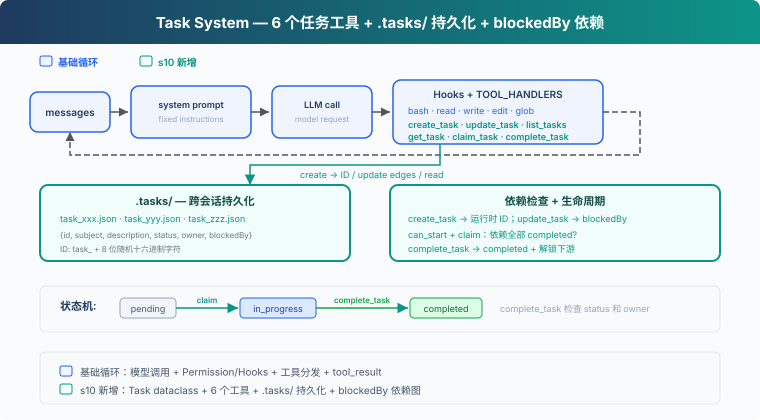
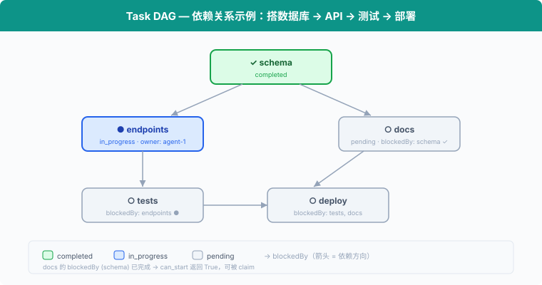

# s10: Task System — 从执行清单到可协调的任务状态

> **TS 对照版**：实现范围和跨章引用以 Python 原版为准；标识符沿用 Python。代码块摘自本章实现，可能省略 import、外层类或分支。

[English](README.md) · [中文](README.zh.md) · [日本語](README.ja.md)

s01 → ... → s08 → s09 → `s10` → [s11](../s11_background_tasks/) → s12 → ... → s16 → s17

> *"大目标拆成小任务, 排好序, 持久化"* — 文件持久化的任务图, 多 agent 协作的基础。
>
> **Harness 层**: 任务 — 持久化的目标, 可恢复的进度。

---

## 问题

s05 的 TodoWrite 让 Agent 记录当前任务的执行步骤。清单中的每一项只有内容和状态，用来提醒 Agent 接下来还要做什么。

当项目被拆成创建数据库表、编写 API 和添加测试三个任务时，Harness 还需要知道它们之间的关系：数据库表完成后才能编写 API，API 接口确定后才能添加测试。每个任务还要记录由谁负责。

TodoWrite 没有记录这些依赖和分工。它可以显示“编写 API”仍未完成，但 Harness 无法据此判断这个任务是否可以开始。

本章加入 Task System。每个任务都有独立的 ID 和状态，`blockedBy` 记录前置任务，`owner` 记录负责执行的 Agent。

---

## 解决方案



代码保留 S04 的五个基础工具、Permission、Hooks 和统一 `execute_tool`，再加入 6 个任务工具、`.tasks/` 目录持久化和 `blockedBy` 依赖检查。

TodoWrite vs Task System：

| | TodoWrite (s05) | Task System (s10) |
|---|---|---|
| 定位 | 当前任务的执行清单 | 可恢复的任务系统 |
| 存储 | 进程内 / 会话状态 | `.tasks/{id}.json` |
| 依赖 | 无 | `blockedBy` 依赖图 |
| 生命周期 | 当前会话 / 当前任务 | 跨会话保留 |
| 分工 | 不负责任务认领 | `owner` / claim |
| 状态 | pending / in_progress / completed | pending / in_progress / completed |
| 粒度 | Agent 自己的步骤 | 可被认领、追踪、解锁的任务 |
| 更新契约 | 整表替换 | 对单条记录执行创建、读取、更新、列举 |

---

## 工作原理



### Task: 数据结构

每个任务是一个 JSON 文件，存于 `.tasks/` 目录：

```typescript
export class Task {
  constructor(public id: string, public subject: string, public description: string, public status: string,
    public owner: string | null, public blockedBy: string[]) {}
}
```

ID 使用 `task_` 加 8 位随机十六进制字符生成。创建文件时使用排他写入；如果 ID 已存在，就重新生成。

`TaskStore` 负责校验任务 ID 和读写 JSON 文件，`TASKS = TaskStore(TASKS_DIR)` 是本章使用的任务存储。

### create_task: 创建任务

```typescript
export function create_task(subject: string, description = ''): Task { return TASKS.create(subject, description); }
```

`TaskStore.create` 检查 subject，分配随机 ID，再把任务写入 `.tasks/{id}.json`。新任务的 `blockedBy` 固定为空，工具结果会把运行时生成的 ID 返回给模型。

### update_task: 使用返回的 ID 添加依赖

```typescript
export function update_task(task_id: string, addBlockedBy: string[]): Task { return TASKS.update_dependencies(task_id, addBlockedBy); }
```

任务图采用两阶段构建：先创建所有节点，再使用 `create_task` 返回的 ID 调用 `update_task` 添加边。模型可能在一条回复里同时发出多个工具调用，而这些同级调用在任何工具结果产生前就已经确定，因此某个 `create_task` 无法直接使用另一个调用刚生成的 ID。

`update_task` 会先校验整次修改，再统一保存。目标任务和依赖必须存在，目标必须仍为 pending 且无人认领，并且不能形成自依赖或环。重复添加已有依赖是安全的，不会产生重复边。

### can_start: 依赖检查

一个任务只能在它的 `blockedBy` **全部 completed** 之后才能开始：

```typescript
export function can_start(task_id: string): boolean { return !incomplete_dependencies(load_task(task_id)).length; }
```

`incomplete_dependencies` 读取每个前置任务。只要有一个不是 completed，或者对应文件已经不存在，任务就不能认领。

### claim_task: 认领任务

Agent 开始做一个任务时，调用 `claim_task`：设置 `owner`，状态从 `pending` → `in_progress`。`owner` 字段记录谁认领了这个任务：

```typescript
export function claim_task(task_id: string, owner = 'agent'): string {
  const task = load_task(task_id);
  if (task.status !== 'pending') return `Task ${task_id} is ${task.status}, cannot claim`;
  const dependencies = incomplete_dependencies(task);
  if (dependencies.length) return `Blocked by: ${python_str(dependencies)}`;
  task.owner = owner;
  task.status = 'in_progress';
  TASKS.save(task);
  console.log(`  [claim] ${task.subject} -> in_progress (owner: ${owner})`);
  return `Claimed ${task.id} (${task.subject})`;
}
```

如果任务不是 pending，或者依赖没有完成，就拒绝认领。S10 只处理顺序执行的状态更新。

### complete_task: 完成与解锁

任务做完后，设为 `completed`。同时扫描所有其他任务，找出**刚刚被解锁**的下游任务：

```typescript
export function complete_task(task_id: string, owner = 'agent'): string {
  const task = load_task(task_id);
  if (task.status !== 'in_progress') return `Task ${task_id} is ${task.status}, cannot complete`;
  if (task.owner !== owner) return `Task ${task_id} is owned by ${task.owner}, not ${owner}`;
  const ready_before = new Set(list_tasks().filter((candidate) => candidate.status === 'pending' && candidate.blockedBy.length && can_start(candidate.id)).map((candidate) => candidate.id));
  task.status = 'completed';
  TASKS.save(task);
  const unblocked = list_tasks().filter((candidate) => candidate.status === 'pending' && candidate.blockedBy.length && !ready_before.has(candidate.id) && can_start(candidate.id)).map((candidate) => candidate.subject);
  console.log(`  [complete] ${task.subject}`);
  let message = `Completed ${task.id} (${task.subject})`;
  if (unblocked.length) { message += `\nUnblocked: ${unblocked.join(', ')}`; console.log(`  [unblocked] ${unblocked.join(', ')}`); }
  return message;
}
```

完成 "schema" 后，"endpoints" 和 "docs" 的 `can_start` 返回 True，它们可以开始。

### get_task: 查看完整细节

`list_tasks` 只显示一行摘要。`get_task` 返回完整的任务 JSON，包括 description 和依赖细节。跨会话恢复时，Agent 需要读取完整描述才能继续工作：

```typescript
export function get_task(task_id: string): string { return JSON.stringify(load_task(task_id), null, 2); }
```

### 状态机: 两个动作，三个状态

```
pending ──claim──→ in_progress ──complete──→ completed
```

这里的 `claim` / `complete` 是动作，`pending` / `in_progress` / `completed` 是状态：

- **claim_task**: `pending` → `in_progress`。设置 owner，开始工作。
- **complete_task**: `in_progress` → `completed`。把任务标记为完成，并解锁下游。

### 合起来跑

```typescript
export const TOOLS: Anthropic.Tool[] = [
  {
    "name": "bash",
    "description": "Run a shell command.",
    "input_schema": {
      "type": "object",
      "properties": {
        "command": {
          "type": "string"
        }
      },
      "required": [
        "command"
      ]
    }
  },
  {
    "name": "read_file",
    "description": "Read file contents.",
    "input_schema": {
      "type": "object",
      "properties": {
        "path": {
          "type": "string"
        },
        "limit": {
          "type": "integer"
        }
      },
      "required": [
        "path"
      ]
    }
  },
  {
    "name": "write_file",
    "description": "Write content to a file.",
    "input_schema": {
      "type": "object",
      "properties": {
        "path": {
          "type": "string"
        },
        "content": {
          "type": "string"
        }
      },
      "required": [
        "path",
        "content"
      ]
    }
  },
  {
    "name": "edit_file",
    "description": "Replace exact text in a file once.",
    "input_schema": {
      "type": "object",
      "properties": {
        "path": {
          "type": "string"
        },
        "old_text": {
          "type": "string"
        },
        "new_text": {
          "type": "string"
        }
      },
      "required": [
        "path",
        "old_text",
        "new_text"
      ]
    }
  },
  {
    "name": "glob",
    "description": "Find files matching a glob pattern; ** matches recursively.",
    "input_schema": {
      "type": "object",
      "properties": {
        "pattern": {
          "type": "string"
        }
      },
      "required": [
        "pattern"
      ]
    }
  },
  {
    "name": "create_task",
    "description": "Create a task and return its runtime-generated ID.",
    "input_schema": {
      "type": "object",
      "properties": {
        "subject": {
          "type": "string"
        },
        "description": {
          "type": "string"
        }
      },
      "required": [
        "subject"
      ],
      "additionalProperties": false
    }
  },
  {
    "name": "update_task",
    "description": "Add dependencies using IDs returned by create_task.",
    "input_schema": {
      "type": "object",
      "properties": {
        "task_id": {
          "type": "string",
          "pattern": "^task_[0-9a-f]{8}$"
        },
        "addBlockedBy": {
          "type": "array",
          "items": {
            "type": "string",
            "pattern": "^task_[0-9a-f]{8}$"
          },
          "minItems": 1
        }
      },
      "required": [
        "task_id",
        "addBlockedBy"
      ],
      "additionalProperties": false
    }
  },
  {
    "name": "list_tasks",
    "description": "List tasks with status, owner, and dependencies.",
    "input_schema": {
      "type": "object",
      "properties": {}
    }
  },
  {
    "name": "get_task",
    "description": "Get a task by ID.",
    "input_schema": {
      "type": "object",
      "properties": {
        "task_id": {
          "type": "string"
        }
      },
      "required": [
        "task_id"
      ]
    }
  },
  {
    "name": "claim_task",
    "description": "Claim a pending task whose dependencies are complete.",
    "input_schema": {
      "type": "object",
      "properties": {
        "task_id": {
          "type": "string"
        }
      },
      "required": [
        "task_id"
      ]
    }
  },
  {
    "name": "complete_task",
    "description": "Complete the task claimed by this agent.",
    "input_schema": {
      "type": "object",
      "properties": {
        "task_id": {
          "type": "string"
        }
      },
      "required": [
        "task_id"
      ]
    }
  }
];

export const TOOL_HANDLERS: Record<string, (input: ToolInput) => string | Promise<string>> = {
  bash: (input: Record<string, unknown>) => (bind_kwargs(input, ["command"], ["command"], "run_bash"), run_bash(input.command as string)),
  read_file: (input: Record<string, unknown>) => (bind_kwargs(input, ["path","limit"], ["path"], "run_read"), run_read(input.path as string, input.limit as number | undefined)),
  write_file: (input: Record<string, unknown>) => (bind_kwargs(input, ["path","content"], ["path","content"], "run_write"), run_write(input.path as string, input.content as string)),
  edit_file: (input: Record<string, unknown>) => (bind_kwargs(input, ["path","old_text","new_text"], ["path","old_text","new_text"], "run_edit"), run_edit(input.path as string, input.old_text as string, input.new_text as string)),
  glob: (input: Record<string, unknown>) => (bind_kwargs(input, ["pattern"], ["pattern"], "run_glob"), run_glob(input.pattern as string)),
  create_task: (input: Record<string, unknown>) => (bind_kwargs(input, ["subject","description"], ["subject"], "run_create_task"), run_create_task(input.subject as string, input.description as string | undefined)),
  update_task: (input: Record<string, unknown>) => (bind_kwargs(input, ["task_id","addBlockedBy"], ["task_id","addBlockedBy"], "run_update_task"), run_update_task(input.task_id as string, input.addBlockedBy as string[])),
  list_tasks: (input: Record<string, unknown>) => (bind_kwargs(input, [], [], "run_list_tasks"), run_list_tasks()),
  get_task: (input: Record<string, unknown>) => (bind_kwargs(input, ["task_id"], ["task_id"], "run_get_task"), run_get_task(input.task_id as string)),
  claim_task: (input: Record<string, unknown>) => (bind_kwargs(input, ["task_id"], ["task_id"], "run_claim_task"), run_claim_task(input.task_id as string)),
  complete_task: (input: Record<string, unknown>) => (bind_kwargs(input, ["task_id"], ["task_id"], "run_complete_task"), run_complete_task(input.task_id as string)),
};
```

每个 `create_task` 写一个 JSON 文件，`update_task`、`claim_task` 和 `complete_task` 更新文件。跨会话时，`.tasks/` 目录还在，Agent 读文件就能恢复进度。

---

## 试一下

```sh
cd learn-claude-code/learn-claude-code-ts
npm run s10
```

试试这些 prompt：

1. `Create tasks: setup database schema, create API endpoints (depends on schema), write tests (depends on endpoints), write docs (depends on schema)`
2. `List all tasks and their statuses`
3. `Claim the first unblocked task and complete it`
4. `List tasks again — which ones are now unblocked?`

观察重点：`.tasks/` 目录下是否生成了 JSON 文件？完成任务后，被阻塞的任务是否解锁？

---

## 接下来

任务图有了，但全量测试、安装依赖和部署等命令可能需要很长时间。同步执行这些命令时，Agent Loop 会一直停在当前工具调用上，只有命令结束后才能继续处理其他工作。

s11 Background Tasks → 把慢操作放到后台。Agent 可以继续处理其他任务，后台执行完成后再接收通知。


<!-- translation-sync: zh@v5, en@v5, ja@v5 -->

## TypeScript 对齐与验证

[code.ts](code.ts) 是独立运行入口；[Python 原版](../../s10_task_system/code.py) 是行为依据。Promise/子进程 I/O 对应 Python 的同步调用与线程；文件和锁的适配以原版各章节为准。原图保持原文件名和字节。

在 TS 工程目录执行 `npm run test:s10`。差分测试通过假模型运行未修改的 Python 原版，因此还需要 Python 3 与 PyYAML。它们验证离线行为；真实 API、全部入口和全项目最终检查的状态统一记录在[对齐记录](../docs/parity-audit.md)。
