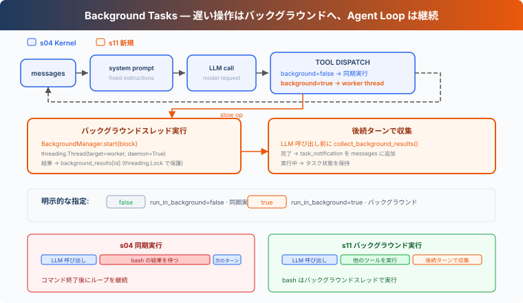

# s11: Background Tasks — 遅い操作はバックグラウンドへ

> **TypeScript 対照版**：実装範囲と章間の参照は Python 原版に従い、識別子を保持します。コード例は実装の抜粋です。

[English](README.md) · [中文](README.zh.md) · [日本語](README.ja.md)

s01 → ... → s09 → s10 → `s11` → [s12](../s12_cron_scheduler/) → s13 → ... → s16 → s17

> *"遅い操作はバックグラウンドへ、Agent Loop は処理を継続"* — バックグラウンド非同期タスクでコマンドを実行し、後続のターンで完了結果を収集する。
>
> **Harness 層**: バックグラウンド — 非同期実行、メインループをブロックしない。

---

## 課題

ファイルの読み込みや `git status` は通常すぐに返るため、同期実行でも待ち時間はほとんど気にならない。しかし、依存関係のインストール、全テストの実行、プロジェクトのビルドには数分かかることがある。コマンドが返るまで、Harness は現在のレスポンスに含まれる次のツール呼び出しを処理できず、次のターンにも進めない。

後続の作業がそのコマンドに依存しないなら、終了まで待つ必要はない。例えば全テストを開始した後も、テストの実行中にドキュメントを確認したり、別のファイルを整理したりできる。

S11 では、時間のかかる Bash コマンドをバックグラウンドで実行し、Agent Loop が他の作業を続けられるようにする。完了結果は後続のターンで収集する。

---

## ソリューション



この章では、時間のかかる操作をバックグラウンド非同期タスクに送る。現在のツール呼び出しはまずプレースホルダー `tool_result` を返すため、Agent Loop は処理を続けられる。後続のターンの開始時に完了済みの結果を収集し、通知として会話に追加する。

同期 vs バックグラウンド：

| | 同期 (s04) | バックグラウンド (s11) |
|---|---|---|
| 遅い操作 | 現在のツール呼び出しがブロックされる | バックグラウンド非同期タスクで実行 |
| Agent Loop | コマンドの返却を待つ | プレースホルダー結果を受け取って続行 |
| 結果 | コマンド終了後に返す | 先に `bg_id` を返し、後続のターンで結果を収集 |
| 判断基準 | — | bash の `run_in_background` パラメータ |

---

## 仕組み

### should_run_background: 明示的リクエスト

モデルは bash ツールの `run_in_background` パラメータでバックグラウンド実行をリクエストする。ツールが bash で、パラメータが明示的に `true` の場合だけ、この経路に入る。他の呼び出しは同期実行を続ける：

```typescript
export function should_run_background(tool_name: string, tool_input: ToolInput): boolean {
  return tool_name === 'bash' && tool_input.run_in_background === true;
}
```

`install`、`build`、`test` などのキーワードから推測しない。実行方法はツール呼び出しが明示的に選ぶ。

### BackgroundManager: バックグラウンド実行とライフサイクル

`BackgroundManager` がタスク状態と完了キューを保持する。`start()` はタスクを登録して バックグラウンド非同期タスクを起動し、すぐに `bg_id` を返す：

```typescript
export class BackgroundManager {
  tasks = new Map<string, { tool_use_id: string; command: string; status: string }>();
  results = new Map<string, string>();
  _ready: string[] = [];
  _counter = 0;

  start(block: ToolCall): string {
    if (block.name !== 'bash') throw new Error('Only Bash commands can run in the background');
    const command = (block.input as ToolInput).command;
    if (typeof command !== 'string' || !command.trim()) throw new Error('Bash command cannot be empty');
    this._counter += 1;
    const task_id = `bg_${String(this._counter).padStart(4, '0')}`;
    this.tasks.set(task_id, { tool_use_id: block.id, command, status: 'running' });
    // Promises and child-process I/O provide the concurrency of Python's daemon thread.
    try { void this._run(task_id, command); } catch (error) { this.tasks.delete(task_id); throw error; }
    console.log(`  [background] started ${task_id}: ${Array.from(command).slice(0, 60).join('')}`);
    return task_id;
  }
  async _run(task_id: string, command: string): Promise<void> {
    let result: string; let status: string;
    try {
      const [output, exit_code] = await _run_bash_process(command);
      result = _format_bash_result(output, exit_code);
      status = exit_code === 0 ? 'completed' : 'failed';
    } catch (error) { result = `Error: ${error instanceof Error ? `${error.name}: ${error.message}` : String(error)}`; status = 'failed'; }
    const task = this.tasks.get(task_id);
    if (!task) return;
    task.status = status;
    this.results.set(task_id, result);
    this._ready.push(task_id);
  }
  collect(): string[] {
    const ready: [string, { command: string; status: string }, string][] = [];
    for (const task_id of this._ready) {
      const task = this.tasks.get(task_id); this.tasks.delete(task_id);
      const result = this.results.get(task_id) ?? ''; this.results.delete(task_id);
      if (task) ready.push([task_id, task, result]);
    }
    this._ready.length = 0;
    const notifications: string[] = [];
    for (const [task_id, task, result] of ready) {
      notifications.push(`<task_notification>\n  <task_id>${task_id}</task_id>\n  <status>${task.status}</status>\n  <command>${task.command}</command>\n  <summary>${Array.from(result).slice(0, 500).join('')}</summary>\n</task_notification>`);
      console.log(`  [background] collected ${task_id}: ${task.status}`);
    }
    return notifications;
  }
}
```

command が非ゼロで終了した場合や worker で例外が起きた場合は `failed` となる。Shell は独立した process group で起動し、command の完了、timeout、または Agent が通常経路や `SIGTERM` で終了する時に元の group を停止する。これは lifecycle cleanup であって sandbox ではなく、別の session を作った process は group から離れられる。

### collect_background_results: 通知収集

後続のターンの開始時に、`collect()` が完了キューから結果を取り出し、`<task_notification>` メッセージとしてフォーマットする：

```typescript
export function collect_background_results(): string[] { return BACKGROUND.collect(); }
```

通知は元の `tool_use_id` を再利用しない。元のツール呼び出しはプレースホルダー `tool_result` で応答済みであり、完了結果を収集した時点で `task_notification` 形式の独立したイベントとして会話に追加する。1 つの `tool_use` に対応する `tool_result` は 1 つのままである。

### ループ統合

各 LLM 呼び出しの前に、Agent Loop は完了済みのバックグラウンド結果を収集する。`execute_tool()` は引き続きフォアグラウンドターンで `PreToolUse` を実行し、その後で同期実行かバックグラウンド実行かを選ぶ：

```typescript
export async function execute_tool(block: ToolCall): Promise<string> {
  const blocked = await trigger_hooks('PreToolUse', block);
  if (blocked !== null && blocked !== undefined) return python_str(blocked);
  let output: string;
  if (should_run_background(block.name, block.input as ToolInput)) {
    try {
      const task_id = start_background_task(block);
      output = `[Background task ${task_id} started] The result will be collected on a later turn.`;
    } catch (error) { output = `Error: ${error instanceof Error ? error.message : String(error)}`; }
  } else output = await call_tool(block);
  await trigger_hooks('PostToolUse', block, output);
  return output;
}
```

遅い操作はまず `bg_id` 付きプレースホルダー tool_result を返す。バックグラウンドタスクの完了だけでは Agent は起動せず、次に Agent Loop が動く時に `inject_background_results()` が結果を収集する。

### 組み合わせて実行

```
Turn 1:
  LLM → bash "npm install" (run_in_background=true)
  → start_background_task → bg_0001
  → tool_result: "[Background task bg_0001 started]..."
  → LLM: "OK, I'll check later. Let me also read the config."

Turn 2:
  LLM → read_file "package.json" (fast, sync)
  → tool_result: file content

Turn 3:
  → collect bg_0001 as <task_notification>
  → LLM sees: config file + install notification in one message
```

npm install がバックグラウンドで実行されている間、Agent Loop は read_file を続けて実行した。

---

## s11 で追加するもの

| コンポーネント | S04 Kernel | S11 |
|--------------|------------|------------|
| 実行モデル | すべて同期 | 遅い操作はバックグラウンド非同期タスク + 通知注入 |
| bash スキーマ | `command` | `command` + `run_in_background` |
| 新規関数 | — | `should_run_background`, `start_background_task`, `collect_background_results`, `inject_background_results` |
| 新規型 | — | `BackgroundManager` |
| 通知形式 | — | `<task_notification>`（tool_use_id を再利用しない） |
| ループ動作 | ツールを同期実行 | 明示的なバックグラウンド実行、後続のターンで完了結果を収集 |
| ツール | 5 | 5（bash スキーマにパラメータを 1 つ追加） |

---

## 試してみる

```sh
cd learn-claude-code/learn-claude-code-ts
npm run s11
```

以下のプロンプトを試してください：

1. `Run npm list --depth=0 in the background and find all TypeScript files in this directory`
2. `Run npm install (use run_in_background) and while waiting, read package.json`
3. `Run a short sleep in the background, then list all Markdown files`

観察ポイント：`run_in_background` を明示的に設定すると、コマンドがバックグラウンドに送られるか？`bg_id` は返されるか？後続のターンで完了結果が `<task_notification>` 形式で収集されるか？

---

## 次の章

バックグラウンドタスクは「遅い操作がブロックしない」を解決した。しかし、定期的に何かをしたい場合は？例えば「毎朝 9 時にテストを実行」「5 分ごとにサーバーステータスを確認」。

s12 Cron Scheduler → Agent にアラームクロックを付ける。


<!-- translation-sync: zh@v7, en@v7, ja@v7 -->

## TypeScript の検証

実行入口は [code.ts](code.ts)、参照実装は [Python 原版](../../s11_background_tasks/code.py) です。章のテストは `npm run test:s11`。差分テストには Python 3 と PyYAML が必要です。全体の検証状況は[対照記録](../docs/parity-audit.md)を参照してください。
