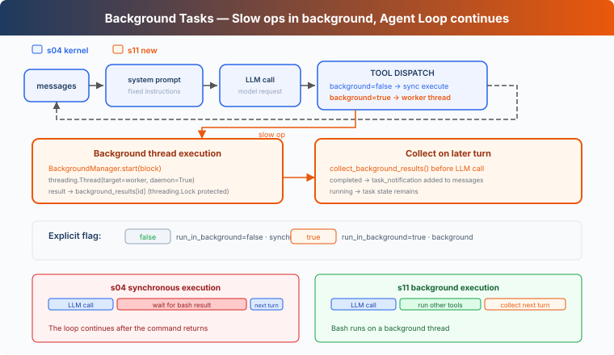

# s11: Background Tasks — Slow Operations Go to the Background

> **TypeScript reference edition**: implementation boundaries and chapter imports follow Python. Identifiers are preserved. Code blocks are implementation excerpts and may omit enclosing declarations.

[English](README.md) · [中文](README.zh.md) · [日本語](README.ja.md)

s01 → ... → s09 → s10 → `s11` → [s12](../s12_cron_scheduler/) → s13 → ... → s16 → s17

> *"Slow operations go to the background, the Agent Loop continues"* — Background async tasks run commands, and later turns collect completed results.
>
> **Harness Layer**: Background — Async execution, doesn't block the main loop.

---

## The Problem

Reading a file or running `git status` usually returns quickly, so synchronous execution causes little noticeable delay. Installing dependencies, running a full test suite, or building a project can take several minutes. Until the command returns, the Harness cannot process the next tool call in the current response or start the next model turn.

If later work does not depend on that command, there is no need to block it. For example, after starting a full test suite, the Agent could inspect documentation or organize other files while the tests run.

S11 addresses this by running slow Bash commands in the background, allowing the Agent Loop to continue and collect completed results on a later turn.

---

## The Solution



This chapter sends slow operations to background async tasks. The current tool call first returns a placeholder `tool_result`, allowing the Agent Loop to continue. At the start of a later turn, completed results are collected and added to the conversation as notifications.

Sync vs Background:

| | Sync (s04) | Background (s11) |
|---|---|---|
| Slow operations | Current tool call blocks | Background async task executes |
| Agent Loop | Waits for the command to return | Continues after the placeholder result |
| Result | Returned after the command finishes | Returns `bg_id` first; collects the result on a later turn |
| Decision criteria | — | bash `run_in_background` parameter |

---

## How It Works

### should_run_background: Explicit Request

The model requests background execution through the bash tool's `run_in_background` parameter. Only bash calls with the parameter explicitly set to `true` enter this path. Other calls still run synchronously.

```typescript
export function should_run_background(tool_name: string, tool_input: ToolInput): boolean {
  return tool_name === 'bash' && tool_input.run_in_background === true;
}
```

The Harness no longer guesses from keywords such as `install`, `build`, or `test`. The tool call chooses the execution mode explicitly.

### BackgroundManager: Background Execution and Lifecycle

`BackgroundManager` owns task state and the completion queue. `start()` registers a task, starts a background async task, and returns `bg_id` immediately:

```typescript
export class BackgroundManager {
  tasks = new Map<string, { tool_use_id: string; command: string; status: string }>();
  results = new Map<string, string>();
  _ready: string[] = [];
  _counter = 0;

  start(block: ToolCall): string {
    if (block.name !== 'bash') throw new Error('Only Bash commands can run in the background');
    const command = (block.input as ToolInput).command;
    if (typeof command !== 'string' || !command.trim()) throw new Error('Bash command cannot be empty');
    this._counter += 1;
    const task_id = `bg_${String(this._counter).padStart(4, '0')}`;
    this.tasks.set(task_id, { tool_use_id: block.id, command, status: 'running' });
    // Promises and child-process I/O provide the concurrency of Python's daemon thread.
    try { void this._run(task_id, command); } catch (error) { this.tasks.delete(task_id); throw error; }
    console.log(`  [background] started ${task_id}: ${Array.from(command).slice(0, 60).join('')}`);
    return task_id;
  }
  async _run(task_id: string, command: string): Promise<void> {
    let result: string; let status: string;
    try {
      const [output, exit_code] = await _run_bash_process(command);
      result = _format_bash_result(output, exit_code);
      status = exit_code === 0 ? 'completed' : 'failed';
    } catch (error) { result = `Error: ${error instanceof Error ? `${error.name}: ${error.message}` : String(error)}`; status = 'failed'; }
    const task = this.tasks.get(task_id);
    if (!task) return;
    task.status = status;
    this.results.set(task_id, result);
    this._ready.push(task_id);
  }
  collect(): string[] {
    const ready: [string, { command: string; status: string }, string][] = [];
    for (const task_id of this._ready) {
      const task = this.tasks.get(task_id); this.tasks.delete(task_id);
      const result = this.results.get(task_id) ?? ''; this.results.delete(task_id);
      if (task) ready.push([task_id, task, result]);
    }
    this._ready.length = 0;
    const notifications: string[] = [];
    for (const [task_id, task, result] of ready) {
      notifications.push(`<task_notification>\n  <task_id>${task_id}</task_id>\n  <status>${task.status}</status>\n  <command>${task.command}</command>\n  <summary>${Array.from(result).slice(0, 500).join('')}</summary>\n</task_notification>`);
      console.log(`  [background] collected ${task_id}: ${task.status}`);
    }
    return notifications;
  }
}
```

A non-zero exit code or worker exception becomes `failed`. The shell starts in its own process group. When the command finishes, times out, or the Agent exits through the normal or `SIGTERM` path, the runtime stops that original group. This is lifecycle cleanup, not a sandbox: a process that creates another session can leave the group.

### collect_background_results: Notification Collection

At the start of a later turn, `collect()` removes completed results from the queue and formats them as `<task_notification>` messages:

```typescript
export function collect_background_results(): string[] { return BACKGROUND.collect(); }
```

Notifications don't reuse the original `tool_use_id`. The original tool call was already answered with a placeholder `tool_result`; when the completed result is collected, it is added as an independent event in `task_notification` format. One `tool_use` still gets exactly one `tool_result`.

### Loop Integration

Before each LLM call, the Agent Loop collects completed background results. `execute_tool()` still runs `PreToolUse` on the foreground turn before choosing synchronous or background execution:

```typescript
export async function execute_tool(block: ToolCall): Promise<string> {
  const blocked = await trigger_hooks('PreToolUse', block);
  if (blocked !== null && blocked !== undefined) return python_str(blocked);
  let output: string;
  if (should_run_background(block.name, block.input as ToolInput)) {
    try {
      const task_id = start_background_task(block);
      output = `[Background task ${task_id} started] The result will be collected on a later turn.`;
    } catch (error) { output = `Error: ${error instanceof Error ? error.message : String(error)}`; }
  } else output = await call_tool(block);
  await trigger_hooks('PostToolUse', block, output);
  return output;
}
```

Slow operations first return a placeholder tool_result with `bg_id`. A completed task does not wake the Agent by itself; `inject_background_results()` collects it the next time the Agent Loop runs.

### Putting It Together

```
Turn 1:
  LLM → bash "npm install" (run_in_background=true)
  → start_background_task → bg_0001
  → tool_result: "[Background task bg_0001 started]..."
  → LLM: "OK, I'll check later. Let me also read the config."

Turn 2:
  LLM → read_file "package.json" (fast, sync)
  → tool_result: file content

Turn 3:
  → collect bg_0001 as <task_notification>
  → LLM sees: config file + install notification in one message
```

While npm install ran in the background, the Agent Loop continued with read_file.

---

## What s11 Adds

| Component | s04 Kernel | s11 |
|-----------|-------------|-------------|
| Execution model | All synchronous | Slow ops to background async task + notification injection |
| bash schema | `command` | `command` + `run_in_background` |
| New functions | — | `should_run_background`, `start_background_task`, `collect_background_results`, `inject_background_results` |
| New types | — | `BackgroundManager` |
| Notification format | — | `<task_notification>` (doesn't reuse tool_use_id) |
| Loop behavior | Tools execute synchronously | Explicit background execution, completed results collected on later turns |
| Tools | 5 | 5 (one parameter added to the bash schema) |

---

## Try It

```sh
cd learn-claude-code/learn-claude-code-ts
npm run s11
```

Try these prompts:

1. `Run npm list --depth=0 in the background and find all TypeScript files in this directory`
2. `Run npm install (use run_in_background) and while waiting, read package.json`
3. `Run a short sleep in the background, then list all Markdown files`

What to observe: After explicitly setting `run_in_background`, is the command dispatched to the background? Is a `bg_id` returned? Are completed results collected in `<task_notification>` format on a later turn?

---

## What's Next

Background tasks solved "slow operations don't block." But what if you want to do something on a schedule? Like "run tests every morning at 9am" or "check server status every 5 minutes."

s12 Cron Scheduler → Give the agent an alarm clock.


<!-- translation-sync: zh@v7, en@v7, ja@v7 -->

## TypeScript verification

Run [code.ts](code.ts) with `npm run s11` and tests with `npm run test:s11`. Differential tests execute the unmodified [Python reference](../../s11_background_tasks/code.py) with fake model responses and require Python 3 and PyYAML. See the [alignment audit](../docs/parity-audit.md) for full-project and live-API verification status.
