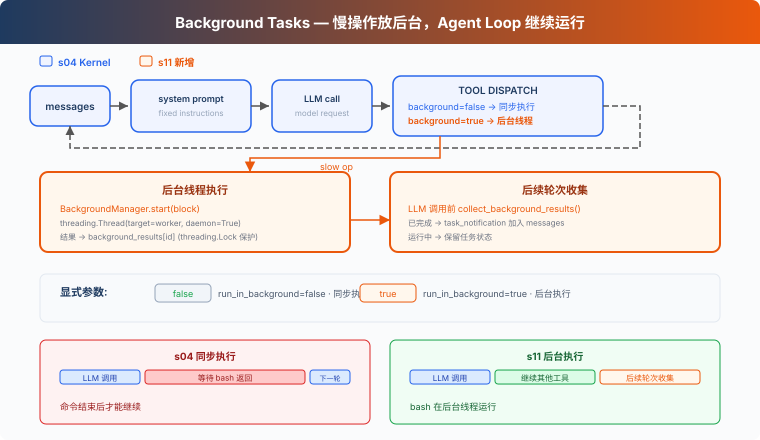

# s11: Background Tasks — 慢操作放后台

> **TS 对照版**：实现范围和跨章引用以 Python 原版为准；标识符沿用 Python。代码块摘自本章实现，可能省略 import、外层类或分支。

[English](README.md) · [中文](README.zh.md) · [日本語](README.ja.md)

s01 → ... → s09 → s10 → `s11` → [s12](../s12_cron_scheduler/) → s13 → ... → s16 → s17

> *"慢操作放后台，Agent Loop 继续运行"* — 后台异步任务执行命令，后续轮次收集完成结果。
>
> **Harness 层**: 后台 — 异步执行, 不阻塞主循环。

---

## 问题

读取文件或运行 `git status` 通常很快，同步执行时等待并不明显。但安装依赖、执行完整测试或构建项目可能持续几分钟。在命令返回前，Harness 无法处理当前响应中的下一个工具调用，也不能进入下一轮。

如果后续工作并不依赖这个命令，继续等待就没有必要。例如，Agent 启动完整测试后，本来还可以检查文档或整理其他文件，但同步执行会让整个 Agent Loop 停在这次 Bash 调用上。

S11 要解决的问题是：让耗时的 Bash 命令在后台执行，使 Agent Loop 可以继续处理其他工作，并在后续轮次收集完成结果。

---

## 解决方案



本章把慢操作放入后台异步任务。当前工具调用先返回一个占位 `tool_result`，Agent Loop 可以继续运行；后续轮次开始时再收集已经完成的结果，以通知形式加入对话。

同步 vs 后台：

| | 同步 (s04) | 后台 (s11) |
|---|---|---|
| 慢操作 | 当前工具调用被阻塞 | 后台异步任务执行 |
| Agent Loop | 等待命令返回 | 收到占位结果后继续运行 |
| 结果 | 命令结束后返回 | 先返回 `bg_id`，后续轮次收集结果 |
| 判断标准 | — | bash 的 `run_in_background` 参数 |

---

## 工作原理

### should_run_background: 显式请求

模型通过 bash 工具的 `run_in_background` 参数请求后台执行。只有参数明确为 `true`，并且工具是 bash 时，才会进入后台执行路径。其他调用仍然同步执行。

```typescript
export function should_run_background(tool_name: string, tool_input: ToolInput): boolean {
  return tool_name === 'bash' && tool_input.run_in_background === true;
}
```

不再根据 `install`、`build` 或 `test` 等关键词猜测。是否进入后台由工具调用明确决定。

### BackgroundManager: 后台执行与生命周期

`BackgroundManager` 保存任务状态和完成队列。`start()` 先登记任务，再启动 后台异步任务，并立即返回 `bg_id`：

```typescript
export class BackgroundManager {
  tasks = new Map<string, { tool_use_id: string; command: string; status: string }>();
  results = new Map<string, string>();
  _ready: string[] = [];
  _counter = 0;

  start(block: ToolCall): string {
    if (block.name !== 'bash') throw new Error('Only Bash commands can run in the background');
    const command = (block.input as ToolInput).command;
    if (typeof command !== 'string' || !command.trim()) throw new Error('Bash command cannot be empty');
    this._counter += 1;
    const task_id = `bg_${String(this._counter).padStart(4, '0')}`;
    this.tasks.set(task_id, { tool_use_id: block.id, command, status: 'running' });
    // Promises and child-process I/O provide the concurrency of Python's daemon thread.
    try { void this._run(task_id, command); } catch (error) { this.tasks.delete(task_id); throw error; }
    console.log(`  [background] started ${task_id}: ${Array.from(command).slice(0, 60).join('')}`);
    return task_id;
  }
  async _run(task_id: string, command: string): Promise<void> {
    let result: string; let status: string;
    try {
      const [output, exit_code] = await _run_bash_process(command);
      result = _format_bash_result(output, exit_code);
      status = exit_code === 0 ? 'completed' : 'failed';
    } catch (error) { result = `Error: ${error instanceof Error ? `${error.name}: ${error.message}` : String(error)}`; status = 'failed'; }
    const task = this.tasks.get(task_id);
    if (!task) return;
    task.status = status;
    this.results.set(task_id, result);
    this._ready.push(task_id);
  }
  collect(): string[] {
    const ready: [string, { command: string; status: string }, string][] = [];
    for (const task_id of this._ready) {
      const task = this.tasks.get(task_id); this.tasks.delete(task_id);
      const result = this.results.get(task_id) ?? ''; this.results.delete(task_id);
      if (task) ready.push([task_id, task, result]);
    }
    this._ready.length = 0;
    const notifications: string[] = [];
    for (const [task_id, task, result] of ready) {
      notifications.push(`<task_notification>\n  <task_id>${task_id}</task_id>\n  <status>${task.status}</status>\n  <command>${task.command}</command>\n  <summary>${Array.from(result).slice(0, 500).join('')}</summary>\n</task_notification>`);
      console.log(`  [background] collected ${task_id}: ${task.status}`);
    }
    return notifications;
  }
}
```

命令以非零状态退出或 worker 抛出异常时，任务会进入 `failed`。Shell 会在独立的进程组中启动；命令完成、超时，或 Agent 经正常路径、`SIGTERM` 退出时，运行时会停止原进程组。这只是生命周期清理，并不是沙箱；另建 session 的进程仍可能离开该进程组。

### collect_background_results: 通知收集

后续轮次开始时，`collect()` 从完成队列中取出结果，并格式化为 `<task_notification>` 通知：

```typescript
export function collect_background_results(): string[] { return BACKGROUND.collect(); }
```

通知不复用原始 `tool_use_id`。原始 tool call 已经用占位 `tool_result` 回复了；后续收集完成结果时，会用 `task_notification` 格式把它作为独立事件加入对话。一个 `tool_use` 仍然只对应一个 `tool_result`。

### 循环中的集成

每次调用 LLM 前，Agent Loop 先收集已经完成的后台结果。`execute_tool()` 仍然在前台回合执行 `PreToolUse`，然后再选择同步或后台执行：

```typescript
export async function execute_tool(block: ToolCall): Promise<string> {
  const blocked = await trigger_hooks('PreToolUse', block);
  if (blocked !== null && blocked !== undefined) return python_str(blocked);
  let output: string;
  if (should_run_background(block.name, block.input as ToolInput)) {
    try {
      const task_id = start_background_task(block);
      output = `[Background task ${task_id} started] The result will be collected on a later turn.`;
    } catch (error) { output = `Error: ${error instanceof Error ? error.message : String(error)}`; }
  } else output = await call_tool(block);
  await trigger_hooks('PostToolUse', block, output);
  return output;
}
```

慢操作先返回一个带 `bg_id` 的占位 tool_result。后台结果不会主动唤醒 Agent；下一次进入 Agent Loop 时，`inject_background_results()` 才会收集已经完成的结果。

### 合起来跑

```
Turn 1:
  LLM → bash "npm install" (run_in_background=true)
  → start_background_task → bg_0001
  → tool_result: "[Background task bg_0001 started]..."
  → LLM: "OK, I'll check later. Let me also read the config."

Turn 2:
  LLM → read_file "package.json" (fast, sync)
  → tool_result: file content

Turn 3:
  → collect bg_0001 as <task_notification>
  → LLM sees: config file + install notification in one message
```

npm install 在后台运行时，Agent Loop 继续执行了 read_file。

---

## 本章新增了什么

| 组件 | S04 Kernel | S11 |
|------|-----------|-----------|
| 执行模型 | 全部同步 | 慢操作后台异步任务 + 通知注入 |
| bash schema | `command` | `command` + `run_in_background` |
| 新函数 | — | `should_run_background`, `start_background_task`, `collect_background_results`, `inject_background_results` |
| 新类型 | — | `BackgroundManager` |
| 通知格式 | — | `<task_notification>`（不复用 tool_use_id） |
| 循环行为 | 工具同步执行 | 显式后台执行，后续轮次收集完成结果 |
| 工具 | 5 | 5（bash schema 增加一个参数） |

---

## 试一下

```sh
cd learn-claude-code/learn-claude-code-ts
npm run s11
```

试试这些 prompt：

1. `Run npm list --depth=0 in the background and find all TypeScript files in this directory`
2. `Run npm install (use run_in_background) and while waiting, read package.json`
3. `Run a short sleep in the background, then list all Markdown files`

观察重点：显式设置 `run_in_background` 后，命令有没有被送到后台？`bg_id` 是否返回？后续轮次有没有以 `<task_notification>` 格式收集完成结果？

---

## 接下来

后台任务解决了"慢操作不阻塞"。但如果想定时做某件事呢？比如"每天早上 9 点跑测试"、"每 5 分钟检查一次服务器状态"。

s12 Cron Scheduler → 给 Agent 装一个闹钟。


<!-- translation-sync: zh@v7, en@v7, ja@v7 -->

## TypeScript 对齐与验证

[code.ts](code.ts) 是独立运行入口；[Python 原版](../../s11_background_tasks/code.py) 是行为依据。Promise/子进程 I/O 对应 Python 的同步调用与线程；文件和锁的适配以原版各章节为准。原图保持原文件名和字节。

在 TS 工程目录执行 `npm run test:s11`。差分测试通过假模型运行未修改的 Python 原版，因此还需要 Python 3 与 PyYAML。它们验证离线行为；真实 API、全部入口和全项目最终检查的状态统一记录在[对齐记录](../docs/parity-audit.md)。
