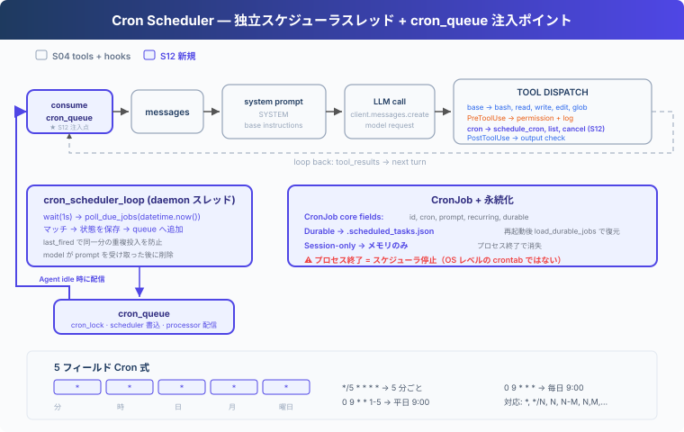

# s12: Cron Scheduler — 時刻に合わせて作業を開始する

> **TypeScript 対照版**：実装範囲と章間の参照は Python 原版に従い、識別子を保持します。コード例は実装の抜粋です。

[English](README.md) · [中文](README.zh.md) · [日本語](README.ja.md)

s01 → ... → s10 → s11 → `s12` → [s13](../s13_agent_teams/) → ... → s17

---

## 課題

S11 が扱うのは、コマンド開始後の実行方法である。時間のかかる Bash コマンドはバックグラウンドで実行できるが、将来の作業をいつ開始するかは記録せず、現在時刻を継続的に確認するコンポーネントもない。

「毎朝 9 時にテストを実行する」「30 分ごとに CI の状態を確認する」といった依頼を現在の Agent Loop だけで扱う場合、ユーザーは時刻が来るたびに prompt を送り直す必要がある。Harness は実行時刻を保存し、時刻が来たら対応する prompt を待機キューへ入れ、Agent がアイドルの時に Agent Loop へ渡す必要がある。

---

## 解決方法



Agent が次のジョブを登録したとする。

```text
cron:   0 9 * * *
prompt: run tests
```

ローカル時刻の 09:00 に scheduler timer がジョブを検出し、`[Scheduled] run tests` を `cron_queue` に入れる。queue processor は Agent がアイドルになるまで待ち、Agent Loop の 1 ターンを開始する。モデルはその後 Bash を呼び出してテストを実行できる。

S12 のコードは S04 の 5 つの基本ツールと Hooks を残し、`schedule_cron`、`list_crons`、`cancel_cron` を追加する。ここで渡すのは新しい作業を開始する prompt であり、実行中のコマンド結果ではないため、S11 の background command は含めない。

---

## 仕組み

### CronJob が保存する内容

```typescript
export class CronJob {
  constructor(public id: string, public cron: string, public prompt: string, public recurring: boolean,
    public durable: boolean, public pending_delivery = false, public last_fired: string | null = null) {}
}
```

`cron` は発火時刻を決め、`prompt` は Agent に渡す作業を表す。`pending_delivery` は期限に達したがモデルに受け取られていないジョブを示し、`last_fired` は同じ分での重複投入を防ぐ。

### 5 フィールドの cron 式

```text
分  時  日  月  曜日
 *   *   *   *   *      毎分
 0   9   *   *   *      毎日 09:00
*/5   *   *   *   *      5 分ごと
 0   9   *   *  1-5     平日 09:00
```

この章では `*`、`*/N`、`N`、`N-M`、`N,M,...` を扱う。`schedule_job()` は保存前に `validate_cron()` を呼び、フィールド数や値の範囲が正しくない式を拒否する。

### 期限に達したらキューへ入れる

scheduler timer は 1 秒ごとにローカル時刻を読む。式が一致し、現在の分にまだ発火していない場合、`_enqueue_due_job()` は `pending_delivery` と `last_fired` を保存してからメモリ上のキューへ追加する。

```typescript
export function poll_due_jobs(moment: Date): void {
  const pad = (value: number) => String(value).padStart(2, '0');
  const minute_marker = `${String(moment.getFullYear()).padStart(4, '0')}-${pad(moment.getMonth() + 1)}-${pad(moment.getDate())} ${pad(moment.getHours())}:${pad(moment.getMinutes())}`;
  for (const job of [...scheduled_jobs.values()]) {
    try {
      if (job.pending_delivery || job.last_fired === minute_marker) continue;
      if (cron_matches(job.cron, moment)) { _enqueue_due_job(job, minute_marker); console.log(`  [cron] due ${job.id}: ${Array.from(job.prompt).slice(0, 60).join('')}`); }
    } catch (error) { console.log(`  [cron] could not enqueue ${job.id}: ${error instanceof Error ? error.message : String(error)}`); }
  }
}
```

永続化に失敗すると、`_enqueue_due_job()` は元の状態へ戻し、メモリにしか存在しない配信を queue processor に渡さない。

### Agent がアイドルになってから配信する

`queue_processor_loop()` は時刻を確認しない。キューだけを確認し、`agent_lock` によってユーザーのターンと定時ターンが同時に session を変更するのを防ぐ。

```typescript
export function queue_processor_loop(): ReturnType<typeof setInterval> {
  return setInterval(() => {
    if (!has_cron_queue() || agent_lock.busy) return;
    agent_lock.busy = true;
    void scheduled_turn.run(true, async () => {
      try { if (has_cron_queue()) await run_agent_turn_locked(); }
      finally { release_agent_lock(); }
    });
  }, 200);
}
```

Agent Loop は期限に達したジョブをキューから取り出し、それぞれを新しい user message として追加する。

```typescript
for (const job of fired) {
    messages.push({ role: 'user', content: `[Scheduled] ${job.prompt}` });
    console.log(`  [cron] delivered ${job.id}: ${Array.from(job.prompt).slice(0, 60).join('')}`);
  }
```

モデル呼び出しに失敗すると、これらの message を現在の session から削除し、ジョブをキューへ戻す。モデルが受け取った後、一回限りのジョブは削除し、定期ジョブは `pending_delivery` を解除して次の一致を待つ。

### 永続化の境界

| モード | 保存先 | プロセス再起動後 |
|---|---|---|
| `durable=True` | `.scheduled_tasks.json` | 再読み込み |
| `durable=False` | メモリ | 消失 |

`.scheduled_tasks.json` は一時ファイルと `os.replace()` で更新する。ファイルが壊れている場合、起動時にエラーを表示し、黙って無視しない。

配信保証は at-least-once である。モデルが prompt を受け取った後、確認状態をディスクへ書く前にプロセスが終了すると、再起動後に同じジョブを再配信する場合がある。

### 実行境界

- scheduler は Agent プロセスのローカル時刻を使う。
- Agent プロセスが終了すると scheduler timer も停止する。`durable` が保持するのはジョブ定義だけである。
- 再起動時にジョブを復元するが、停止中に過ぎた実行時刻は補わない。
- 定時ターンは queue processor task で動く。対話的な許可が必要な tool call は拒否し、main terminal から同時に入力を読まない。
- scheduler と queue processor の async task は CLI 実行時だけ開始する。`code.ts` の import では background async task を起動しない。

Agent が閉じている間も実行する必要がある場合は、crontab、systemd timer、外部 scheduler を使う。

---

## 試してみる

```sh
cd learn-claude-code/learn-claude-code-ts
npm run s12
```

次の prompt を順に入力できる。

1. `Schedule "run date" every 2 minutes and keep it after restart.`
2. `List all cron jobs.`
3. `Cancel the cron job you just created.`

`.scheduled_tasks.json` の内容と、期限に達した後の `[Scheduled] run date` message を確認する。分単位のジョブを試す間は Agent プロセスを起動したままにする。

---

## 次の章

スケジューラは指定した時刻に Agent Loop の 1 ターンを開始できるが、そのターンを処理するのは一つの Agent である。複数のモジュールを同時に調査、変更し、結果をまとめるタスクでは、Harness が複数の Agent へ作業を割り当て、それぞれの実行結果を集める必要がある。

s13 Agent Teams → Lead がタスクを割り当て、teammate が個別に実行し、inbox を通じて結果を返す。

<!-- translation-sync: zh@v9, en@v9, ja@v9 -->

## TypeScript の検証

実行入口は [code.ts](code.ts)、参照実装は [Python 原版](../../s12_cron_scheduler/code.py) です。章のテストは `npm run test:s12`。差分テストには Python 3 と PyYAML が必要です。全体の検証状況は[対照記録](../docs/parity-audit.md)を参照してください。
