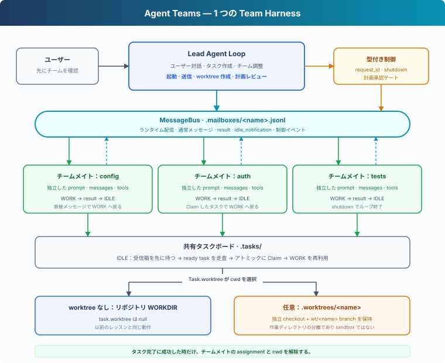
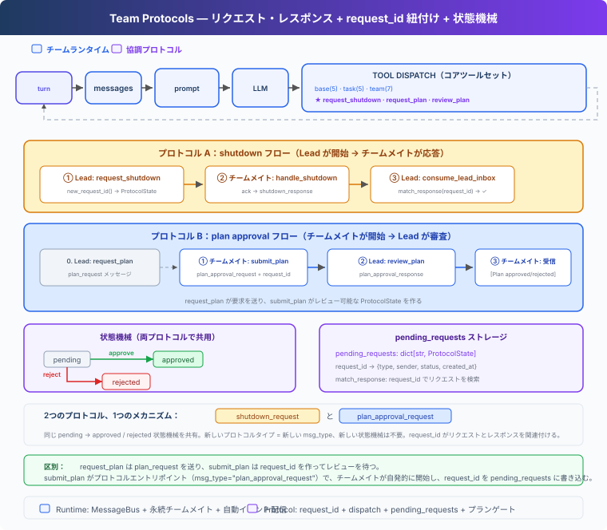

# s13: Agent Teams — チームランタイムと協調プロトコル

> **TypeScript 対照版**：実装範囲と章間の参照は Python 原版に従い、識別子を保持します。コード例は実装の抜粋です。

[English](README.md) · [中文](README.zh.md) · [日本語](README.ja.md)

s01 → ... → [s10](../s10_task_system/) → `s13` → [s14](../s14_mcp_plugin/) → s15 → s16 → s17

> *「1 つの Agent で仕事全体を抱えきれないなら、チームメイトで分担する。」* — 永続チームメイト、共有タスクの Claim、任意の worktree、協調プロトコル。
>
> **Harness レイヤー**：Team — 複数の Agent が Lead の管理下で仕事を分担し、状態を共有する仕組み。

---

## 問題

Agent にバックエンド全体のリファクタリングを依頼するとする。作業範囲は設定の読み込み、認証、テストにまたがる。1 つの Agent でも順番に処理できるが、時間がかかり、初期の詳細は少しずつコンテキストから抜けていく。

この仕事は並列化に向いている。ただし、ユーザーは通常、チーム構成ではなく目標を伝える：

```text
このサンプルバックエンドをリファクタリングしてください。
設定の読み込み、認証、テストを整理し、既存インターフェースを保ち、
テストが通ることを確認してください。
```

Harness は、つながった 6 つの問題を扱う必要がある：

1. 並列作業が有効だと誰が判断し、追加の Agent を誰が承認するのか。
2. 各チームメイトは、複数の割り当てをまたいで識別子とコンテキストをどう保つのか。
3. モデルに受信箱をポーリングさせず、結果を Lead へどう返すのか。
4. IDLE のチームメイトは、次の指示を待たずに ready task を引き受けられるか。
5. 並列編集が衝突し得る時、タスクはどの作業ディレクトリを使うのか。
6. shutdown と計画承認を、追跡できて実際に制約をかけるプロトコルにするにはどうするか。

---

## 解決策



s13 は s10 の基本ツール、Hooks、Permission、Task System を再利用し、Lead 管理のチームランタイムを加える：

- **Lead** はユーザーとの会話を担当し、分担案を示して確認を待つ。
- **チームメイト** は独立した Agent Loop を実行し、WORK と IDLE を行き来する。
- **MessageBus** は、ファイルベースの受信箱で通常メッセージ、結果、制御イベントを運ぶ。
- **ランタイム配信** は Lead の受信箱を消費し、チームイベントを次のターンへ追加する。
- **共有タスクボード** により、IDLE のチームメイトは ready task を探し、ロック下で Claim できる。
- **任意の worktree** は、必要なタスクだけを別の作業ディレクトリへ紐付ける。紐付けのないタスクは通常のリポジトリディレクトリを使う。
- **型付きプロトコルと計画ゲート** は shutdown と承認状態を明示し、必要な計画が承認されるまで変更系ツールを止める。

タスクグラフの作成は s10 の 2 段階契約を維持する。Lead はまず全ノードに `create_task` を呼び、返された実行時 ID で `update_task(addBlockedBy=...)` を実行してから ready task を割り当てる。`update_task` を使えるのは Lead だけであり、チームメイトは一覧・Claim・完了はできるが、チーム実行中にグラフ構造を変更できない。

s11 の background task と s12 の scheduled task は本章へ持ち込まない。どちらも teammate communication、task claim、plan approval には必要ない。

これらはすべて Team Harness レイヤーの一部である。タスク発見のために別の Agent Loop は要らず、worktree が別種の Agent を作るわけでもない。

---

## 仕組み

### 1. Lead はチーム案を示し、ユーザーの確認を待つ

チームメイトを起動すると、コスト、並行度、ワークスペースを編集できる主体が変わる。Lead のシステムプロンプトは、その境界を明示する：

```typescript
"teams": "When parallel work would help, first propose a small team with clear responsibilities and wait for the user's confirmation. Do not call spawn_teammate before the user confirms. After confirmation, delegate independent work by creating a Task for each parallel change. Pass task_id to spawn_teammate when assigning ready work, then create a task-bound worktree only when a separate working directory would prevent conflicting edits. A teammate must complete its current Task before claiming another. A worktree changes tool default cwd only; it is not a sandbox. Worktree removal stays with the host or user. After spawning a teammate, end the current turn instead of polling its status; the runtime will deliver team events and wake the Lead. React to those events, and shut teammates down when coordination is complete."
```

最初の要求に対して、Lead は分担案だけを示す：

```text
3 つの領域を並行して進めることを提案します：
- config：設定の読み込みを整理
- auth：認証をリファクタリング
- tests：回帰テストを追加

確認後にチームメイトを起動します。
```

ユーザーが「始めてください」と返した後、Lead は `spawn_teammate` を呼べる。Lead は先に Task を作り、初期 `task_id` をチームメイトへ渡す。ユーザーが目標を示し、Lead がチームを設計し、ユーザーが実行境界を確認する。

### 2. 各チームメイトは独立したループを持つ

s06 の subagent は 1 回限りの呼び出しである。チームメイトは永続する実行単位だ：

| | s06 Subagent | s13 Teammate |
|---|---|---|
| ライフサイクル | 1 回の呼び出し後に終了 | shutdown まで `WORK → IDLE → WORK` |
| コンテキスト | 1 つのタスクにだけ存在 | 割り当てをまたいで保持 |
| 通信 | 1 回だけ結果を返す | メッセージを受け取りイベントを送る |
| 協調 | 一方向の委譲 | Lead との双方向協調 |

`TeammateRuntime` は、各チームメイト専用のシステムプロンプト、messages、ツール、現在の Task を保持し、background async task で WORK / IDLE loop を実行する。チームメイトの作業中も Lead は調整を続けられる。`lead` と `agent` はランタイム識別子として予約されるが、`MessageBus` はコーディネーターの受信箱として `lead` を引き続き受け付ける。

`spawn_teammate` は async task を開始する前に初期 Task を Claim する。Claim に失敗した場合、チームメイトは起動しない。Task がない状態では workspace tool と Shell tool は repository directory へ戻らず、先に Task を Claim するよう求める。

### 3. MessageBus は通信をモデルのコンテキスト外に置く

Lead とチームメイトは同じ messages 配列を共有できない。共有すると、あるチームメイトのツール結果が別のチームメイトの推論へ混ざる。`MessageBus` は Agent ごとに `.mailboxes/<name>.jsonl` 受信箱を用意する：

```typescript
send(from_agent: string, to_agent: string, content: string, msg_type = 'message', metadata: Record<string, unknown> | null = null): void {
    const msg: Envelope = { from: from_agent, to: to_agent, content, type: msg_type, ts: Date.now() / 1000, metadata: metadata || {} };
    mkdirSync(MAILBOX_DIR, { recursive: true });
    appendFileSync(this._path(to_agent), json_dump(msg, true) + '\n', 'utf8');
    this._changed.emit('changed');
    console.log(`  [bus] ${from_agent} -> ${to_agent}: (${msg_type}) ${char_slice(content, 0, 50)}`);
  }

async wait_for_messages(agent: string, timeout: number | null = null): Promise<Envelope[]> {
    const deadline = timeout === null ? null : performance.now() + timeout * 1000;
    while (!this.peek(agent)) {
      const remaining = deadline === null ? null : deadline - performance.now();
      if (remaining !== null && remaining <= 0) return [];
      await new Promise<void>((done) => {
        let timer: ReturnType<typeof setTimeout> | undefined;
        const wake = () => { clearTimeout(timer); this._changed.removeListener('changed', wake); done(); };
        this._changed.once('changed', wake);
        if (remaining !== null) { timer = setTimeout(wake, remaining); timer.unref(); }
      });
    }
    return this._read_unlocked(agent);
  }
```

ロックは、チームメイトによる受信箱ファイルの並行アクセスを保護する。`Condition` はメッセージ到着時にチームメイトを起こし、IDLE 中の短い timeout にも使える。

### 4. 受信イベントはランタイムが配信する

`read_inbox()` は受信箱ファイルを読み取って削除するため、Lead 側の消費処理は `consume_lead_inbox()` だけにする：

```typescript
export function consume_lead_inbox(): Envelope[] {
  const msgs = BUS.read_inbox('lead');
  for (const msg of msgs) {
    const metadata = msg.metadata ?? {}; const request_id = (metadata.request_id ?? '') as string;
    if (request_id && (msg.type ?? '').endsWith('_response')) match_response(msg.type, request_id, (metadata.approve ?? false) as boolean, msg.from ?? '', msg.to ?? '');
  }
  return msgs;
}
```

CLI のメインループは terminal input と Lead の受信箱を同時に待つ。新しいメッセージが届くと、受信箱を消費してから Lead の次ターンを始める：

```text
MessageBus → consume_lead_inbox
           → プロトコル状態を更新
           → [Team events] を history に追加
           → Lead の次ターンを開始
```

Lead は teammate を起動した後、`list_teammates` や `get_task` を繰り返して待たず、現在の turn を終了する。team event が届くと runtime が次の turn を開始する。

`check_inbox` はモデルのツールではない。メッセージの到着と消費はランタイムが担当し、モデルはコンテキストへ配信済みのイベントを処理する。

### 5. 結果と IDLE は別のイベントである

チームメイトが 1 つの割り当てを終えると、ランタイムは 2 つのイベントを順に送る：

```text
result:            "認証をリファクタリングし、関連テストが通りました。"
idle_notification: "Waiting for more work."
```

`result` は「この割り当てで何ができたか」、`idle_notification` は「このチームメイトが次の仕事を受けられるか」を表す。曖昧な「完了」だけでは、両方の状態を表せない。

IDLE のチームメイトは終了しない。直接メッセージか ready task を受けると WORK に戻り、`shutdown_request` を受けると段階的な shutdown handshake を始める。

### 6. IDLE は受信箱を先に確認し、その後 ready task を探す

IDLE ではメッセージを優先し、その後に共有タスクボードを確認する：

```typescript
async wait_for_work(): Promise<boolean> {
    while (true) {
      const inbox = await BUS.wait_for_messages(this.name, IDLE_SCAN_INTERVAL);
      if (inbox.length) {
        const before = this.messages.length; if (this.handle_inbox(inbox)) return false;
        if (this.messages.length > before) return true;
        continue;
      }
      const task = claim_next_task(this.name); if (!task) continue;
      const cwd = assignment_cwd(this.name);
      this.messages.push({ role: 'user', content: `[Auto-claimed task ${task.id}] ${task.subject}\n${task.description}\nWork directory: ${cwd}` });
      console.log(`  [idle] ${this.name} claimed ${task.id}: ${task.subject}`); return true;
    }
  }
```

shutdown、計画承認、Lead からの直接指示は、空き時間に見つけた仕事より先に扱う。メッセージも ready task もなければ、チームメイトは IDLE を続ける。別のチームメイトが前提タスクを完了すると、blocked task が ready になることもある。

### 7. 発見と Claim を分け、Claim はアトミックに行う

走査は候補を探すだけで、状態を変更しない：

```typescript
export function scan_unclaimed_tasks(): Task[] {
  const ready: Task[] = [];
  for (const task of list_tasks()) {
    if (task.status !== 'pending' || task.owner !== null || !can_start(task.id)) continue;
    const [, error] = task_worktree_cwd(task); if (!error) ready.push(task);
  }
  return ready;
}
```

候補一覧は一時点の snapshot にすぎない。別のチームメイトだけでなく、同じ task directory を使う別の Harness process も同じ task を見る可能性がある。そのため、所有権の変更は process 内 lock と file lock を組み合わせた `task_store_lock()` の下で `claim_task()` が行う：

```typescript
export function claim_task(task_id: string, owner = 'agent'): string {
  return task_store_lock(() => {
    const task = load_task(task_id);
    if (task.status !== 'pending') return `Task ${task_id} is ${task.status}, cannot claim`;
    if (task.owner) return `Task ${task_id} is already owned by ${task.owner}`;
    const assignment = teammate_assignments.get(owner);
    if (assignment) return `Owner ${owner} must finish the current work turn for ${assignment.task_id} before claiming another task`;
    const current = _owner_in_progress(owner);
    if (current) return `Owner ${owner} must complete ${current.id} before claiming another task`;
    if (!can_start(task_id)) return `Blocked by: ${python_str(_incomplete_dependencies(task))}`;
    const [cwd, error] = task_worktree_cwd(task);
    if (error) return `Cannot claim ${task_id}: ${error}`;
    task.owner = owner; task.status = 'in_progress'; save_task(task);
    teammate_assignments.set(owner, { task_id: task.id, cwd }); advance_assignment_version(owner);
    console.log(`  [claim] ${task.subject} -> in_progress (owner: ${owner})`);
    return `Claimed ${task.id} (${task.subject})`;
  });
}
```

複数のチームメイトが同じ候補を発見しても、`in_progress` へ進められる Claim は 1 つだけである。同じ store lock を保持したまま temporary file へ書き、正式な task file を atomic に置き換える。現在のタスクを完了するまで、チームメイトは次のタスクを Claim できない。worktree の紐付けが壊れている場合、リポジトリディレクトリへ戻さず Claim を失敗させる。

### 8. Claim した仕事は同じ WORK ループを再利用する

Claim に成功すると、ランタイムはタスク ID、件名、説明をチームメイトの messages へ追加する：

```text
ready task が現れる
  → IDLE のチームメイトが発見
  → claim_task が owner と in_progress を記録
  → タスクがチームメイトの messages に入る
  → WORK
  → complete_task
  → result + idle_notification
  → IDLE
```

チームメイトは、Lead が直接割り当てた時と同じモデル呼び出し、ファイルツール、Shell、計画ゲート、結果通知、shutdown protocol を使う。タスク発見は、既存の WORK ループへの別の入口である。

### 9. タスクがツールの作業ディレクトリを選ぶ

`Task.worktree` は任意フィールドである：

```typescript
export class Task {
  constructor(public id: string, public subject: string, public description: string, public status: string,
    public owner: string | null, public blockedBy: string[], public worktree: string | null = null) {}
}
```

並列編集を別ディレクトリに分けたい時、Lead は worktree を作成してタスクへ紐付けられる：

```typescript
create_worktree('auth-refactor', 'task_1a2b3c4d'); // Example task ID: replace with create_task's returned ID.
```

`create_worktree` は Lead 専用ツールである。pending、owner なし、worktree 未設定のタスクを受け取り、名前、パス、ブランチ、Git registry を確認する。checkout の作成後にだけタスクへ紐付ける。Git が失敗を返しても branch や登録済み checkout が残った場合は partial operation を報告し、task は未紐付けのまま、それらを manual recovery 用に保持する。チームメイトが使うのはタスクツールとファイルツールである。

Claim 時に、解決済みのディレクトリを `teammate_assignments` へ保存する。チームメイトの `bash`、`read_file`、`write_file`、`edit_file`、`glob` wrapper は assignment からディレクトリを読む。worktree のないタスクは `WORKDIR` に解決されるが、Task を Claim していないチームメイトはこれらの workspace tool を使えない：

```typescript
export function assignment_cwd(owner: string): string {
  let assignment = teammate_assignments.get(owner); let task = _owner_in_progress(owner);
  if (task && (!assignment || assignment.task_id !== task.id)) {
    const [cwd, error] = task_worktree_cwd(task); if (error) throw new ValueError(error);
    assignment = { task_id: task.id, cwd }; teammate_assignments.set(owner, assignment);
  } else if (!assignment) return WORKDIR;
  task = load_task(assignment!.task_id);
  if (!['in_progress', 'completed'].includes(task.status) || task.owner !== owner) throw new ValueError(`Assignment for ${owner} is no longer active`);
  const [cwd, error] = task_worktree_cwd(task); if (error) throw new ValueError(error);
  if (resolve_path(cwd) !== resolve_path(assignment!.cwd)) throw new ValueError(`Assignment cwd changed for task ${task.id}`);
  return cwd;
}
```

`complete_task(task_id, owner)` は、呼び出し元が進行中タスクの owner か確認する。成功時は結果を記録するが assignment をすぐには解除せず、同じ model turn の後続 tool call もそのタスクの directory を使う。チームメイトが IDLE に戻る時にランタイムが assignment を解除する。失敗時も directory を維持し、修正して再試行できるようにする。

process 再起動後、`assignment_cwd()` は永続化された task owner と worktree binding から進行中の assignment を復元できる。同じ owner が別の task へ移った場合は、local の古い lease も置き換える。binding が見つからない、または無効な場合は repository directory へ戻さず失敗する。

> Worktree が分離するのは Git の作業ディレクトリとブランチであり、sandbox ではない。Shell コマンドは親プロセスに許可されたパスやリソースへアクセスできる。

### 10. Worktree の削除は host が担う

モデルは task-bound worktree を作成できるが、削除はできない。cleanup は host helper として残し、user または host が task ownership、assignment lease、Git status を先に確認する。helper は pending または in-progress の binding と current turn の lease を拒否する。明示的に破壊的削除を選ばない限り、tracked、untracked、ignored file はすべて cleanup を止める。

`remove_worktree(name, discard_changes=True)` は、user の明示的な確認を別途得た host からのみ呼び出す。どちらの削除経路でも `wt/<name>` ブランチはリポジトリに残り、upstream のない clean な local commit も保持される。削除成功後は task binding を解除する。

```text
clean worktree   → host が directory を削除し、wt/<name> branch を保持できる
changed worktree → 保持か破棄かを user が決める
pending/running task → 削除を拒否
```

タスク完了と worktree cleanup も分かれている。`complete_task` はタスク結果を記録し、teammate が IDLE に戻った後で user または host が worktree を確認、merge、keep、remove できる。

### 11. 制御メッセージには型と request_id を使う

通常の協調には自由形式のテキストを使えるが、shutdown と承認を意図の推測に任せるべきではない。これらは構造化メッセージを使う：



```typescript
export class ProtocolState {
  constructor(public request_id: string, public type: string, public sender: string, public target: string,
    public status: string, public payload: string, public work_version: number | null = null, public task_id: string | null = null,
    public created_at = Date.now() / 1000) {}
}
```

shutdown の流れは次の通り：

```text
Lead が pending の shutdown request を作る
  → shutdown_request(request_id) がチームメイトの受信箱に入る
  → チームメイトが現在のステップを終える
  → shutdown_response(request_id) が Lead へ戻る
  → request_id で元の request を特定する
  → pending が approved になり、チームメイトの loop が終了する
```

ID は応答を 1 つの request に対応付け、型は不一致の応答による状態変更を防ぎ、status は同じ応答の二重適用を防ぐ。

### 12. 計画承認は実行も制約する

計画プロトコルは逆方向に進む：

```text
Lead → plan_request
チームメイト → plan_approval_request(request_id, plan)
Lead → plan_approval_response(request_id, approve, feedback)
```

Lead が起動前から plan を必須にしたい場合は、`spawn_teammate(..., task.id, true)` を使う。runtime は Task を Claim し、gate を有効にしてから teammate async task を開始する。すでに動いている teammate には `request_plan` で plan を要求できる。

ツール dispatch がゲートを強制する：

```typescript
export async function _run_teammate_tool(name: string, block: ToolCall, handlers: Record<string, Handler>): Promise<string> {
  const gate = plan_gates.get(name) ?? 'not_required';
  if (['bash', 'write_file', 'edit_file'].includes(block.name)) {
    if (gate !== 'approved' && gate !== 'not_required') return `Blocked: plan status is ${gate}. Submit or revise the plan and wait for approval before changing the workspace.`;
    const blocked = await check_permission(block, false); if (blocked) return blocked;
  }
  const handler = Object.hasOwn(handlers, block.name) ? handlers[block.name] : undefined;
  if (!handler) return `Unknown tool: ${block.name}`;
  // Python skips only the permission callback, then ignores other PreToolUse results here.
  await trigger_hooks('PreToolUse', [block], true);
  let output: string;
  try { output = python_str(await handler(block.input as ToolInput)); } catch (error) { output = `Error: ${error_text(error)}`; }
  await trigger_hooks('PostToolUse', [block, output]); return output;
}
```

状態が `required`、`pending`、`rejected` の間、チームメイトはファイルを読み、計画を提出または修正できるが、Shell コマンドの実行、ファイルの書き込み、編集はできない。提出時には current task と work version を記録し、承認時に両方が一致する場合だけ有効になる。Task の Claim または release は work version を変えて古い承認を無効にするが、通常の message は task identity も approval state も変えない。

チームメイトは background async task から user input を直接読まない。危険な command や workspace 外の path は permission error を返し、Lead が user と判断する。

---

## 一連の実行例

```text
s13 >> バックエンドのリファクタリングを共有タスクボードに分解し、
       設定、認証、テストを可能な範囲で並行実行してください。
       認証には worktree を使い、既存インターフェースを保ち、
       テストが通ることを確認してください。

Lead：config、auth、tests の 3 領域に分けることを提案します。
      チームを起動しますか？

s13 >> 始めてください

[task] config created
[task] auth created → worktree auth-refactor
[task] tests created
[claim] alice → config (cwd: repository)
[claim] bob → auth (cwd: .worktrees/auth-refactor)
[teammate] alice spawned
[teammate] bob spawned
[complete] auth
[bus] bob → lead (result) ...
[bus] bob → lead (idle_notification) ...
[wake: 2 team events → new turn]
Lead：認証タスクの結果を受け取りました。残りの作業を調整します。
```

ターミナルには、ユーザーの要求、Lead の提案、タスク状態、Claim、選択されたディレクトリ、結果、IDLE 遷移、制御イベントが表示される。ユーザーが Lead を指定したり、受信箱の確認を依頼したりする必要はない。

---

## s10 からの変更

| コンポーネント | s10 | s13 |
|---|---|---|
| Agent | 1 つの Agent | 1 つの Lead と永続チームメイト |
| ユーザーフロー | 要求を実行 | チーム案を示してから起動確認 |
| 通信 | なし | ファイル受信箱とランタイム配信 |
| ライフサイクル | 1 つのループ | チームメイトの `WORK / IDLE / shutdown` |
| 共有作業 | 1 つの Agent がタスクツールを使用 | IDLE 走査とチームメイトのアトミックな Claim |
| 作業ディレクトリ | リポジトリの `WORKDIR` | Claim 済み Task、必要に応じて worktree |
| 結果通知 | 現在の Agent の出力 | `result` と `idle_notification` を分離 |
| 制御 | なし | 型付き shutdown と計画承認プロトコル |
| 強制 | チーム向け制約なし | 必須計画が変更系ツールをゲート |

---

## 試してみる

```sh
cd learn-claude-code/learn-claude-code-ts
npm run s13
```

通常の要求を入力する：

```text
バックエンドのリファクタリングを共有タスクボードへ分解し、依存関係が
許す範囲で設定、認証、テストを並行実行してください。認証には worktree
を使い、既存インターフェースを維持して、最後に結果をまとめてください。
```

Lead がチーム案を示したら、次のように返す：

```text
始めてください
```

`.tasks/` が `pending`、`in_progress`、`completed` と変化する様子、`.mailboxes/` が `result` と `idle_notification` を配信する様子、紐付けたタスクにだけ `.worktrees/` が作られることを確認する。直接メッセージがタスクボード走査より優先されることと、`complete_task` の失敗後もチームメイトの作業ディレクトリが変わらないことも確認できる。

---

## 次の章

Lead と teammate が呼び出せるのは、`code.ts` に直接定義したツールだけである。Jira、デプロイ基盤、ナレッジベースへ接続するには、外部システムごとに tool schema と handler を書く必要があり、外部ツールの追加や変更に合わせてコースコードも修正しなければならない。

s14 MCP Tools → 共通の発見・呼び出しプロトコルで実行時に外部サービスへ接続し、そのツールを tool pool に追加する。

<!-- translation-sync: zh@v12, en@v12, ja@v12 -->

## TypeScript の検証

実行入口は [code.ts](code.ts)、参照実装は [Python 原版](../../s13_agent_teams/code.py) です。章のテストは `npm run test:s13`。差分テストには Python 3 と PyYAML が必要です。全体の検証状況は[対照記録](../docs/parity-audit.md)を参照してください。
