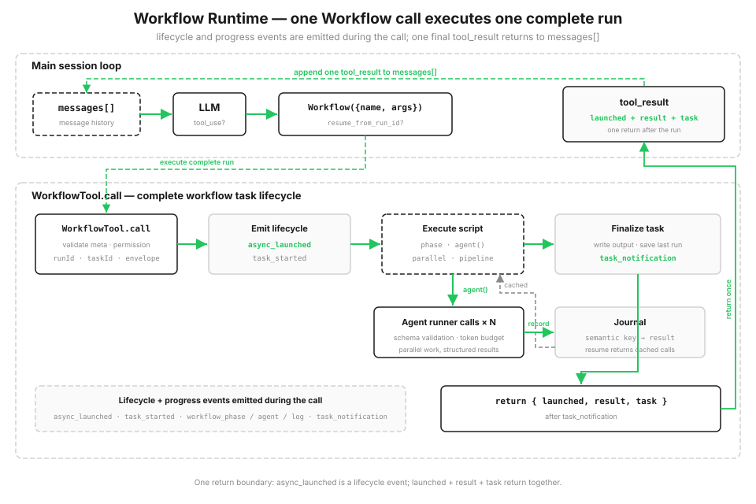

# s16: Workflow Runtime — モデルが単一 step を決め、script が orchestration を決める

> **TypeScript 対照版**：実装範囲と章間の参照は Python 原版に従い、識別子を保持します。コード例は実装の抜粋です。 (s15 host)

[English](README.md) · [中文](README.zh.md) · [日本語](README.ja.md)

s01 → ... → s14 → [s15](../s15_integrated_harness/) → `s16` → [s17](../s17_goal_loop/)

> *「1 回の tool_use で、一式の orchestration を実行する」* — `Workflow` ツールが復元可能な script runtime を起動し、多数の agent call を協調させます。
>
> **Harness 層**: Orchestration — single-agent loop の上で保存済み multi-agent script を実行します。

---

s01 から s15 まで、各 round で model が呼び出す tools を決めます。tool results が `messages[]` に入ると、model は更新された context から次の step を決めます。次の経路が前の step の発見に依存する task に向いています。

一方、固定された流れを繰り返す task もあります。code review なら、複数の観点を同時に調べ、各 finding を検証し、重複をまとめて severity 順に並べます。実行前に step と順序が分かっている場合、host には次の 3 つが必要です。

- **並行性**: 1 件ずつ順番に待たないこと。
- **安定した結果構造**: 個々の agent answer が変わっても構造を保つこと。
- **復元可能性**: 途中で止まっても、完了済みの部分を最初からやり直さないこと。

この orchestration が conversation history にしか存在しなければ、順序と checkpoint も history にしか残りません。saved workflow は固定 flow を code に置き、完了した call を journal に記録します。

## 計画は chat のラウンドを重ねず、コードに書く

harness の tool pool に `Workflow` ツールを追加します。host は `agent() / parallel() / pipeline() / phase()` で構成した trusted script を登録します。model が渡すのは saved workflow name、argument、任意の resume run ID だけで、実行可能 code や metadata は渡しません。

workflow は 1 回の `tool_use` として main loop に入ります。script の実行中、runtime は lifecycle event と progress event を出し、各 step を disk journal へ記録します。script が終わると、この call は launch 情報、result、task state を返します。script の中間結果は変数に保存され、conversation history を使いません。`resume_from_run_id` で再開すると、変更されていない `agent()` は journal の結果を再利用します。



```typescript
export const SAMPLE_META: WorkflowMeta = {
  "name": "review-changes",
  "description": "Review changed files across dimensions, verify each finding",
  "phases": [
    "Review",
    "Verify"
  ]
};

export async function sample_workflow(ctx: ExecutionState, args: Args): Promise<{ confirmed: (Finding & { dimension: string })[] }> {
  ctx.phase('Review'); const changes = Object.hasOwn(args, 'changes') ? args.changes : '';
  if (typeof changes !== 'string') throw new WorkflowInputError('args.changes must be a string');
  const review_input = changes.trim() || 'No change context was supplied.';
  async function audit(_value: unknown, dimension: string, _idx: number): Promise<{ dimension: string; findings: Finding[] }> {
    const out = await ctx.agent(`Review this change context for ${dimension} issues. Report only issues supported by the supplied text.\n\n${review_input}`, FINDINGS_SCHEMA, `audit:${dimension}`, 'Review') as { findings: Finding[] };
    return { dimension, findings: out.findings };
  }
  async function verify(audited: { findings: Finding[] }, dimension: string, _idx: number): Promise<{ dimension: string; confirmed: Finding[] }> {
    ctx.phase('Verify');
    const verdicts = await ctx.parallel(audited.findings.map((f) => () => ctx.agent(
      `Adversarially verify this ${dimension} finding against the supplied change context.\n\nChange context:\n${review_input}\n\nFinding:\n${json_dump(f)}`, VERDICT_SCHEMA, `verify:${dimension}:${f.title}`, 'Verify')));
    const confirmed = audited.findings.filter((_f, index) => verdicts[index] && (verdicts[index] as { isReal?: unknown }).isReal);
    return { dimension, confirmed };
  }
  const results = await ctx.pipeline(DIMENSIONS, audit, verify) as { dimension: string; confirmed: Finding[] }[];
  const confirmed = results.filter(Boolean).flatMap((r) => r.confirmed.map((f) => ({ dimension: r.dimension, ...f })));
  const rank = (severity: string) => ({ high: 0, medium: 1, low: 2 } as Record<string, number>)[severity] ?? 3;
  confirmed.sort((a, b) => rank(a.severity) - rank(b.severity));
  ctx.log(`confirmed ${confirmed.length} real finding(s)`); return { confirmed };
}
```

## Workflow ツール: 1 回の call で run 全体を実行する

`Workflow` は s15 host の既存 tool pool に追加されます。ユーザーが保存済み workflow の実行を求めるか、タスクが既知の orchestration に一致したときにモデルがこのツールを選びます。adapter は name を host-owned `WORKFLOWS` registry で解決し、trusted metadata と function を runtime へ渡します。s15 の他の tools も同じ loop で利用できます。

model-facing schema が受け取るのは `name`、`args`、`resume_from_run_id` です。unknown name や不正 argument は error tool result として返し、host loop を終了させません。その後 runtime が登録済み metadata を検証し、permission check を通し、local workflow task を登録して、script の実行前に `async_launched` を出します。progress event と最後の `task_notification` が続き、call は JSON-safe な launch 情報、result、task state を返します。

```typescript
export const WORKFLOW_TOOL: Anthropic.Tool = {
  "name": "Workflow",
  "description": "Run a saved workflow by name. Pass input in args.",
  "input_schema": {
    "type": "object",
    "properties": {
      "name": {
        "type": "string"
      },
      "args": {
        "type": "object"
      },
      "resume_from_run_id": {
        "type": "string"
      }
    },
    "required": [
      "name"
    ],
    "additionalProperties": false
  }
};
```

## Workflow metadata: 起動前に検証する

各 saved workflow は `name`、`description`、任意の `phases` を持つ trusted metadata を登録します。runtime は workflow code を実行する前に検証します。`name` と `description` は task と UI の表示に使い、`phases` は progress 表示の group 名を定義します。これらは model input ではなく host registry に属します。

不正な登録内容は launch 前に `WorkflowInputError` になります。s12 の cron 式検証と同じ考えです。不正な saved workflow が実行時まで進んでから壊れないようにします。

runtime は `meta.name` をローカル artifact のファイル名に使うため、英数字で始まり、英数字、`.`、`_`、`-` のみからなる 1-64 文字の安全な slug も要求する。

```typescript
export function validate_meta(meta: unknown): WorkflowMeta {
  if (!meta || typeof meta !== 'object' || Array.isArray(meta)) throw new WorkflowInputError('meta must be an object literal');
  const value = meta as Args;
  if (!value.name || !value.description) throw new WorkflowInputError('meta requires `name` and `description`');
  if (typeof value.name !== 'string' || value.name.length > 64 || value.name.endsWith('\n') || !WORKFLOW_NAME_RE.test(value.name)) throw new WorkflowInputError("meta.name must be a 1-64 character slug using letters, numbers, '.', '_', or '-'");
  if (typeof value.description !== 'string') throw new WorkflowInputError('meta.description must be a string');
  if (Object.hasOwn(value, 'phases') && (!Array.isArray(value.phases) || !value.phases.every((phase) => typeof phase === 'string' && phase))) throw new WorkflowInputError('meta.phases must be a list of non-empty strings');
  return meta as WorkflowMeta;
}
```

## Orchestration primitive

script は少数の orchestration primitive だけを公開する `ExecutionState` を受け取り、ファイルを直接読み書きせず、shell も実行しません。default の interactive mode では `agent()` を host と同じ real API client に接続し、各 workflow agent は arguments で渡された内容だけを読みます。`demo` と unit test は `MockAgentRunner` を使い、event と journal replay を繰り返し確認できるようにします。

| Primitive | 役割 |
|------|------|
| `agent(prompt, {schema, label, phase})` | 1 つの subagent を派遣 |
| `parallel(thunks)` | **barrier**: すべての task を並行実行し、全結果が戻るまで待つ |
| `pipeline(items, *stages)` | 各 item を **barrier なし**で stage ごとに実行し、終わった item から先へ進める |
| `phase(title)` | 現在の progress phase を記録し、progress bar を更新 |
| `log(message)` | progress log を 1 行出力 |
| `workflow(name, args)` | nested sub-workflow（1 階層だけ） |

各 item が同じ stage を独立して通る場合は `pipeline` を使えます。item A が stage 3 にいる間、item B はまだ stage 1 かもしれません。次の処理が前の group の全結果を必要とする場合は `parallel` を使います。

```typescript
async pipeline<Item>(items: Item[], ...stages: ((value: any, item: Item, index: number) => Promise<any>)[]): Promise<unknown[]> {
    const run_item = async (item: Item, idx: number) => { let value: unknown = item; for (const stage of stages) value = await stage(value, item, idx); return value; };
    return Promise.all(items.map((item, idx) => run_item(item, idx)));
  }
```

## 構造化出力: Subagent に散文を返させない

`agent({schema})` は、schema に一致する JSON object だけを返すよう workflow agent に要求します。runtime は結果を parse、validate し、不一致なら 1 回 retry します。下流コードは prose から field を取り出さず、object を受け取れます。

s05 では tool argument を全面的に信頼できないと説明しました。ここでは同じ教訓を逆向きに使います。subagent の出力も全面的には信頼できません。orchestration boundary で検証し、1 回 retry の機会を与え、不確実性を後続 flow の外へ止めます。

```typescript
async agent(prompt: string, schema: Schema | null = null, label: string | null = null, phase: string | null = null): Promise<unknown> {
    label = label || (char_slice(prompt, 0, 24) + '...'); this._limits.claim_agent();
    if (this.budget.remaining() <= 0) throw new WorkflowInputError('token budget exceeded');
    const key = this.journal.key('agent', label, prompt, schema); const cached = this.journal.cached(key);
    if (cached !== MISS) {
      if (schema !== null) { const [ok, err] = new SimpleJsonSchema(schema).validate(cached); if (!ok) throw new WorkflowInputError(`cached agent output failed schema validation: ${err}`); }
      this.task.progress_event('workflow_agent', { label, phase: phase || this._phase, status: 'cached' }); return cached;
    }
    let run: RunnerOutput;
    await this._limits.semaphore.acquire();
    try { run = await this.runner.run(prompt, schema, label); } finally { this._limits.semaphore.release(); }
    let result = run.value; let tokens = run.tokens;
    if (schema !== null) {
      let [ok, err] = new SimpleJsonSchema(schema).validate(result);
      if (!ok) {
        const retry = await this.runner.run(prompt + '\n\nReturn valid JSON.', schema, label);
        result = retry.value; tokens += retry.tokens; [ok, err] = new SimpleJsonSchema(schema).validate(result);
        if (!ok) throw new WorkflowInputError(`agent({schema}) invalid output: ${err}`);
      }
    }
    this.budget.add(tokens); this.task.usage.agents += 1; this.task.usage.tokens += tokens;
    this.journal.record(key, result); this.task.progress_event('workflow_agent', { label, phase: phase || this._phase, status: 'done' }); return result;
  }
```

## Task state と progress event

`LocalWorkflowTask` は status と token usage を管理し、SDK style の event stream を外へ出します。`task_started` → phase change、subagent start、log を含む一連の `task_progress` → 完了または失敗に加え、output file、agent 数、token 数を含む最後の `task_notification` です。

demo はこれらの event を順番に表示し、最後の notification の後で task state を返します。

```typescript
progress_event(ptype: string, data: Args = {}): void {
    this.progress.push({ type: ptype, ...data });
    const line = Object.entries(data).map(([k, v]) => `${k}=${python_str(v)}`).join(' ');
    console.log(`  progress   ${ptype.padEnd(16)} ${line}`);
  }
```

## 保存: Snapshot + journal で中断から再開する

runtime は各 run を `s16_workflow_runtime/.runtime/` に保存します。`<runId>.json` snapshot、`<runId>.output.json` output、`<runId>.journal.jsonl` journal、`<runId>.lock` coordination file です。fresh run は journal を開く前に exclusive file creation で新しい `runId` を予約します。run lock は実行と最終永続化が終わるまで保持するため、別 process は同じ run を同時に resume できません。snapshot に workflow name、arguments、task state を記録し、resume は保存済み snapshot と journal を先に検証してから、成功済み artifact を変更します。

journal は checkpoint resume の中心で、各 `agent()` の結果を 1 行ずつ記録します。

```typescript
record(key: string, value: unknown): void {
    if (this._f === null) throw new Error('I/O operation on closed file.');
    appendFileSync(this._f, json_dump({ key, value: value ?? null }) + '\n', 'utf8'); this.cache.set(key, value ?? null);
  }
```

## Resume: runId から続行し、変更のないものを再利用する

`resume_from_run_id` を渡して workflow を再度呼ぶと script を再実行しますが、各 `agent()` は決定的な semantic key を計算します。journal に key があれば、再実行せず cached result を返します。変更された call と、それに依存する後続 step だけが本当に動きます。

key は concurrency の完了順に依存してはいけません。`parallel` と `pipeline` の Agent は不定の順番で完了します。「何番目に完了したか」を key にすると、次回の cache が別の call へ対応してしまいます。そのため key は競合する counter ではなく、call の内容、つまり type、label、prompt、schema の stable hash です。

```typescript
key(kind: string, label: string | null, prompt: string, schema: Schema | null = null): string {
    const basis = `${kind}|${python_str(label)}|${prompt}|${json_dump(schema, true)}`;
    return `${kind}-${String(_stable_hash(basis) % 10000000000n).padStart(10, '0')}`;
  }

cached(key: string): unknown { return this.cache.has(key) ? this.cache.get(key) : MISS; }
```

## Stable call key

resume では、現在の各 `agent()` call を以前の journal record と対応付ける必要があります。stable hash は変更されていない workflow code と arguments に同じ call key を与えます。real model の出力は変化しても、call 内容が同じなら journal に保存済みの result を使います。

## 実際に動かす

sample workflow `review-changes` は `pipeline` を使い、各 review dimension を独立して audit → verify へ通します。interactive mode は real API を使い、`args.changes` から review 対象を読みます。`demo` は固定 runner data で pipeline、validation、journal、resume を示します。

```typescript
export async function sample_workflow(ctx: ExecutionState, args: Args): Promise<{ confirmed: (Finding & { dimension: string })[] }> {
  ctx.phase('Review'); const changes = Object.hasOwn(args, 'changes') ? args.changes : '';
  if (typeof changes !== 'string') throw new WorkflowInputError('args.changes must be a string');
  const review_input = changes.trim() || 'No change context was supplied.';
  async function audit(_value: unknown, dimension: string, _idx: number): Promise<{ dimension: string; findings: Finding[] }> {
    const out = await ctx.agent(`Review this change context for ${dimension} issues. Report only issues supported by the supplied text.\n\n${review_input}`, FINDINGS_SCHEMA, `audit:${dimension}`, 'Review') as { findings: Finding[] };
    return { dimension, findings: out.findings };
  }
  async function verify(audited: { findings: Finding[] }, dimension: string, _idx: number): Promise<{ dimension: string; confirmed: Finding[] }> {
    ctx.phase('Verify');
    const verdicts = await ctx.parallel(audited.findings.map((f) => () => ctx.agent(
      `Adversarially verify this ${dimension} finding against the supplied change context.\n\nChange context:\n${review_input}\n\nFinding:\n${json_dump(f)}`, VERDICT_SCHEMA, `verify:${dimension}:${f.title}`, 'Verify')));
    const confirmed = audited.findings.filter((_f, index) => verdicts[index] && (verdicts[index] as { isReal?: unknown }).isReal);
    return { dimension, confirmed };
  }
  const results = await ctx.pipeline(DIMENSIONS, audit, verify) as { dimension: string; confirmed: Finding[] }[];
  const confirmed = results.filter(Boolean).flatMap((r) => r.confirmed.map((f) => ({ dimension: r.dimension, ...f })));
  const rank = (severity: string) => ({ high: 0, medium: 1, low: 2 } as Record<string, number>)[severity] ?? 3;
  confirmed.sort((a, b) => rank(a.severity) - rank(b.severity));
  ctx.log(`confirmed ${confirmed.length} real finding(s)`); return { confirmed };
}
```

## s15 からの変更点

| | s15 Integrated Harness | s16 Workflow Runtime |
|--|-----------|---------------------|
| loop | 1 つ、モデル駆動 | main loop は不変。tool の背後で script orchestration を実行 |
| 次の step を決めるもの | モデルが毎ラウンド判断 | script が orchestration flow を事前に定義 |
| multi-agent | s06 subagent を一度だけ派遣 | agent-runner boundary を通る scripted、resumable call |
| 新しい仕組み | — | orchestration primitive、host registry と tool adapter、task lifecycle、progress event、journal/resume、structured output |

s16 は main loop を置き換えません。tool layer に `Workflow` を公開し、背後で local workflow runtime を起動します。saved script が agent-runner boundary を通じて N 回の call を協調させます。s06 の subagent はモデルがその場で 1 回派遣し、s16 は orchestration を resumable な host code にします。

## 試してみる

```bash
npm run s16          # main model と Workflow agent の両方が real API を使う
npm run s16 demo     # deterministic fixture と event stream を確認
npm run s16 resume   # 前回の runId から resume。すべての agent() が journal cache に当たる
```

default command では、model に changes を読ませ、その text を `args.changes` に入れて保存済み `review-changes` workflow を実行させます。main model と workflow agent の両方が real API を使います。`demo` は固定 runner data で lifecycle と resume を繰り返し観察でき、すべて cache hit した resume は `agents=0 tokens=0` と表示されます。

## 次へ

[s17 Goal Loop](../s17_goal_loop/) は、より小さな独立 loop で goal が達成されたかを確認し、次の round が必要かを判断します。

<!-- translation-sync: zh@v10, en@v10, ja@v10 -->

## TypeScript の検証

実行入口は [code.ts](code.ts)、参照実装は [Python 原版](../../s16_workflow_runtime/code.py) です。章のテストは `npm run test:s16`。差分テストには Python 3 と PyYAML が必要です。全体の検証状況は[対照記録](../docs/parity-audit.md)を参照してください。
