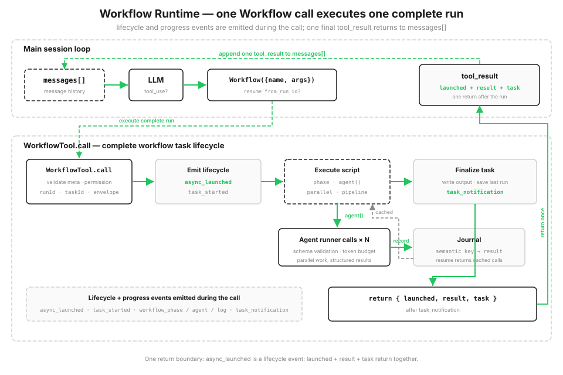

# s16: Workflow Runtime — The Model Decides Each Step; a Script Decides the Orchestration

> **TypeScript reference edition**: implementation boundaries and chapter imports follow Python. Identifiers are preserved. Code blocks are implementation excerpts and may omit enclosing declarations. (s15 host)

[English](README.md) · [中文](README.zh.md) · [日本語](README.ja.md)

s01 → ... → s14 → [s15](../s15_integrated_harness/) → `s16` → [s17](../s17_goal_loop/)

> *"One tool_use runs an entire orchestration"* — The `Workflow` tool starts a recoverable script runtime that coordinates many agent calls.
>
> **Harness layer**: Orchestration — run saved multi-agent scripts above the single-agent loop.

---

From s01 through s15, the model decides which tools to call in each round. Their results enter `messages[]`, and the model decides the next step from the updated context. This works well when the path depends on what the previous step discovers.

Some tasks repeat a fixed sequence. A code review may inspect several dimensions concurrently, verify each finding, combine duplicates, and sort the result. The sequence and dependencies are known before execution. Here the host needs three things:

- **Parallelism**, rather than waiting for one item at a time;
- **A stable result structure**, even when individual agent answers vary;
- **Recoverability**, so an interruption does not rerun work that is already complete.

If this orchestration exists only in conversation history, its ordering and checkpoints also exist only in that history. A saved workflow puts the fixed sequence in code and records completed calls in a journal.

## Put the Plan in Code, Not in a Sequence of Chat Turns

Add a `Workflow` tool to the harness tool pool. The host registers trusted scripts built from `agent()`, `parallel()`, `pipeline()`, and `phase()`. The model supplies only a saved workflow name, arguments, and an optional run ID to resume; it does not send executable code or metadata.

The workflow enters the main loop as one `tool_use`. As the script runs, the runtime emits lifecycle and progress events and records every step in a journal on disk. When the script finishes, the call returns the launch envelope, result, and task state. Intermediate script results live in variables instead of taking space in conversation history. When restarted with `resume_from_run_id`, unchanged `agent()` calls hit the journal cache and reuse previous results.



```typescript
export const SAMPLE_META: WorkflowMeta = {
  "name": "review-changes",
  "description": "Review changed files across dimensions, verify each finding",
  "phases": [
    "Review",
    "Verify"
  ]
};

export async function sample_workflow(ctx: ExecutionState, args: Args): Promise<{ confirmed: (Finding & { dimension: string })[] }> {
  ctx.phase('Review'); const changes = Object.hasOwn(args, 'changes') ? args.changes : '';
  if (typeof changes !== 'string') throw new WorkflowInputError('args.changes must be a string');
  const review_input = changes.trim() || 'No change context was supplied.';
  async function audit(_value: unknown, dimension: string, _idx: number): Promise<{ dimension: string; findings: Finding[] }> {
    const out = await ctx.agent(`Review this change context for ${dimension} issues. Report only issues supported by the supplied text.\n\n${review_input}`, FINDINGS_SCHEMA, `audit:${dimension}`, 'Review') as { findings: Finding[] };
    return { dimension, findings: out.findings };
  }
  async function verify(audited: { findings: Finding[] }, dimension: string, _idx: number): Promise<{ dimension: string; confirmed: Finding[] }> {
    ctx.phase('Verify');
    const verdicts = await ctx.parallel(audited.findings.map((f) => () => ctx.agent(
      `Adversarially verify this ${dimension} finding against the supplied change context.\n\nChange context:\n${review_input}\n\nFinding:\n${json_dump(f)}`, VERDICT_SCHEMA, `verify:${dimension}:${f.title}`, 'Verify')));
    const confirmed = audited.findings.filter((_f, index) => verdicts[index] && (verdicts[index] as { isReal?: unknown }).isReal);
    return { dimension, confirmed };
  }
  const results = await ctx.pipeline(DIMENSIONS, audit, verify) as { dimension: string; confirmed: Finding[] }[];
  const confirmed = results.filter(Boolean).flatMap((r) => r.confirmed.map((f) => ({ dimension: r.dimension, ...f })));
  const rank = (severity: string) => ({ high: 0, medium: 1, low: 2 } as Record<string, number>)[severity] ?? 3;
  confirmed.sort((a, b) => rank(a.severity) - rank(b.severity));
  ctx.log(`confirmed ${confirmed.length} real finding(s)`); return { confirmed };
}
```

## The Workflow Tool: One Call, One Complete Run

`Workflow` is added to the s15 host's existing tool pool. The user can request a saved workflow, or the model can select it when a task matches a known orchestration. The adapter resolves the name through the host-owned `WORKFLOWS` registry, then passes its trusted metadata and function to the runtime. The other s15 tools remain available in the same loop.

The model-facing schema accepts `name`, `args`, and `resume_from_run_id`. Unknown names and malformed arguments become an error tool result instead of ending the host loop. The runtime then validates the registered metadata, checks permissions, registers a local workflow task, and emits `async_launched` before running the script. Progress events follow, then the final `task_notification`; the call returns JSON-safe launch information, result, and task state.

```typescript
export const WORKFLOW_TOOL: Anthropic.Tool = {
  "name": "Workflow",
  "description": "Run a saved workflow by name. Pass input in args.",
  "input_schema": {
    "type": "object",
    "properties": {
      "name": {
        "type": "string"
      },
      "args": {
        "type": "object"
      },
      "resume_from_run_id": {
        "type": "string"
      }
    },
    "required": [
      "name"
    ],
    "additionalProperties": false
  }
};
```

## Workflow Metadata: Validate Before Launch

Each saved workflow registers trusted metadata with `name`, `description`, and optional `phases`. The runtime validates it before executing workflow code. `name` and `description` identify the task in the UI, while `phases` names groups in the progress display. These fields belong to the host registry, not to model input.

Invalid registration raises `WorkflowInputError` before launch. This is the same idea as validating cron expressions in s12: do not wait until execution to discover a bad saved workflow.

Because the runtime uses `meta.name` in local artifact filenames, it also requires a 1-64 character safe slug containing letters, numbers, `.`, `_`, or `-`.

```typescript
export function validate_meta(meta: unknown): WorkflowMeta {
  if (!meta || typeof meta !== 'object' || Array.isArray(meta)) throw new WorkflowInputError('meta must be an object literal');
  const value = meta as Args;
  if (!value.name || !value.description) throw new WorkflowInputError('meta requires `name` and `description`');
  if (typeof value.name !== 'string' || value.name.length > 64 || value.name.endsWith('\n') || !WORKFLOW_NAME_RE.test(value.name)) throw new WorkflowInputError("meta.name must be a 1-64 character slug using letters, numbers, '.', '_', or '-'");
  if (typeof value.description !== 'string') throw new WorkflowInputError('meta.description must be a string');
  if (Object.hasOwn(value, 'phases') && (!Array.isArray(value.phases) || !value.phases.every((phase) => typeof phase === 'string' && phase))) throw new WorkflowInputError('meta.phases must be a list of non-empty strings');
  return meta as WorkflowMeta;
}
```

## Orchestration Primitives

A script receives an `ExecutionState` exposing a small set of orchestration primitives. It does not read files or run shell commands directly. The default interactive mode connects `agent()` to the same real API client as the host, and each workflow agent reads only the content supplied through workflow arguments. `demo` and unit tests use `MockAgentRunner` so events and journal replay are repeatable.

| Primitive | Purpose |
|------|------|
| `agent(prompt, {schema, label, phase})` | Dispatch one subagent |
| `parallel(thunks)` | **Barrier**: run every task concurrently and wait until all results return |
| `pipeline(items, *stages)` | Run each item through stages **without a barrier**; finished items proceed immediately |
| `phase(title)` | Mark the current progress phase and update the progress display |
| `log(message)` | Emit a progress log line |
| `workflow(name, args)` | Run a nested sub-workflow, one level only |

Use `pipeline` when each item independently crosses the same stages. Item A may reach stage three while item B is still in stage one. Use `parallel` when the next step needs every result from the preceding group.

```typescript
async pipeline<Item>(items: Item[], ...stages: ((value: any, item: Item, index: number) => Promise<any>)[]): Promise<unknown[]> {
    const run_item = async (item: Item, idx: number) => { let value: unknown = item; for (const stage of stages) value = await stage(value, item, idx); return value; };
    return Promise.all(items.map((item, idx) => run_item(item, idx)));
  }
```

## Structured Output: Do Not Let Subagents Return Essays

`agent({schema})` asks a workflow agent to return only a JSON object matching the schema. The runtime parses and validates the result, then retries once if it does not match. Downstream code receives an object instead of extracting fields from prose.

s05 warned that tool arguments cannot be trusted completely. This is the same lesson in reverse: subagent output cannot be trusted completely either. Validate at the orchestration boundary, give one retry, and keep uncertainty out of the rest of the flow.

```typescript
async agent(prompt: string, schema: Schema | null = null, label: string | null = null, phase: string | null = null): Promise<unknown> {
    label = label || (char_slice(prompt, 0, 24) + '...'); this._limits.claim_agent();
    if (this.budget.remaining() <= 0) throw new WorkflowInputError('token budget exceeded');
    const key = this.journal.key('agent', label, prompt, schema); const cached = this.journal.cached(key);
    if (cached !== MISS) {
      if (schema !== null) { const [ok, err] = new SimpleJsonSchema(schema).validate(cached); if (!ok) throw new WorkflowInputError(`cached agent output failed schema validation: ${err}`); }
      this.task.progress_event('workflow_agent', { label, phase: phase || this._phase, status: 'cached' }); return cached;
    }
    let run: RunnerOutput;
    await this._limits.semaphore.acquire();
    try { run = await this.runner.run(prompt, schema, label); } finally { this._limits.semaphore.release(); }
    let result = run.value; let tokens = run.tokens;
    if (schema !== null) {
      let [ok, err] = new SimpleJsonSchema(schema).validate(result);
      if (!ok) {
        const retry = await this.runner.run(prompt + '\n\nReturn valid JSON.', schema, label);
        result = retry.value; tokens += retry.tokens; [ok, err] = new SimpleJsonSchema(schema).validate(result);
        if (!ok) throw new WorkflowInputError(`agent({schema}) invalid output: ${err}`);
      }
    }
    this.budget.add(tokens); this.task.usage.agents += 1; this.task.usage.tokens += tokens;
    this.journal.record(key, result); this.task.progress_event('workflow_agent', { label, phase: phase || this._phase, status: 'done' }); return result;
  }
```

## Task State and Progress Events

`LocalWorkflowTask` maintains status and token usage and emits an SDK-style event stream: `task_started` → a sequence of `task_progress` events containing phase changes, subagent starts, and log batches → one final `task_notification` reporting completion or failure, plus the output file and agent and token counts.

The demo prints these events in order and returns the task state after the final notification.

```typescript
progress_event(ptype: string, data: Args = {}): void {
    this.progress.push({ type: ptype, ...data });
    const line = Object.entries(data).map(([k, v]) => `${k}=${python_str(v)}`).join(' ');
    console.log(`  progress   ${ptype.padEnd(16)} ${line}`);
  }
```

## Storage: Snapshot + Journal for Resuming after Interruptions

The runtime stores each run under `s16_workflow_runtime/.runtime/`: a `<runId>.json` snapshot, `<runId>.output.json` output, `<runId>.journal.jsonl` journal, and `<runId>.lock` coordination file. Every fresh run reserves a new `runId` with exclusive file creation before opening its journal. The run lock stays held through execution and final persistence, so another process cannot resume the same run at the same time. Its snapshot records the workflow name, arguments, and task state; resume validates the saved snapshot and journal before changing either successful artifact.

The journal is the core of checkpointed resume. It records every `agent()` result one line at a time:

```typescript
record(key: string, value: unknown): void {
    if (this._f === null) throw new Error('I/O operation on closed file.');
    appendFileSync(this._f, json_dump({ key, value: value ?? null }) + '\n', 'utf8'); this.cache.set(key, value ?? null);
  }
```

## Resume: Continue by runId and Reuse Everything Unchanged

Calling the workflow again with `resume_from_run_id` reruns the script, but every `agent()` computes a deterministic semantic key. If that key is present in the journal, it returns the cached result without executing again. Every unchanged call hits the cache; only a changed call and the downstream steps that depend on it actually rerun.

The key detail is that keys cannot depend on concurrency order. Agents in `parallel` and `pipeline` finish in nondeterministic order. If "the nth completion" became the key, cache entries would map to the wrong calls on the next run. A key therefore uses a stable hash of call content, including type, label, prompt, and schema, rather than a shared counter:

```typescript
key(kind: string, label: string | null, prompt: string, schema: Schema | null = null): string {
    const basis = `${kind}|${python_str(label)}|${prompt}|${json_dump(schema, true)}`;
    return `${kind}-${String(_stable_hash(basis) % 10000000000n).padStart(10, '0')}`;
  }

cached(key: string): unknown { return this.cache.has(key) ? this.cache.get(key) : MISS; }
```

## Stable Call Keys

On resume, the runtime must match each current `agent()` call with its earlier journal record. A stable hash gives unchanged workflow code and arguments the same call key. Real model output may vary; when the call content has not changed, resume uses the result already saved in the journal.

## See It Run

The sample `review-changes` workflow uses `pipeline` to send each review dimension independently through audit → verify. Interactive mode uses the real API and reads the material to review from `args.changes`. `demo` uses fixed runner data to show pipeline, validation, journal, and resume behavior.

```typescript
export async function sample_workflow(ctx: ExecutionState, args: Args): Promise<{ confirmed: (Finding & { dimension: string })[] }> {
  ctx.phase('Review'); const changes = Object.hasOwn(args, 'changes') ? args.changes : '';
  if (typeof changes !== 'string') throw new WorkflowInputError('args.changes must be a string');
  const review_input = changes.trim() || 'No change context was supplied.';
  async function audit(_value: unknown, dimension: string, _idx: number): Promise<{ dimension: string; findings: Finding[] }> {
    const out = await ctx.agent(`Review this change context for ${dimension} issues. Report only issues supported by the supplied text.\n\n${review_input}`, FINDINGS_SCHEMA, `audit:${dimension}`, 'Review') as { findings: Finding[] };
    return { dimension, findings: out.findings };
  }
  async function verify(audited: { findings: Finding[] }, dimension: string, _idx: number): Promise<{ dimension: string; confirmed: Finding[] }> {
    ctx.phase('Verify');
    const verdicts = await ctx.parallel(audited.findings.map((f) => () => ctx.agent(
      `Adversarially verify this ${dimension} finding against the supplied change context.\n\nChange context:\n${review_input}\n\nFinding:\n${json_dump(f)}`, VERDICT_SCHEMA, `verify:${dimension}:${f.title}`, 'Verify')));
    const confirmed = audited.findings.filter((_f, index) => verdicts[index] && (verdicts[index] as { isReal?: unknown }).isReal);
    return { dimension, confirmed };
  }
  const results = await ctx.pipeline(DIMENSIONS, audit, verify) as { dimension: string; confirmed: Finding[] }[];
  const confirmed = results.filter(Boolean).flatMap((r) => r.confirmed.map((f) => ({ dimension: r.dimension, ...f })));
  const rank = (severity: string) => ({ high: 0, medium: 1, low: 2 } as Record<string, number>)[severity] ?? 3;
  confirmed.sort((a, b) => rank(a.severity) - rank(b.severity));
  ctx.log(`confirmed ${confirmed.length} real finding(s)`); return { confirmed };
}
```

## Changes from s15

| | s15 Integrated Harness | s16 Workflow Runtime |
|--|-----------|---------------------|
| Loop | One model-driven loop | Main loop unchanged; a tool runs scripted orchestration |
| Who decides the next step | Model decides each round | Script declares the orchestration in advance |
| Multiple agents | One-shot s06 subagents | Scripted, resumable calls through an agent-runner boundary |
| New mechanisms | — | Script primitives, host registry and tool adapter, task lifecycle, progress events, journal/resume, structured output |

s16 does not replace the main loop. It exposes `Workflow` at the tool layer and starts a local workflow runtime behind it: one saved script coordinates N calls through an agent-runner boundary. An s06 subagent is dispatched once at the model's discretion; s16 turns the orchestration into resumable host code.

## Try It

```bash
npm run s16          # Both the main model and Workflow agents use the real API
npm run s16 demo     # Deterministic review-changes fixture and event stream
npm run s16 resume   # Resume by the last runId; every agent() hits the journal cache
```

In the default command, ask the model to read the changes, place that text in `args.changes`, and run the saved `review-changes` workflow. Both the main model and workflow agents use the real API. The `demo` command uses fixed runner data so lifecycle and resume behavior can be observed repeatedly. A resumed demo reports `agents=0 tokens=0` when every call hits the cache.

## Next

[s17 Goal Loop](../s17_goal_loop/) uses a smaller, independent loop to check whether a stated goal has been reached and decide whether another turn is needed.

<!-- translation-sync: zh@v10, en@v10, ja@v10 -->

## TypeScript verification

Run [code.ts](code.ts) with `npm run s16` and tests with `npm run test:s16`. Differential tests execute the unmodified [Python reference](../../s16_workflow_runtime/code.py) with fake model responses and require Python 3 and PyYAML. See the [alignment audit](../docs/parity-audit.md) for full-project and live-API verification status.
