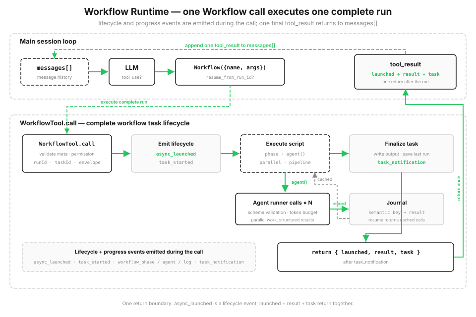

# s16: Workflow Runtime — 模型决定单步，脚本决定编排

> **TS 对照版**：实现范围和跨章引用以 Python 原版为准；标识符沿用 Python。代码块摘自本章实现，可能省略 import、外层类或分支。 (s15 host)

[English](README.md) · [中文](README.zh.md) · [日本語](README.ja.md)

s01 → ... → s14 → [s15](../s15_integrated_harness/) → `s16` → [s17](../s17_goal_loop/)

> *"一次 tool_use，跑完一整套编排"* — `Workflow` 工具启动一个可恢复的脚本运行时，协调多次 agent 调用。
>
> **Harness 层**: 编排 — 在单 agent 循环之上，执行保存好的多 agent 脚本。

---

从 s01 到 s15，每一轮都由模型决定调用哪些工具。工具结果进入 `messages[]` 后，模型再根据更新后的上下文决定下一步。当后续路径取决于上一步发现了什么时，这种方式很合适。

有些任务会重复一套固定流程。例如代码审查可以同时检查多个维度，再逐条验证发现、合并重复项并按严重程度排序。执行前已经知道步骤及其先后关系，这时宿主需要三样东西：

- **并行**，别一个一个串着等；
- **稳定的结果结构**，即使每个 agent 的回答会变化；
- **可恢复**，跑到一半断了，已经做完的部分别从头再来。

如果这套编排只存在于对话历史里，步骤顺序和检查点也只存在于历史里。保存好的 workflow 把固定流程写进代码，并在 journal 中记录已经完成的调用。

## 计划写在代码里，不是靠聊天一轮轮凑

在 harness 的工具池里加入一个 `Workflow` 工具。宿主注册由 `agent() / parallel() / pipeline() / phase()` 组成的可信脚本。模型只提供保存好的 workflow 名称、参数和可选的续跑 run ID，不会提交可执行代码或元数据。

workflow 以一次 `tool_use` 进入主循环。脚本运行时，runtime 会发出生命周期和进度事件，并把每一步写进磁盘上的 journal。脚本结束后，这次调用返回启动信息、结果和任务状态。脚本里的中间结果存在变量里，不会塞进对话历史。下次用 `resume_from_run_id` 重启时，没改过的 `agent()` 会直接使用 journal 中的结果。



```typescript
export const SAMPLE_META: WorkflowMeta = {
  "name": "review-changes",
  "description": "Review changed files across dimensions, verify each finding",
  "phases": [
    "Review",
    "Verify"
  ]
};

export async function sample_workflow(ctx: ExecutionState, args: Args): Promise<{ confirmed: (Finding & { dimension: string })[] }> {
  ctx.phase('Review'); const changes = Object.hasOwn(args, 'changes') ? args.changes : '';
  if (typeof changes !== 'string') throw new WorkflowInputError('args.changes must be a string');
  const review_input = changes.trim() || 'No change context was supplied.';
  async function audit(_value: unknown, dimension: string, _idx: number): Promise<{ dimension: string; findings: Finding[] }> {
    const out = await ctx.agent(`Review this change context for ${dimension} issues. Report only issues supported by the supplied text.\n\n${review_input}`, FINDINGS_SCHEMA, `audit:${dimension}`, 'Review') as { findings: Finding[] };
    return { dimension, findings: out.findings };
  }
  async function verify(audited: { findings: Finding[] }, dimension: string, _idx: number): Promise<{ dimension: string; confirmed: Finding[] }> {
    ctx.phase('Verify');
    const verdicts = await ctx.parallel(audited.findings.map((f) => () => ctx.agent(
      `Adversarially verify this ${dimension} finding against the supplied change context.\n\nChange context:\n${review_input}\n\nFinding:\n${json_dump(f)}`, VERDICT_SCHEMA, `verify:${dimension}:${f.title}`, 'Verify')));
    const confirmed = audited.findings.filter((_f, index) => verdicts[index] && (verdicts[index] as { isReal?: unknown }).isReal);
    return { dimension, confirmed };
  }
  const results = await ctx.pipeline(DIMENSIONS, audit, verify) as { dimension: string; confirmed: Finding[] }[];
  const confirmed = results.filter(Boolean).flatMap((r) => r.confirmed.map((f) => ({ dimension: r.dimension, ...f })));
  const rank = (severity: string) => ({ high: 0, medium: 1, low: 2 } as Record<string, number>)[severity] ?? 3;
  confirmed.sort((a, b) => rank(a.severity) - rank(b.severity));
  ctx.log(`confirmed ${confirmed.length} real finding(s)`); return { confirmed };
}
```

## Workflow 工具：一次调用，完成整次运行

`Workflow` 会加入 s15 宿主已有的工具池。用户可以要求运行一个保存好的 workflow，模型也可以在任务匹配已知编排时选择这个工具。适配器会用名称查询宿主管理的 `WORKFLOWS` registry，再把可信的元数据和函数交给运行时；s15 的其他工具仍在同一个循环里可用。

模型可见的 schema 只接受 `name`、`args` 和 `resume_from_run_id`。名称未知或参数格式错误时，适配器会返回错误工具结果，不会让宿主循环退出。随后运行时校验已经注册的元数据、经过权限检查、注册本地 workflow 任务，并在执行脚本前发出 `async_launched`。进度事件和最终的 `task_notification` 随后到达；调用返回可写入 JSON 的启动信息、结果和任务状态。

```typescript
export const WORKFLOW_TOOL: Anthropic.Tool = {
  "name": "Workflow",
  "description": "Run a saved workflow by name. Pass input in args.",
  "input_schema": {
    "type": "object",
    "properties": {
      "name": {
        "type": "string"
      },
      "args": {
        "type": "object"
      },
      "resume_from_run_id": {
        "type": "string"
      }
    },
    "required": [
      "name"
    ],
    "additionalProperties": false
  }
};
```

## Workflow 元数据：启动前先校验

每个保存好的 workflow 都会注册一份可信元数据，包含 `name`、`description` 和可选的 `phases`。运行时会在执行 workflow 代码前校验它：`name` 和 `description` 用来标识任务，`phases` 给进度显示分组命名。这些字段属于宿主 registry，不是模型输入。

注册内容不合法时，运行时会在启动前抛出 `WorkflowInputError`。这和 s12 校验 cron 表达式是一个思路：保存好的 workflow 有问题，就不要等到执行时才发现。

运行时会把 `meta.name` 用在本地产物文件名中，因此还要求它是 1-64 个字符的安全 slug，只能包含字母、数字、`.`、`_`、`-`。

```typescript
export function validate_meta(meta: unknown): WorkflowMeta {
  if (!meta || typeof meta !== 'object' || Array.isArray(meta)) throw new WorkflowInputError('meta must be an object literal');
  const value = meta as Args;
  if (!value.name || !value.description) throw new WorkflowInputError('meta requires `name` and `description`');
  if (typeof value.name !== 'string' || value.name.length > 64 || value.name.endsWith('\n') || !WORKFLOW_NAME_RE.test(value.name)) throw new WorkflowInputError("meta.name must be a 1-64 character slug using letters, numbers, '.', '_', or '-'");
  if (typeof value.description !== 'string') throw new WorkflowInputError('meta.description must be a string');
  if (Object.hasOwn(value, 'phases') && (!Array.isArray(value.phases) || !value.phases.every((phase) => typeof phase === 'string' && phase))) throw new WorkflowInputError('meta.phases must be a list of non-empty strings');
  return meta as WorkflowMeta;
}
```

## 编排原语

脚本收到一个只暴露少量编排原语的 `ExecutionState`，本身不直接读写文件，也不运行 shell。默认交互模式把 `agent()` 接到与宿主相同的真实 API client；每个子 agent 只读取 workflow 参数中提供的内容。`demo` 和单元测试使用 `MockAgentRunner`，便于重复观察事件和 journal。

| 原语 | 作用 |
|------|------|
| `agent(prompt, {schema, label, phase})` | 派一个子 agent 干活 |
| `parallel(thunks)` | **等齐屏障**：所有任务并行跑完，一起等结果回来 |
| `pipeline(items, *stages)` | 每个 item 分阶段跑，**不等齐**，跑完一个往下走一个 |
| `phase(title)` | 标记当前进度阶段（更新进度条） |
| `log(message)` | 打一行进度日志 |
| `workflow(name, args)` | 嵌套子工作流（只支持一层） |

每个 item 都要独立经过相同步骤时，可以使用 `pipeline`。item A 跑到第 3 阶段时，item B 可能还在第 1 阶段；下一步必须同时使用上一阶段全部结果时，再使用 `parallel` 等待所有调用完成。

```typescript
async pipeline<Item>(items: Item[], ...stages: ((value: any, item: Item, index: number) => Promise<any>)[]): Promise<unknown[]> {
    const run_item = async (item: Item, idx: number) => { let value: unknown = item; for (const stage of stages) value = await stage(value, item, idx); return value; };
    return Promise.all(items.map((item, idx) => run_item(item, idx)));
  }
```

## 结构化输出：别让子 agent 回来写散文

`agent({schema})` 会要求子 agent 只返回匹配 schema 的 JSON 对象。运行时解析并校验结果，不符合时重试一次。这样下游代码拿到的是对象，不必再从自然语言中提取字段。

s05 就说过，工具的参数不能全信；这里是同一个道理反过来：子 agent 的输出也不能全信。加一层校验，不对就给一次机会重试，把不确定性挡在编排层外面。

```typescript
async agent(prompt: string, schema: Schema | null = null, label: string | null = null, phase: string | null = null): Promise<unknown> {
    label = label || (char_slice(prompt, 0, 24) + '...'); this._limits.claim_agent();
    if (this.budget.remaining() <= 0) throw new WorkflowInputError('token budget exceeded');
    const key = this.journal.key('agent', label, prompt, schema); const cached = this.journal.cached(key);
    if (cached !== MISS) {
      if (schema !== null) { const [ok, err] = new SimpleJsonSchema(schema).validate(cached); if (!ok) throw new WorkflowInputError(`cached agent output failed schema validation: ${err}`); }
      this.task.progress_event('workflow_agent', { label, phase: phase || this._phase, status: 'cached' }); return cached;
    }
    let run: RunnerOutput;
    await this._limits.semaphore.acquire();
    try { run = await this.runner.run(prompt, schema, label); } finally { this._limits.semaphore.release(); }
    let result = run.value; let tokens = run.tokens;
    if (schema !== null) {
      let [ok, err] = new SimpleJsonSchema(schema).validate(result);
      if (!ok) {
        const retry = await this.runner.run(prompt + '\n\nReturn valid JSON.', schema, label);
        result = retry.value; tokens += retry.tokens; [ok, err] = new SimpleJsonSchema(schema).validate(result);
        if (!ok) throw new WorkflowInputError(`agent({schema}) invalid output: ${err}`);
      }
    }
    this.budget.add(tokens); this.task.usage.agents += 1; this.task.usage.tokens += tokens;
    this.journal.record(key, result); this.task.progress_event('workflow_agent', { label, phase: phase || this._phase, status: 'done' }); return result;
  }
```

## 任务状态和进度事件

`LocalWorkflowTask` 维护状态和 token 用量，向外发一条 SDK 风格的事件流：`task_started` → 一串 `task_progress`（包含阶段切换、子 agent 启动和日志输出）→ 最后一个 `task_notification`（完成或失败，带输出文件、agent 数和 token 数）。

演示会按顺序打印这些事件，并在最终通知后返回任务状态。

```typescript
progress_event(ptype: string, data: Args = {}): void {
    this.progress.push({ type: ptype, ...data });
    const line = Object.entries(data).map(([k, v]) => `${k}=${python_str(v)}`).join(' ');
    console.log(`  progress   ${ptype.padEnd(16)} ${line}`);
  }
```

## 存储：快照 + journal，断了能续

运行时把每次运行的数据存在 `s16_workflow_runtime/.runtime/`：快照 `<runId>.json`、输出 `<runId>.output.json`、journal `<runId>.journal.jsonl` 和协调文件 `<runId>.lock`。每次新运行都会在打开 journal 前，用排他式文件创建预留新的 `runId`。整次执行和最终持久化期间都持有 run lock，另一个进程不能同时 resume 同一次运行。快照记录 workflow 名称、参数和任务状态；resume 会先验证已保存的快照和 journal，再改动原有的成功产物。

journal 是断点续跑的核心，它一条一条记下来每个 `agent()` 的结果：

```typescript
record(key: string, value: unknown): void {
    if (this._f === null) throw new Error('I/O operation on closed file.');
    appendFileSync(this._f, json_dump({ key, value: value ?? null }) + '\n', 'utf8'); this.cache.set(key, value ?? null);
  }
```

## resume：用 runId 续跑，没改的直接用缓存

带着 `resume_from_run_id` 再次调用 workflow 时，脚本会重新执行，但每个 `agent()` 都会计算一个确定的语义 key：key 在 journal 里有记录，就直接返回缓存结果；只有改过的调用以及依赖它的后续步骤才会真的运行。

这里有个关键点：key 不能依赖并发顺序。`parallel` 和 `pipeline` 里 agent 完成的顺序是不确定的，用"第几个完成"当 key，两次跑缓存就对错位了。所以 key 是根据调用内容（类型、标签、prompt、schema）算的稳定哈希，不是一个会竞争的计数器：

```typescript
key(kind: string, label: string | null, prompt: string, schema: Schema | null = null): string {
    const basis = `${kind}|${python_str(label)}|${prompt}|${json_dump(schema, true)}`;
    return `${kind}-${String(_stable_hash(basis) % 10000000000n).padStart(10, '0')}`;
  }

cached(key: string): unknown { return this.cache.has(key) ? this.cache.get(key) : MISS; }
```

## 稳定调用键

续跑时，运行时需要把当前 `agent()` 与 journal 中的旧调用对应起来。稳定哈希让同一份 workflow 和同样的参数产生相同的调用 key。真实模型的回答可以变化；只要调用内容没有变化，resume 就直接使用 journal 中已经保存的结果。

## 跑起来看看

示例 workflow `review-changes` 用 `pipeline` 让每个审查维度独立走“审计 → 验证”。默认交互模式使用真实 API，并从 `args.changes` 读取待审查内容；`demo` 使用固定 runner 数据来展示 pipeline、结构校验、journal 和续跑。

```typescript
export async function sample_workflow(ctx: ExecutionState, args: Args): Promise<{ confirmed: (Finding & { dimension: string })[] }> {
  ctx.phase('Review'); const changes = Object.hasOwn(args, 'changes') ? args.changes : '';
  if (typeof changes !== 'string') throw new WorkflowInputError('args.changes must be a string');
  const review_input = changes.trim() || 'No change context was supplied.';
  async function audit(_value: unknown, dimension: string, _idx: number): Promise<{ dimension: string; findings: Finding[] }> {
    const out = await ctx.agent(`Review this change context for ${dimension} issues. Report only issues supported by the supplied text.\n\n${review_input}`, FINDINGS_SCHEMA, `audit:${dimension}`, 'Review') as { findings: Finding[] };
    return { dimension, findings: out.findings };
  }
  async function verify(audited: { findings: Finding[] }, dimension: string, _idx: number): Promise<{ dimension: string; confirmed: Finding[] }> {
    ctx.phase('Verify');
    const verdicts = await ctx.parallel(audited.findings.map((f) => () => ctx.agent(
      `Adversarially verify this ${dimension} finding against the supplied change context.\n\nChange context:\n${review_input}\n\nFinding:\n${json_dump(f)}`, VERDICT_SCHEMA, `verify:${dimension}:${f.title}`, 'Verify')));
    const confirmed = audited.findings.filter((_f, index) => verdicts[index] && (verdicts[index] as { isReal?: unknown }).isReal);
    return { dimension, confirmed };
  }
  const results = await ctx.pipeline(DIMENSIONS, audit, verify) as { dimension: string; confirmed: Finding[] }[];
  const confirmed = results.filter(Boolean).flatMap((r) => r.confirmed.map((f) => ({ dimension: r.dimension, ...f })));
  const rank = (severity: string) => ({ high: 0, medium: 1, low: 2 } as Record<string, number>)[severity] ?? 3;
  confirmed.sort((a, b) => rank(a.severity) - rank(b.severity));
  ctx.log(`confirmed ${confirmed.length} real finding(s)`); return { confirmed };
}
```

## 相对 s15 的变更

| | s15 Agent Harness 集成 | s16 Workflow Runtime |
|--|-----------|---------------------|
| 循环 | 单个、模型驱动 | 主循环不变；工具背后执行脚本编排 |
| 谁决定下一步 | 模型逐轮决定 | 脚本预先写好编排流程 |
| 多 agent | s06 子 agent，一次性派出去 | 通过 agent-runner 边界执行脚本化、可续跑的调用 |
| 新增机制 | — | 编排原语、宿主 registry 与工具适配器、任务生命周期、进度事件、journal/续跑、结构化输出 |

s16 不替换主循环，它只是在工具层暴露 `Workflow`，背后启动一个本地 workflow 运行时：一份保存好的脚本通过 agent-runner 边界协调 N 次调用。s06 的子 agent 是模型临场派一次；s16 把编排写成可续跑的宿主代码。

## 试一下

```bash
npm run s16          # 主模型和 Workflow 子 agent 都使用真实 API
npm run s16 demo     # 运行确定性的 review-changes 测试数据并观察事件流
npm run s16 resume   # 用上次的 runId 续跑，每个 agent() 都命中 journal 缓存
```

默认命令里，可以先让模型读取改动，再把内容放进 `args.changes` 并运行保存好的 `review-changes` workflow。主模型和 workflow 子 agent 都使用真实 API。`demo` 命令使用固定 runner 数据，便于重复观察生命周期和续跑；续跑命中全部缓存时显示 `agents=0 tokens=0`。

## 接下来

[s17 Goal Loop](../s17_goal_loop/) 会使用一个更小、独立的循环检查既定目标是否已经达成，并据此决定是否还需要下一轮。

<!-- translation-sync: zh@v10, en@v10, ja@v10 -->

## TypeScript 对齐与验证

[code.ts](code.ts) 是独立运行入口；[Python 原版](../../s16_workflow_runtime/code.py) 是行为依据。Promise/子进程 I/O 对应 Python 的同步调用与线程；文件和锁的适配以原版各章节为准。原图保持原文件名和字节。

在 TS 工程目录执行 `npm run test:s16`。差分测试通过假模型运行未修改的 Python 原版，因此还需要 Python 3 与 PyYAML。它们验证离线行为；真实 API、全部入口和全项目最终检查的状态统一记录在[对齐记录](../docs/parity-audit.md)。
